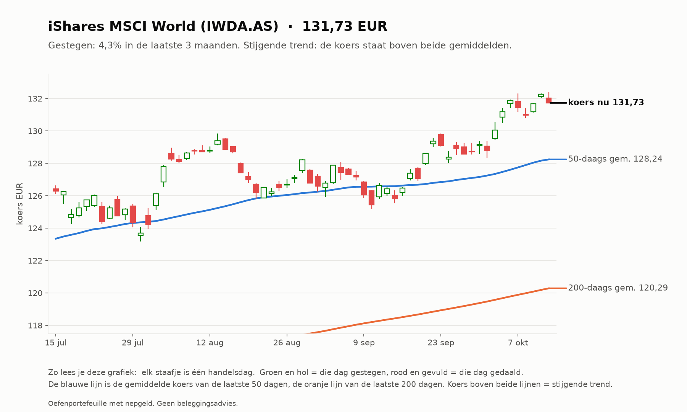
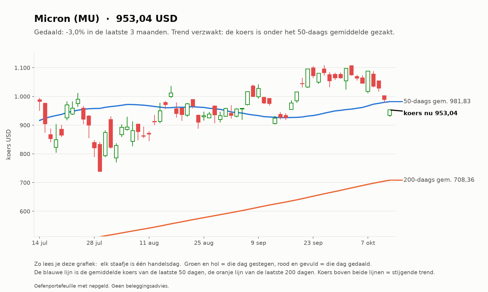
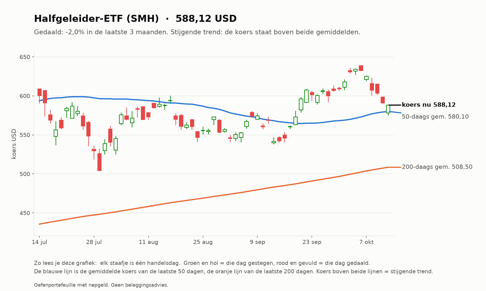
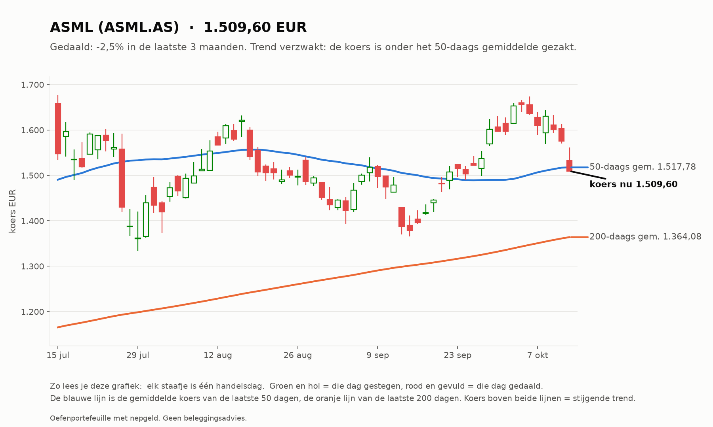
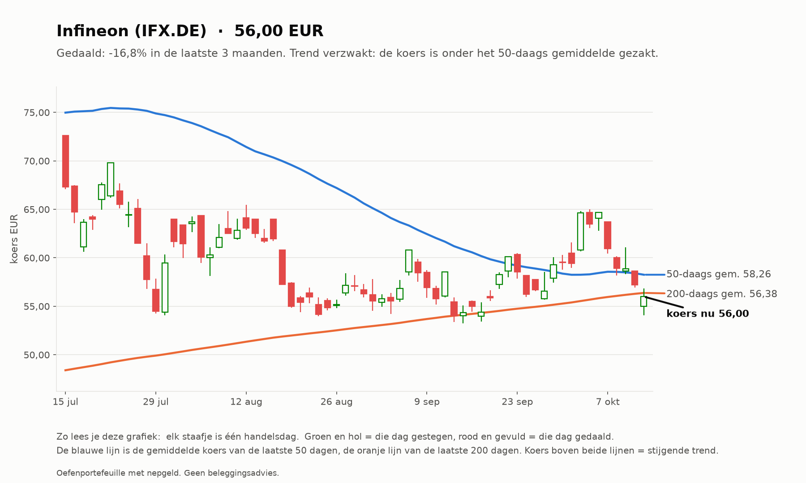
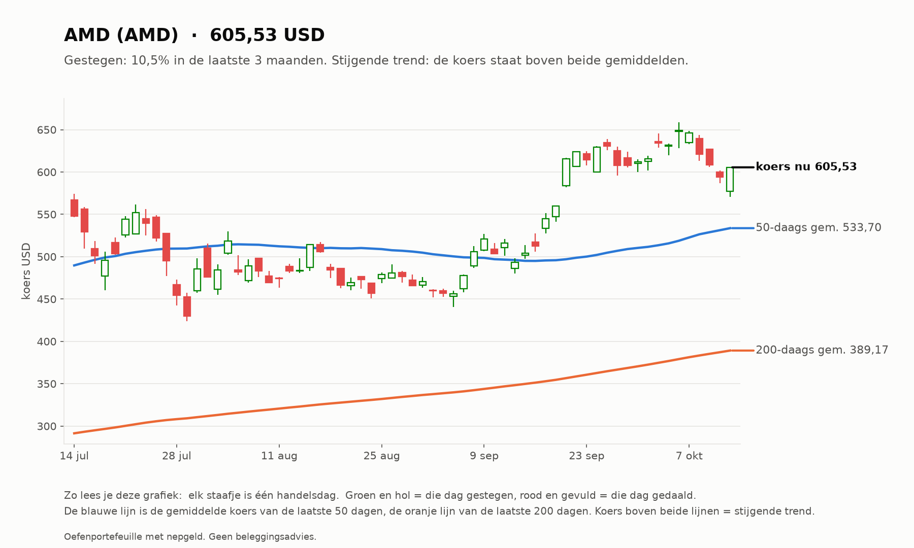
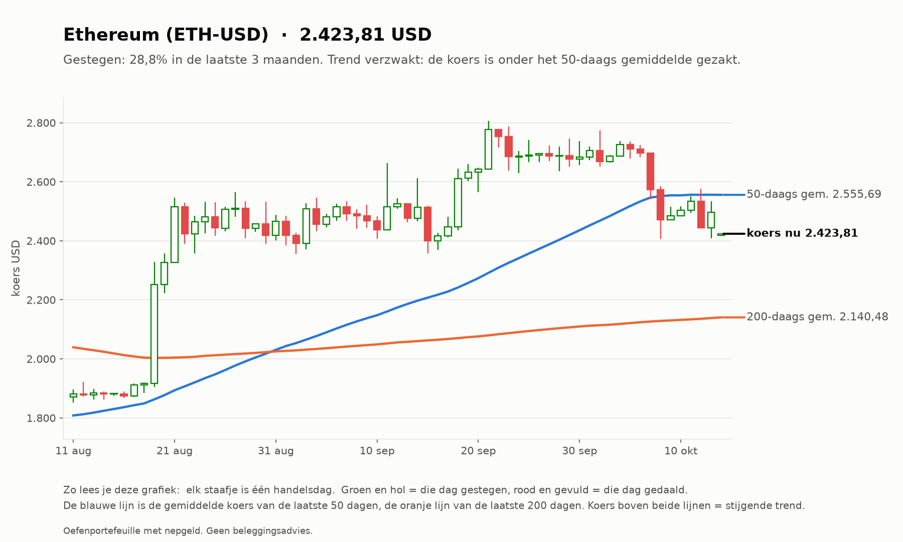
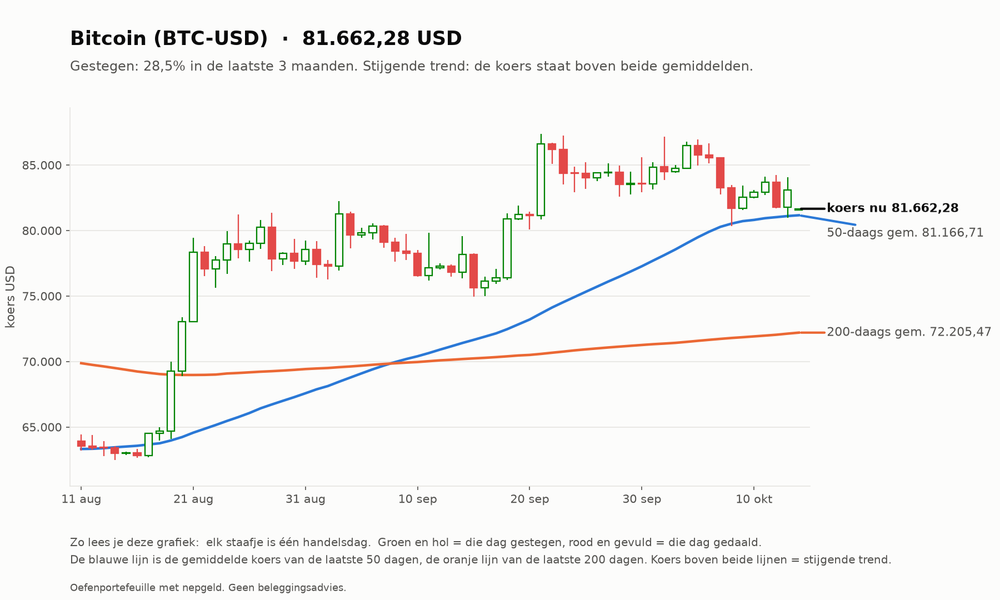

# Investeerder 2026-10-14

_Oefenportefeuille met nepgeld. Geen beleggingsadvies._

**Status:** OK  
**Waarde:** €9,887.78  
**Marktregime:** stijgend-laag  
**Strategieversie:** investeerder-1.0-c2474a  
**Koersbronnen:** 0 bevestigd door 2 bronnen, 52 uit 1 bron, 0 afwijkend; wisselkoers bevestigd  
**Sinds start:** -1.12%  

## Verdeling

| Instrument | Aandeel |
| --- | --- |
| iShares MSCI World (IWDA.AS) | 60.7% |
| AMD (AMD) | 6.2% |
| Halfgeleider-ETF (SMH) | 6.0% |
| Micron (MU) | 5.8% |
| Infineon (IFX.DE) | 5.8% |
| ASML (ASML.AS) | 5.7% |
| Bitcoin (BTC-USD) | 5.0% |
| Ethereum (ETH-USD) | 4.9% |
| Kas | 0.0% |

## Analyse van vandaag

**Wat de bot zag**

- **Markt (IWDA.AS):** koers 131,73, 9,5% boven het 200-daags gemiddelde (120,29); de afgelopen maand +4,2%. Trend: **stijgend**.
- **Beweeglijkheid:** 8% op jaarbasis, tegen normaal 10% het afgelopen jaar: **laag**.
- **Breedte:** 33 van de 50 instrumenten staan boven hun 200-daags gemiddelde (66%; EU 12 van 23, US 21 van 27).
- **BTC-USD:** 13,1% boven het 200-daags gemiddelde (mag in de mix).
- **ETH-USD:** 13,2% boven het 200-daags gemiddelde (mag in de mix).

**Wat de bot eruit haalt**

- De markt stijgt: de kern (wereld-ETF) doet zijn werk, de sterkste aandelen lopen mee.
- Uit de top gevallen: AMD, ASML.AS, IFX.DE, MU, SMH. Blijft dat zo, dan worden ze bij de volgende herverdeling (eerste handelsdag van 2026-11) vervangen door iets anders.

## Verlies en winst per belegging

| Instrument | Waarde | Ingelegd | Resultaat |
| --- | --- | --- | --- |
| ASML.AS | €564,31 | €600,00 | -€35,69 (-5,9%) |
| IFX.DE | €569,61 | €600,00 | -€30,39 (-5,1%) |
| MU | €575,81 | €600,00 | -€24,19 (-4,0%) |
| ETH-USD | €486,29 | €500,00 | -€13,71 (-2,7%) |
| BTC-USD | €491,45 | €500,00 | -€8,55 (-1,7%) |
| SMH | €594,66 | €600,00 | -€5,34 (-0,9%) |
| IWDA.AS | €5.996,73 | €6.000,00 | -€3,27 (-0,1%) |
| AMD | €608,92 | €600,00 | €8,92 (+1,5%) |

Totaal op de beleggingen: -€112,22 (inclusief aankoopkosten).
Daling vanaf de hoogste waarde ooit: -1,12% (top €10.000,00). De investeerder heeft geen stop-loss: hij houdt een spreiding vast en herverdeelt maandelijks.

## Vandaag gedaan

- Niets (herverdelen gebeurt één keer per maand)

## Klaar voor echt geld?

**Investeerder:** Nog niet klaar: de bot is nog bezig met bewijzen. Blijven oefenen.

| Eis | Stand | Nu |
| --- | --- | --- |
| Oefentijd | ⏳ | 2 van 63 handelsdagen (ongeveer 3 maanden) |
| Minstens zo goed als de wereld-ETF | ⏳ | verschil tot nu toe -0,58% |
| Daling niet veel dieper dan de ETF | ✅ | bot -1,12%, ETF -0,40% |

## Waarschuwingen

- Alle koersen uit US lopen achter (nieuwste 13-10): mogelijk een beursvakantie of een storing bij de bron. Daar vandaag niets gekocht.
- Alle koersen uit EU lopen achter (nieuwste 13-10): mogelijk een beursvakantie of een storing bij de bron. Daar vandaag niets gekocht.
- AAPL: verdachte data (koers niet bijgewerkt (laatste 13-10, verwacht 14-10)), niet nieuw gekozen
- MSFT: verdachte data (koers niet bijgewerkt (laatste 13-10, verwacht 14-10)), niet nieuw gekozen
- NVDA: verdachte data (koers niet bijgewerkt (laatste 13-10, verwacht 14-10)), niet nieuw gekozen
- AMZN: verdachte data (koers niet bijgewerkt (laatste 13-10, verwacht 14-10)), niet nieuw gekozen
- GOOGL: verdachte data (koers niet bijgewerkt (laatste 13-10, verwacht 14-10)), niet nieuw gekozen
- META: verdachte data (koers niet bijgewerkt (laatste 13-10, verwacht 14-10)), niet nieuw gekozen
- AVGO: verdachte data (koers niet bijgewerkt (laatste 13-10, verwacht 14-10)), niet nieuw gekozen
- TSLA: verdachte data (koers niet bijgewerkt (laatste 13-10, verwacht 14-10)), niet nieuw gekozen
- AMD: verdachte data (koers niet bijgewerkt (laatste 13-10, verwacht 14-10)), niet nieuw gekozen
- MU: verdachte data (koers niet bijgewerkt (laatste 13-10, verwacht 14-10)), niet nieuw gekozen
- ORCL: verdachte data (koers niet bijgewerkt (laatste 13-10, verwacht 14-10)), niet nieuw gekozen
- CRM: verdachte data (koers niet bijgewerkt (laatste 13-10, verwacht 14-10)), niet nieuw gekozen
- NFLX: verdachte data (koers niet bijgewerkt (laatste 13-10, verwacht 14-10)), niet nieuw gekozen
- PLTR: verdachte data (koers niet bijgewerkt (laatste 13-10, verwacht 14-10)), niet nieuw gekozen
- CRWD: verdachte data (koers niet bijgewerkt (laatste 13-10, verwacht 14-10)), niet nieuw gekozen
- PANW: verdachte data (koers niet bijgewerkt (laatste 13-10, verwacht 14-10)), niet nieuw gekozen
- ANET: verdachte data (koers niet bijgewerkt (laatste 13-10, verwacht 14-10)), niet nieuw gekozen
- JPM: verdachte data (koers niet bijgewerkt (laatste 13-10, verwacht 14-10)), niet nieuw gekozen
- V: verdachte data (koers niet bijgewerkt (laatste 13-10, verwacht 14-10)), niet nieuw gekozen
- LLY: verdachte data (koers niet bijgewerkt (laatste 13-10, verwacht 14-10)), niet nieuw gekozen
- COST: verdachte data (koers niet bijgewerkt (laatste 13-10, verwacht 14-10)), niet nieuw gekozen
- XOM: verdachte data (koers niet bijgewerkt (laatste 13-10, verwacht 14-10)), niet nieuw gekozen
- SPY: verdachte data (koers niet bijgewerkt (laatste 13-10, verwacht 14-10)), niet nieuw gekozen
- QQQ: verdachte data (koers niet bijgewerkt (laatste 13-10, verwacht 14-10)), niet nieuw gekozen
- SMH: verdachte data (koers niet bijgewerkt (laatste 13-10, verwacht 14-10)), niet nieuw gekozen
- XLE: verdachte data (koers niet bijgewerkt (laatste 13-10, verwacht 14-10)), niet nieuw gekozen
- GLD: verdachte data (koers niet bijgewerkt (laatste 13-10, verwacht 14-10)), niet nieuw gekozen
- ASML.AS: verdachte data (koers niet bijgewerkt (laatste 13-10, verwacht 14-10)), niet nieuw gekozen
- ASM.AS: verdachte data (koers niet bijgewerkt (laatste 13-10, verwacht 14-10)), niet nieuw gekozen
- BESI.AS: verdachte data (koers niet bijgewerkt (laatste 13-10, verwacht 14-10)), niet nieuw gekozen
- ADYEN.AS: verdachte data (koers niet bijgewerkt (laatste 13-10, verwacht 14-10)), niet nieuw gekozen
- INGA.AS: verdachte data (koers niet bijgewerkt (laatste 13-10, verwacht 14-10)), niet nieuw gekozen
- SHELL.AS: verdachte data (koers niet bijgewerkt (laatste 13-10, verwacht 14-10)), niet nieuw gekozen
- PRX.AS: verdachte data (koers niet bijgewerkt (laatste 13-10, verwacht 14-10)), niet nieuw gekozen
- AD.AS: verdachte data (koers niet bijgewerkt (laatste 13-10, verwacht 14-10)), niet nieuw gekozen
- HEIA.AS: verdachte data (koers niet bijgewerkt (laatste 13-10, verwacht 14-10)), niet nieuw gekozen
- WKL.AS: verdachte data (koers niet bijgewerkt (laatste 13-10, verwacht 14-10)), niet nieuw gekozen
- SAP.DE: verdachte data (koers niet bijgewerkt (laatste 13-10, verwacht 14-10)), niet nieuw gekozen
- SIE.DE: verdachte data (koers niet bijgewerkt (laatste 13-10, verwacht 14-10)), niet nieuw gekozen
- ALV.DE: verdachte data (koers niet bijgewerkt (laatste 13-10, verwacht 14-10)), niet nieuw gekozen
- DTE.DE: verdachte data (koers niet bijgewerkt (laatste 13-10, verwacht 14-10)), niet nieuw gekozen
- RHM.DE: verdachte data (koers niet bijgewerkt (laatste 13-10, verwacht 14-10)), niet nieuw gekozen
- IFX.DE: verdachte data (koers niet bijgewerkt (laatste 13-10, verwacht 14-10)), niet nieuw gekozen
- MC.PA: verdachte data (koers niet bijgewerkt (laatste 13-10, verwacht 14-10)), niet nieuw gekozen
- OR.PA: verdachte data (koers niet bijgewerkt (laatste 13-10, verwacht 14-10)), niet nieuw gekozen
- TTE.PA: verdachte data (koers niet bijgewerkt (laatste 13-10, verwacht 14-10)), niet nieuw gekozen
- SU.PA: verdachte data (koers niet bijgewerkt (laatste 13-10, verwacht 14-10)), niet nieuw gekozen
- AIR.PA: verdachte data (koers niet bijgewerkt (laatste 13-10, verwacht 14-10)), niet nieuw gekozen
- BNP.PA: verdachte data (koers niet bijgewerkt (laatste 13-10, verwacht 14-10)), niet nieuw gekozen
- IWDA.AS: verdachte data (koers niet bijgewerkt (laatste 13-10, verwacht 14-10)), niet nieuw gekozen

Zo analyseert de investeerder (klik om te openen)

1. **Kern (60%):** de wereld-ETF (IWDA), altijd.
2. **Satelliet (30%):** de 5 aandelen of ETF's met de grootste stijging over 12 maanden (de laatste maand niet
   meegeteld, omdat die vaak terugveert), alleen als ze boven hun 200-daags gemiddelde staan en genoeg verhandeld worden.
3. **Crypto (10%):** Bitcoin en Ethereum, alleen als ze boven hun 200-daags gemiddelde staan; anders kas.
4. **Eén keer per maand** wordt alles teruggezet naar deze verdeling. Tussendoor kijkt hij elke dag mee, maar handelt niet.

## Grafieken (laatste 3 maanden)

_Grafieken worden 20 handelsdagen bewaard._
