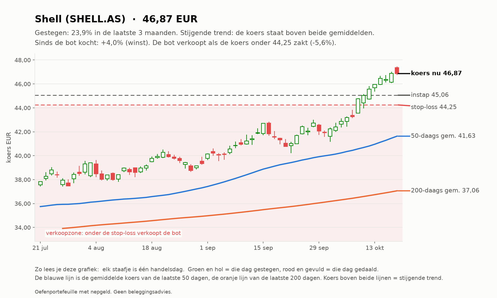
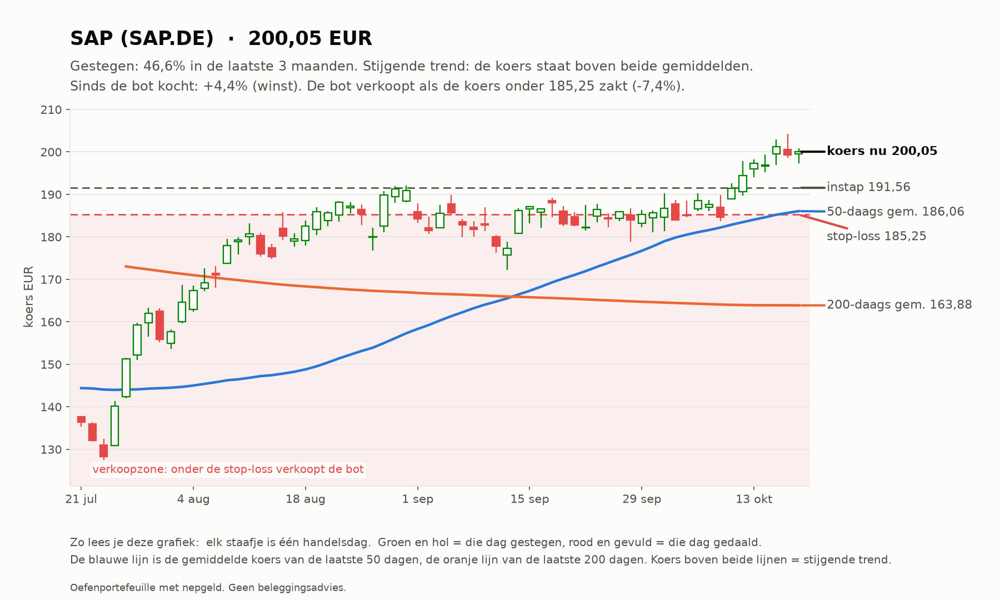
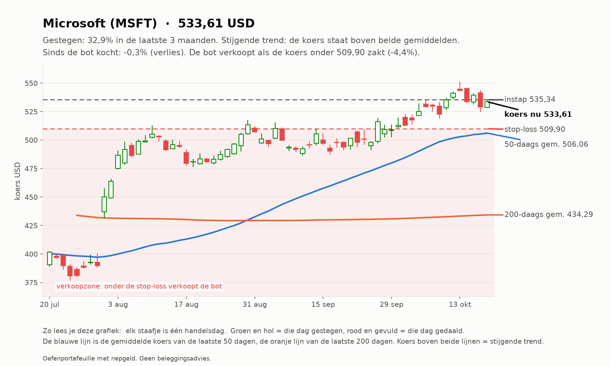

# Trend-agent rapport 2026-10-19

_Oefenportefeuille met nepgeld. Geen beleggingsadvies; resultaten uit het verleden zeggen niets over de toekomst._

**Status:** OK  
**Waarde:** €10,035.41  
**Kas:** €8,550.41  
**Marktregime:** stijgend-laag  
**Strategieversie:** trend-1.1-d373c7  
**Koersbronnen:** 0 bevestigd door 2 bronnen, 50 uit 1 bron, 0 afwijkend; wisselkoers bevestigd  
**Sinds start:** +0.35%  

## Analyse van vandaag

**Wat de bot zag**

- **Markt (IWDA.AS):** koers 130,67, 8,3% boven het 200-daags gemiddelde (120,66); de afgelopen maand +2,9%. Trend: **stijgend**.
- **Beweeglijkheid:** 8% op jaarbasis, tegen normaal 10% het afgelopen jaar: **laag**.
- **Breedte:** 34 van de 50 instrumenten staan boven hun 200-daags gemiddelde (68%; EU 12 van 23, US 22 van 27).
- **Bekeken:** 50 instrumenten.
- **Afgevallen** (een instrument kan op meer regels afvallen): geen stijgende trend (koers niet boven 50- en 200-daags gemiddelde): 33; niet gestegen over 1 of 3 maanden: 30; te weinig handel: 1.
- **Door de zeef:** 15. Koopbare trends: **15**.

**Wat de bot eruit haalt**

- De markt stijgt breed: goede omstandigheden voor trendvolgen.
- De markt is rustig: stops liggen dichterbij, posities kunnen iets groter.
- Amerika staat er duidelijk beter voor dan Europa (81% tegen 52% in een stijgende trend).
- Alle plekken zijn bezet, dus de bot koopt niets bij, hoe sterk een trend ook is.

## Vandaag gedaan

- SHELL.AS: stop omhoog van 44.19 naar 44.25
- SAP.DE: stop omhoog van 185.13 naar 185.25

## Verlies en risico

| Ticker | Instap | Koers nu | Resultaat | Stop | Afstand tot stop | Als de stop geraakt wordt |
| --- | --- | --- | --- | --- | --- | --- |
| SHELL.AS | 45.06 EUR | 46.87 | €23,50 (+4,0%) | 44.25 | +5,9% | -€11,51 verlies |
| SAP.DE | 191.56 EUR | 200.05 | €16,99 (+4,4%) | 185.25 | +8,0% | -€13,61 verlies |
| MSFT | 535.34 USD | 533.61 | -€2,08 (-0,3%) | 509.90 | +4,7% | -€24,21 verlies |

Raken alle stops tegelijk, dan is het verlies hooguit ongeveer €49,33 (bij een koersgat 's ochtends kan het meer zijn).

**Remmen** (bij overschrijden gaat de kill switch aan en koopt de bot niets meer):

- Daling vanaf de top: -0,03% (grens -5%; top was €10.038,89)
- Vandaag: +0,07% (grens -1%)
- Verliestrades op rij: 0 van 3

## Kansen: wat de bot vandaag het sterkst vond

_Dit is wat de oefenbot met zijn nepgeld volgens zijn eigen regels zou doen. Geen advies voor echt geld; het instapmoment is een ongeteste vuistregel en wordt door de bot niet gebruikt._

### 1. Shell (SHELL.AS): instapmoment **opgelopen**

- **Waarom sterk:** Shell steeg +22,5% in 3 maanden en +13,4% in 1 maand; koers boven het 50-daags en dat boven het 200-daags gemiddelde; MACD positief (de stijging versnelt); handel 0,9x het normale volume; beweegt gemiddeld 1,9% per dag.
- **Instapmoment:** de koers staat +5,9% van het 20-daags gemiddelde (3,1x de normale dagbeweging) en RSI is 81; na zo'n sprint volgt vaak eerst een terugval.
- **Status:** al in bezit.
- **Plan van de bot:** koop 14 stuks rond 46.89 EUR (inzet €656,44), stop-loss 45.13 EUR (-3,8%). Maximaal verlies als de stop wordt geraakt: ongeveer €26,65. Ter oriëntatie: 2x het risico winst ligt bij 50.41 EUR; de bot verkoopt daar niet vanzelf, hij laat de stop meeschuiven.

### 2. SAP (SAP.DE): instapmoment **neutraal**

- **Waarom sterk:** SAP steeg +51,5% in 3 maanden en +9,2% in 1 maand; koers boven het 50-daags en dat boven het 200-daags gemiddelde; MACD positief (de stijging versnelt); handel 0,8x het normale volume; beweegt gemiddeld 2,7% per dag.
- **Instapmoment:** de koers staat +4,5% van het 20-daags gemiddelde, RSI 67.
- **Status:** al in bezit.
- **Plan van de bot:** koop 2 stuks rond 200.15 EUR (inzet €400,30), stop-loss 189.18 EUR (-5,5%). Maximaal verlies als de stop wordt geraakt: ongeveer €23,93. Ter oriëntatie: 2x het risico winst ligt bij 222.08 EUR; de bot verkoopt daar niet vanzelf, hij laat de stop meeschuiven.

### 3. Wolters Kluwer (WKL.AS): instapmoment **opgelopen**

- **Waarom sterk:** Wolters Kluwer steeg +42,2% in 3 maanden en +23,4% in 1 maand; koers boven het 50-daags en dat boven het 200-daags gemiddelde; MACD positief (de stijging versnelt); handel 0,9x het normale volume; beweegt gemiddeld 2,9% per dag.
- **Instapmoment:** de koers staat +13,0% van het 20-daags gemiddelde (4,4x de normale dagbeweging) en RSI is 81; na zo'n sprint volgt vaak eerst een terugval.
- **Status:** niet gekocht: alle 3 plekken zijn bezet.
- **Plan van de bot:** koop 5 stuks rond 84.14 EUR (inzet €420,71), stop-loss 79.24 EUR (-5,8%). Maximaal verlies als de stop wordt geraakt: ongeveer €26,53. Ter oriëntatie: 2x het risico winst ligt bij 93.95 EUR; de bot verkoopt daar niet vanzelf, hij laat de stop meeschuiven.

### 4. Visa (V): instapmoment **neutraal**

- **Waarom sterk:** Visa steeg +13,5% in 3 maanden en +9,4% in 1 maand; koers boven het 50-daags en dat boven het 200-daags gemiddelde; MACD positief (de stijging versnelt); handel 0,9x het normale volume; beweegt gemiddeld 1,8% per dag.
- **Instapmoment:** de koers staat +5,4% van het 20-daags gemiddelde, RSI 74.
- **Status:** niet gekocht: alle 3 plekken zijn bezet.
- **Plan van de bot:** koop 1 stuk rond 403.26 USD (inzet €359,47), stop-loss 388.59 USD (-3,6%). Maximaal verlies als de stop wordt geraakt: ongeveer €15,08. Ter oriëntatie: 2x het risico winst ligt bij 432.60 USD; de bot verkoopt daar niet vanzelf, hij laat de stop meeschuiven.

### 5. Energie-ETF (XLE): instapmoment **neutraal**

- **Waarom sterk:** Energie-ETF steeg +16,6% in 3 maanden en +6,1% in 1 maand; koers boven het 50-daags en dat boven het 200-daags gemiddelde; MACD positief (de stijging versnelt); handel 1,1x het normale volume; beweegt gemiddeld 1,9% per dag.
- **Instapmoment:** de koers staat +4,1% van het 20-daags gemiddelde, RSI 67.
- **Status:** niet gekocht: alle 3 plekken zijn bezet.
- **Plan van de bot:** koop 10 stuks rond 67.85 USD (inzet €604,81), stop-loss 65.22 USD (-3,9%). Maximaal verlies als de stop wordt geraakt: ongeveer €25,43. Ter oriëntatie: 2x het risico winst ligt bij 73.11 USD; de bot verkoopt daar niet vanzelf, hij laat de stop meeschuiven.

## Wat de bot tot nu toe geleerd heeft

- Nog geen afgesloten trades. Leren begint pas als trades zijn afgesloten: dan weet de bot of een instap goed of slecht uitpakte, en onder welke omstandigheden.

## Klaar voor echt geld?

**Trend-agent:** Nog niet klaar: de bot is nog bezig met bewijzen. Blijven oefenen.

| Eis | Stand | Nu |
| --- | --- | --- |
| Oefentijd | ⏳ | 6 van 63 handelsdagen (ongeveer 3 maanden) |
| Minstens zo goed als de wereld-ETF | ⏳ | verschil tot nu toe +1,41% |
| Grootste daling onder 5% | ✅ | grootste daling tot nu toe -0,10% |
| Genoeg afgesloten trades | ⏳ | 0 van 20 |

Zo analyseert de trend-agent (klik om te openen)

1. **Data controleren.** Koersen van Yahoo, gecontroleerd bij een tweede bron en de wisselkoers bij de ECB.
   Bevroren koersen, rare sprongen of achterlopende markten: dat instrument wordt die dag niet gekocht.
2. **De markt als geheel.** Aan de hand van de wereld-ETF (IWDA) of de S&P 500: staat de koers boven het
   200-daags gemiddelde (stijgend), eronder (dalend) of ertussenin (zijwaarts)? En beweegt de markt meer of
   minder dan normaal vergeleken met het afgelopen jaar? Plus: hoeveel aandelen staan boven hun 200-daags gemiddelde (de breedte).
3. **Elk instrument door de zeef.** Een trend telt alleen als ALLES klopt: koers boven het 50-daags gemiddelde en
   dat boven het 200-daags, plus over 1 en 3 maanden gestegen, genoeg handel en geen verdachte sprong.
4. **Rangschikken.** Score = stijging (60% 3 maanden, 40% 1 maand) gedeeld door de beweeglijkheid. Een rustige,
   stevige stijger wint van een wilde.
5. **Risico bepalen.** Stop-loss op 2x de gemiddelde dagbeweging (ATR) onder de instap. Het aantal stuks wordt zo
   gekozen dat de stop hooguit 0,25% van het vermogen kost.
6. **Beheren.** De stop schuift mee omhoog (3x ATR onder de hoogste slotkoers). Verkopen bij stop of als de koers
   onder het 50-daags gemiddelde sluit.

## Open posities

| Ticker | Aantal | Instap | Stop | Sinds |
| --- | --- | --- | --- | --- |
| SHELL.AS | 13 | 45.06 EUR | 44.25 | 2026-10-10 |
| SAP.DE | 2 | 191.56 EUR | 185.25 | 2026-10-10 |
| MSFT | 1 | 535.34 USD | 509.90 | 2026-10-10 |

## Sterkste trends vandaag

| # | Ticker | Score | 3 mnd | 1 mnd |
| --- | --- | --- | --- | --- |
| 1 | SHELL.AS | 0.162 | +22.5% | +13.4% |
| 2 | SAP.DE | 0.139 | +51.5% | +9.2% |
| 3 | WKL.AS | 0.136 | +42.2% | +23.4% |
| 4 | V | 0.102 | +13.5% | +9.4% |
| 5 | XLE | 0.101 | +16.6% | +6.1% |
| 6 | MSFT | 0.097 | +34.4% | +8.1% |
| 7 | XOM | 0.097 | +18.3% | +9.0% |
| 8 | CRM | 0.070 | +42.8% | +1.9% |
| 9 | PLTR | 0.065 | +46.4% | +9.3% |
| 10 | TTE.PA | 0.052 | +9.4% | +2.5% |

## Grafieken (laatste 3 maanden)

_Grafieken worden 20 handelsdagen bewaard._
