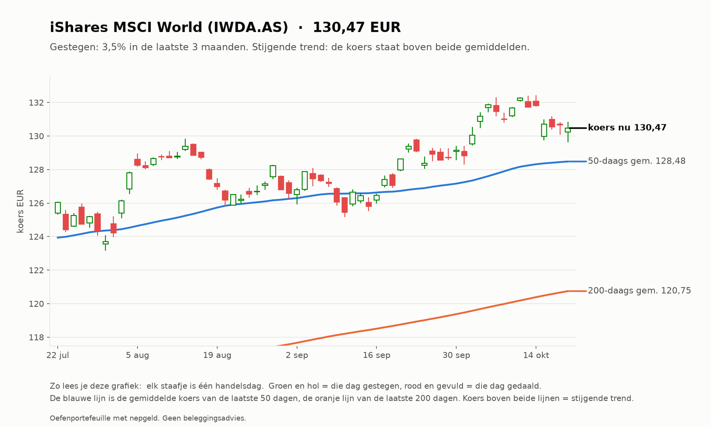
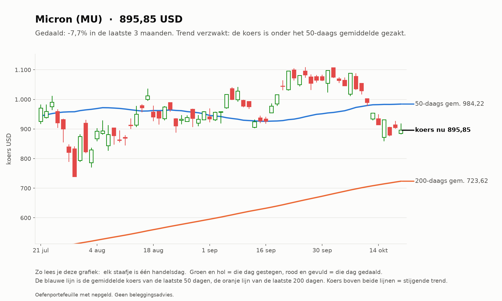
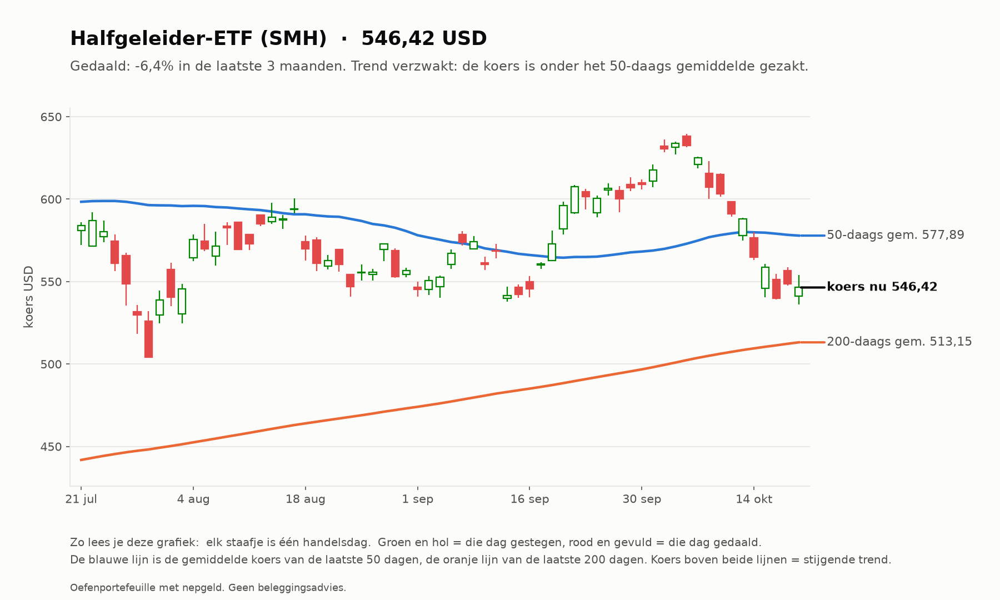
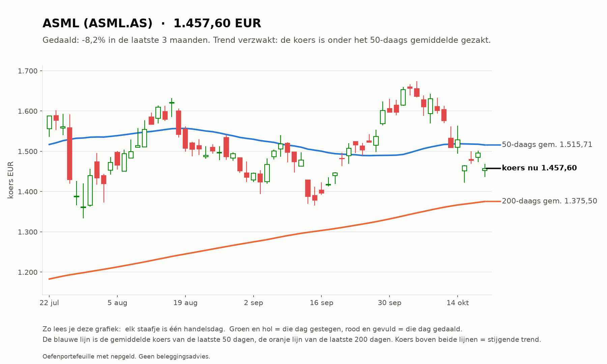
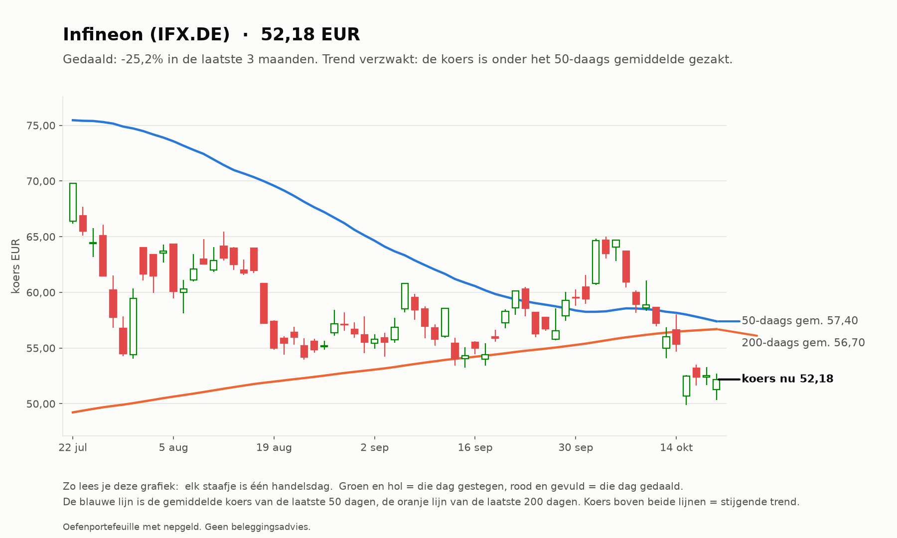
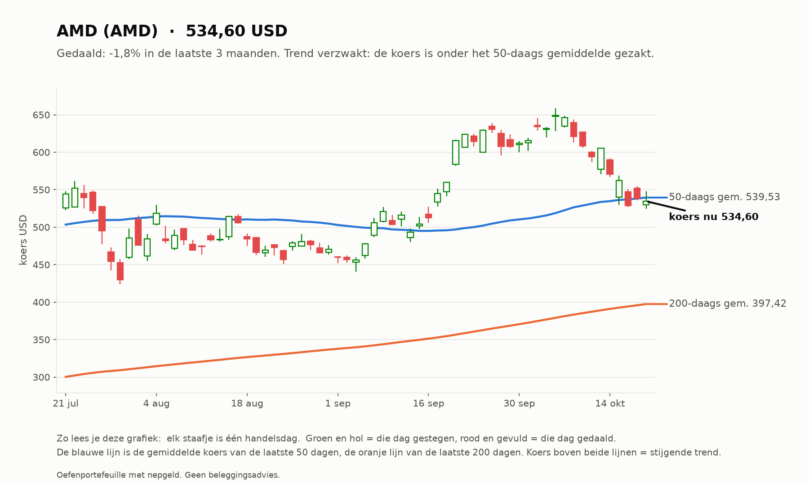
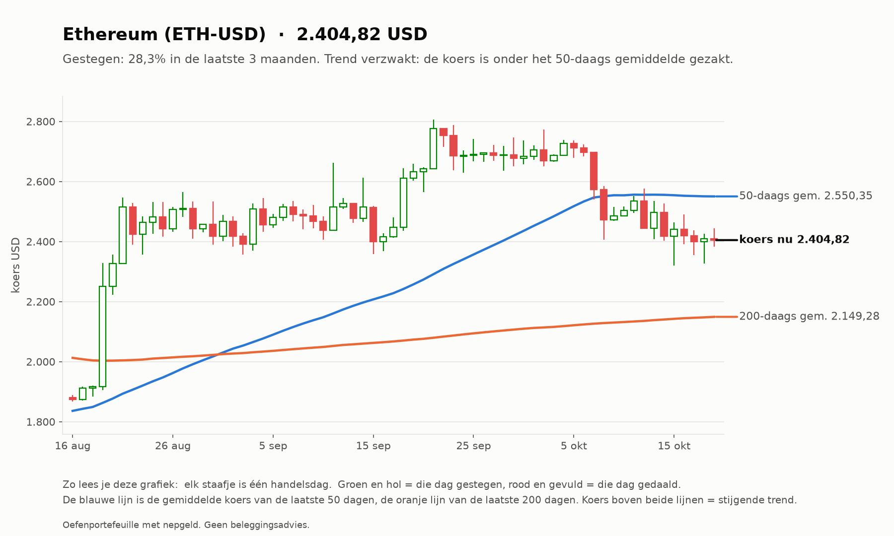
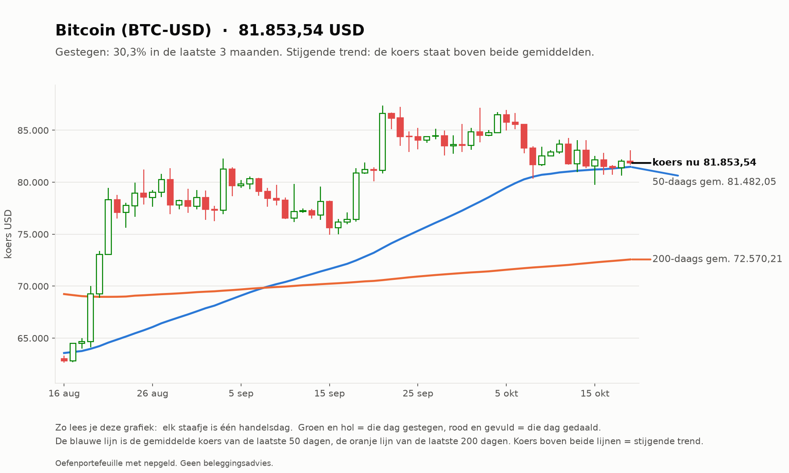

# Investeerder 2026-10-20

_Oefenportefeuille met nepgeld. Geen beleggingsadvies._

**Status:** OK  
**Waarde:** €9,613.83  
**Marktregime:** stijgend-laag  
**Strategieversie:** investeerder-1.0-c2474a  
**Koersbronnen:** 0 bevestigd door 2 bronnen, 52 uit 1 bron, 0 afwijkend; wisselkoers bevestigd  
**Sinds start:** -3.86%  

## Verdeling

| Instrument | Aandeel |
| --- | --- |
| iShares MSCI World (IWDA.AS) | 61.8% |
| Halfgeleider-ETF (SMH) | 5.7% |
| ASML (ASML.AS) | 5.7% |
| Micron (MU) | 5.6% |
| AMD (AMD) | 5.6% |
| Infineon (IFX.DE) | 5.5% |
| Bitcoin (BTC-USD) | 5.1% |
| Ethereum (ETH-USD) | 5.0% |
| Kas | 0.0% |

## Analyse van vandaag

**Wat de bot zag**

- **Markt (IWDA.AS):** koers 130,47, 8,1% boven het 200-daags gemiddelde (120,75); de afgelopen maand +1,4%. Trend: **stijgend**.
- **Beweeglijkheid:** 8% op jaarbasis, tegen normaal 10% het afgelopen jaar: **laag**.
- **Breedte:** 33 van de 50 instrumenten staan boven hun 200-daags gemiddelde (66%; EU 12 van 23, US 21 van 27).
- **Sterkste momentum nu (12 maanden, zonder laatste maand):** Micron +416%, AMD +164%, CrowdStrike +106%, Palo Alto Networks +79%, Halfgeleider-ETF +74%.
- **BTC-USD:** 12,8% boven het 200-daags gemiddelde (mag in de mix).
- **ETH-USD:** 11,9% boven het 200-daags gemiddelde (mag in de mix).

**Wat de bot eruit haalt**

- De markt stijgt: de kern (wereld-ETF) doet zijn werk, de sterkste aandelen lopen mee.
- Uit de top gevallen: ASML.AS, IFX.DE. Blijft dat zo, dan worden ze bij de volgende herverdeling (eerste handelsdag van 2026-11) vervangen door CRWD, PANW.

## Verlies en winst per belegging

| Instrument | Waarde | Ingelegd | Resultaat |
| --- | --- | --- | --- |
| IFX.DE | €530,75 | €600,00 | -€69,25 (-11,5%) |
| AMD | €536,02 | €600,00 | -€63,98 (-10,7%) |
| IWDA.AS | €5.939,38 | €6.000,00 | -€60,62 (-1,0%) |
| MU | €539,68 | €600,00 | -€60,32 (-10,1%) |
| ASML.AS | €544,87 | €600,00 | -€55,13 (-9,2%) |
| SMH | €550,89 | €600,00 | -€49,11 (-8,2%) |
| ETH-USD | €481,07 | €500,00 | -€18,93 (-3,8%) |
| BTC-USD | €491,17 | €500,00 | -€8,83 (-1,8%) |

Totaal op de beleggingen: -€386,17 (inclusief aankoopkosten).
Daling vanaf de hoogste waarde ooit: -3,86% (top €10.000,00). De investeerder heeft geen stop-loss: hij houdt een spreiding vast en herverdeelt maandelijks.

## Vandaag gedaan

- Niets (herverdelen gebeurt één keer per maand)

## Klaar voor echt geld?

**Investeerder:** Nog niet klaar: de bot is nog bezig met bewijzen. Blijven oefenen.

| Eis | Stand | Nu |
| --- | --- | --- |
| Oefentijd | ⏳ | 6 van 63 handelsdagen (ongeveer 3 maanden) |
| Minstens zo goed als de wereld-ETF | ⏳ | verschil tot nu toe -2,37% |
| Daling niet veel dieper dan de ETF | ✅ | bot -3,96%, ETF -1,37% |

Zo analyseert de investeerder (klik om te openen)

1. **Kern (60%):** de wereld-ETF (IWDA), altijd.
2. **Satelliet (30%):** de 5 aandelen of ETF's met de grootste stijging over 12 maanden (de laatste maand niet
   meegeteld, omdat die vaak terugveert), alleen als ze boven hun 200-daags gemiddelde staan en genoeg verhandeld worden.
3. **Crypto (10%):** Bitcoin en Ethereum, alleen als ze boven hun 200-daags gemiddelde staan; anders kas.
4. **Eén keer per maand** wordt alles teruggezet naar deze verdeling. Tussendoor kijkt hij elke dag mee, maar handelt niet.

## Grafieken (laatste 3 maanden)

_Grafieken worden 20 handelsdagen bewaard._
