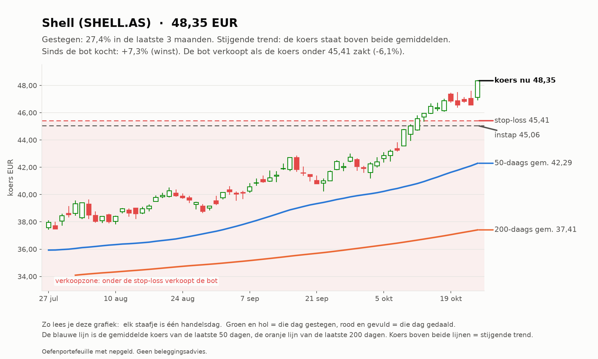
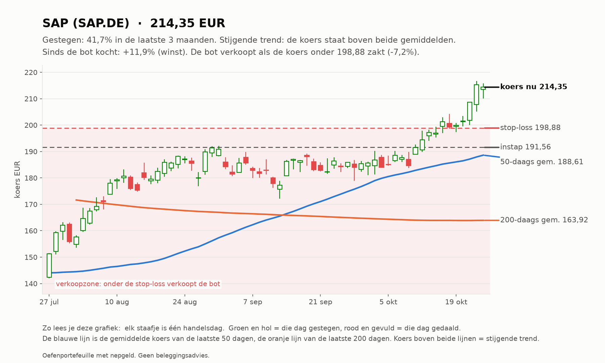
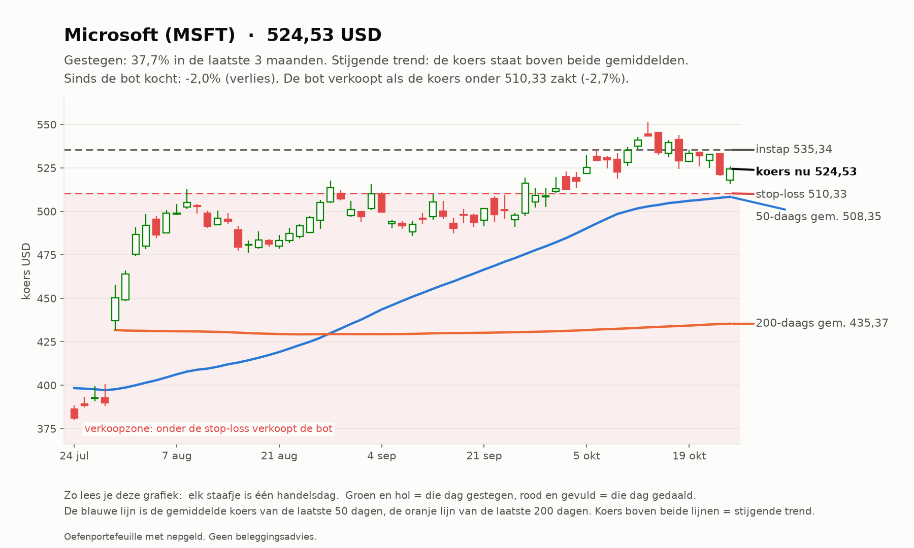

# Trend-agent rapport 2026-10-23

_Oefenportefeuille met nepgeld. Geen beleggingsadvies; resultaten uit het verleden zeggen niets over de toekomst._

**Status:** OK  
**Waarde:** €10,075.73  
**Kas:** €8,550.41  
**Marktregime:** stijgend-laag  
**Strategieversie:** trend-1.1-d373c7  
**Koersbronnen:** 0 bevestigd door 2 bronnen, 50 uit 1 bron, 0 afwijkend; wisselkoers bevestigd  
**Sinds start:** +0.76%  

## Analyse van vandaag

**Wat de bot zag**

- **Markt (IWDA.AS):** koers 129,82, 7,3% boven het 200-daags gemiddelde (120,99); de afgelopen maand +1,1%. Trend: **stijgend**.
- **Beweeglijkheid:** 8% op jaarbasis, tegen normaal 10% het afgelopen jaar: **laag**.
- **Breedte:** 32 van de 50 instrumenten staan boven hun 200-daags gemiddelde (64%; EU 11 van 23, US 21 van 27).
- **Bekeken:** 50 instrumenten.
- **Afgevallen** (een instrument kan op meer regels afvallen): geen stijgende trend (koers niet boven 50- en 200-daags gemiddelde): 33; niet gestegen over 1 of 3 maanden: 34; te weinig handel: 1.
- **Door de zeef:** 13. Koopbare trends: **13**.

**Wat de bot eruit haalt**

- De markt stijgt breed: goede omstandigheden voor trendvolgen.
- De markt is rustig: stops liggen dichterbij, posities kunnen iets groter.
- Amerika staat er duidelijk beter voor dan Europa (78% tegen 48% in een stijgende trend).
- 4 van de 5 sterkste staan al ver boven hun gemiddelde (SHELL.AS, SAP.DE, WKL.AS, XOM): de trend is sterk, maar instappen op zo'n moment kost vaker een terugval.
- Alle plekken zijn bezet, dus de bot koopt niets bij, hoe sterk een trend ook is.

## Vandaag gedaan

- SHELL.AS: stop omhoog van 44.25 naar 45.41
- MSFT: stop omhoog van 510.08 naar 510.33

## Verlies en risico

| Ticker | Instap | Koers nu | Resultaat | Stop | Afstand tot stop | Als de stop geraakt wordt |
| --- | --- | --- | --- | --- | --- | --- |
| SHELL.AS | 45.06 EUR | 48.34 | €42,74 (+7,3%) | 45.41 | +6,5% | €3,61 winst vastgezet |
| SAP.DE | 191.56 EUR | 214.35 | €45,59 (+11,9%) | 198.88 | +7,8% | €13,66 winst vastgezet |
| MSFT | 535.34 USD | 524.52 | -€9,60 (-2,0%) | 510.33 | +2,8% | -€23,27 verlies |

Raken alle stops tegelijk, dan is het verlies hooguit ongeveer €23,27 (bij een koersgat 's ochtends kan het meer zijn).

**Remmen** (bij overschrijden gaat de kill switch aan en koopt de bot niets meer):

- Daling vanaf de top: +0,00% (grens -5%; top was €10.075,73)
- Vandaag: +0,22% (grens -1%)
- Verliestrades op rij: 0 van 3

## Kansen: wat de bot vandaag het sterkst vond

_Dit is wat de oefenbot met zijn nepgeld volgens zijn eigen regels zou doen. Geen advies voor echt geld; het instapmoment is een ongeteste vuistregel en wordt door de bot niet gebruikt._

### 1. Shell (SHELL.AS): instapmoment **opgelopen**

- **Waarom sterk:** Shell steeg +29,0% in 3 maanden en +13,9% in 1 maand; koers boven het 50-daags en dat boven het 200-daags gemiddelde; MACD positief (de stijging versnelt); handel 1,0x het normale volume; beweegt gemiddeld 2,0% per dag.
- **Instapmoment:** de koers staat +6,9% van het 20-daags gemiddelde (3,4x de normale dagbeweging) en RSI is 81; na zo'n sprint volgt vaak eerst een terugval.
- **Status:** al in bezit.
- **Plan van de bot:** koop 12 stuks rond 48.37 EUR (inzet €580,43), stop-loss 46.41 EUR (-4,0%). Maximaal verlies als de stop wordt geraakt: ongeveer €25,46. Ter oriëntatie: 2x het risico winst ligt bij 52.28 EUR; de bot verkoopt daar niet vanzelf, hij laat de stop meeschuiven.

### 2. SAP (SAP.DE): instapmoment **opgelopen**

- **Waarom sterk:** SAP steeg +34,6% in 3 maanden en +16,4% in 1 maand; koers boven het 50-daags en dat boven het 200-daags gemiddelde; MACD positief (de stijging versnelt); handel 0,9x het normale volume; beweegt gemiddeld 2,8% per dag.
- **Instapmoment:** de koers staat +8,4% van het 20-daags gemiddelde (3,0x de normale dagbeweging) en RSI is 76; na zo'n sprint volgt vaak eerst een terugval.
- **Status:** al in bezit.
- **Plan van de bot:** koop 2 stuks rond 214.46 EUR (inzet €428,91), stop-loss 202.56 EUR (-5,5%). Maximaal verlies als de stop wordt geraakt: ongeveer €25,80. Ter oriëntatie: 2x het risico winst ligt bij 238.25 EUR; de bot verkoopt daar niet vanzelf, hij laat de stop meeschuiven.

### 3. Energie-ETF (XLE): instapmoment **neutraal**

- **Waarom sterk:** Energie-ETF steeg +19,5% in 3 maanden en +10,8% in 1 maand; koers boven het 50-daags en dat boven het 200-daags gemiddelde; MACD positief (de stijging versnelt); handel 1,1x het normale volume; beweegt gemiddeld 2,1% per dag.
- **Instapmoment:** de koers staat +4,8% van het 20-daags gemiddelde, RSI 70.
- **Status:** niet gekocht: alle 3 plekken zijn bezet.
- **Plan van de bot:** koop 9 stuks rond 69.36 USD (inzet €557,17), stop-loss 66.42 USD (-4,2%). Maximaal verlies als de stop wordt geraakt: ongeveer €25,66. Ter oriëntatie: 2x het risico winst ligt bij 75.26 USD; de bot verkoopt daar niet vanzelf, hij laat de stop meeschuiven.

### 4. Wolters Kluwer (WKL.AS): instapmoment **opgelopen**

- **Waarom sterk:** Wolters Kluwer steeg +24,4% in 3 maanden en +28,0% in 1 maand; koers boven het 50-daags en dat boven het 200-daags gemiddelde; MACD positief (de stijging versnelt); handel 0,9x het normale volume; beweegt gemiddeld 2,8% per dag.
- **Instapmoment:** de koers staat +12,5% van het 20-daags gemiddelde (4,5x de normale dagbeweging) en RSI is 84; na zo'n sprint volgt vaak eerst een terugval.
- **Status:** niet gekocht: alle 3 plekken zijn bezet.
- **Plan van de bot:** koop 5 stuks rond 88.16 EUR (inzet €440,82), stop-loss 83.29 EUR (-5,5%). Maximaal verlies als de stop wordt geraakt: ongeveer €26,36. Ter oriëntatie: 2x het risico winst ligt bij 97.91 EUR; de bot verkoopt daar niet vanzelf, hij laat de stop meeschuiven.

### 5. ExxonMobil (XOM): instapmoment **opgelopen**

- **Waarom sterk:** ExxonMobil steeg +19,1% in 3 maanden en +13,0% in 1 maand; koers boven het 50-daags en dat boven het 200-daags gemiddelde; MACD positief (de stijging versnelt); handel 0,9x het normale volume; beweegt gemiddeld 2,1% per dag.
- **Instapmoment:** de koers staat +6,0% van het 20-daags gemiddelde (2,8x de normale dagbeweging) en RSI is 76; na zo'n sprint volgt vaak eerst een terugval.
- **Status:** niet gekocht: alle 3 plekken zijn bezet.
- **Plan van de bot:** koop 3 stuks rond 183.30 USD (inzet €490,79), stop-loss 175.45 USD (-4,3%). Maximaal verlies als de stop wordt geraakt: ongeveer €23,02. Ter oriëntatie: 2x het risico winst ligt bij 199.00 USD; de bot verkoopt daar niet vanzelf, hij laat de stop meeschuiven.

## Wat de bot tot nu toe geleerd heeft

- Nog geen afgesloten trades. Leren begint pas als trades zijn afgesloten: dan weet de bot of een instap goed of slecht uitpakte, en onder welke omstandigheden.

## Klaar voor echt geld?

**Trend-agent:** Nog niet klaar: de bot is nog bezig met bewijzen. Blijven oefenen.

| Eis | Stand | Nu |
| --- | --- | --- |
| Oefentijd | ⏳ | 10 van 63 handelsdagen (ongeveer 3 maanden) |
| Minstens zo goed als de wereld-ETF | ⏳ | verschil tot nu toe +2,46% |
| Grootste daling onder 5% | ✅ | grootste daling tot nu toe -0,10% |
| Genoeg afgesloten trades | ⏳ | 0 van 20 |

Zo analyseert de trend-agent (klik om te openen)

1. **Data controleren.** Koersen van Yahoo, gecontroleerd bij een tweede bron en de wisselkoers bij de ECB.
   Bevroren koersen, rare sprongen of achterlopende markten: dat instrument wordt die dag niet gekocht.
2. **De markt als geheel.** Aan de hand van de wereld-ETF (IWDA) of de S&P 500: staat de koers boven het
   200-daags gemiddelde (stijgend), eronder (dalend) of ertussenin (zijwaarts)? En beweegt de markt meer of
   minder dan normaal vergeleken met het afgelopen jaar? Plus: hoeveel aandelen staan boven hun 200-daags gemiddelde (de breedte).
3. **Elk instrument door de zeef.** Een trend telt alleen als ALLES klopt: koers boven het 50-daags gemiddelde en
   dat boven het 200-daags, plus over 1 en 3 maanden gestegen, genoeg handel en geen verdachte sprong.
4. **Rangschikken.** Score = stijging (60% 3 maanden, 40% 1 maand) gedeeld door de beweeglijkheid. Een rustige,
   stevige stijger wint van een wilde.
5. **Risico bepalen.** Stop-loss op 2x de gemiddelde dagbeweging (ATR) onder de instap. Het aantal stuks wordt zo
   gekozen dat de stop hooguit 0,25% van het vermogen kost.
6. **Beheren.** De stop schuift mee omhoog (3x ATR onder de hoogste slotkoers). Verkopen bij stop of als de koers
   onder het 50-daags gemiddelde sluit.

## Open posities

| Ticker | Aantal | Instap | Stop | Sinds |
| --- | --- | --- | --- | --- |
| SHELL.AS | 13 | 45.06 EUR | 45.41 | 2026-10-10 |
| SAP.DE | 2 | 191.56 EUR | 198.88 | 2026-10-10 |
| MSFT | 1 | 535.34 USD | 510.33 | 2026-10-10 |

## Sterkste trends vandaag

| # | Ticker | Score | 3 mnd | 1 mnd |
| --- | --- | --- | --- | --- |
| 1 | SHELL.AS | 0.191 | +29.0% | +13.9% |
| 2 | SAP.DE | 0.139 | +34.6% | +16.4% |
| 3 | XLE | 0.123 | +19.5% | +10.8% |
| 4 | WKL.AS | 0.118 | +24.4% | +28.0% |
| 5 | XOM | 0.111 | +19.1% | +13.0% |
| 6 | V | 0.103 | +12.7% | +10.9% |
| 7 | OR.PA | 0.099 | +13.8% | +13.3% |
| 8 | MSFT | 0.095 | +35.1% | +5.3% |
| 9 | TTE.PA | 0.080 | +14.8% | +4.5% |
| 10 | CRM | 0.076 | +43.4% | +4.3% |

## Grafieken (laatste 3 maanden)

_Grafieken worden 20 handelsdagen bewaard._
