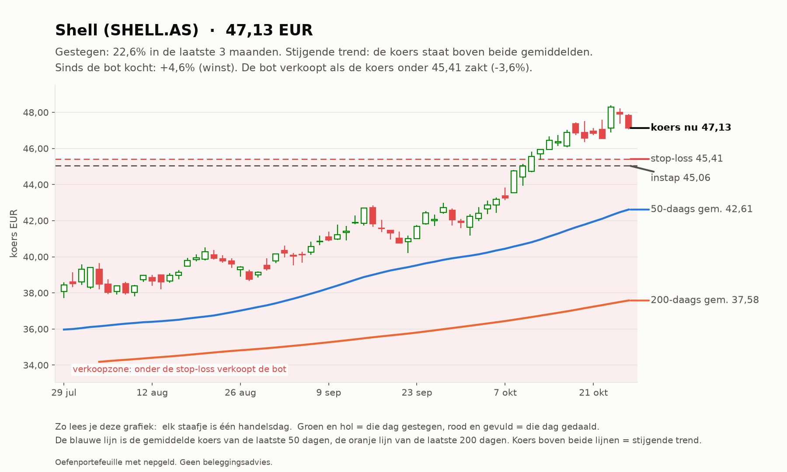
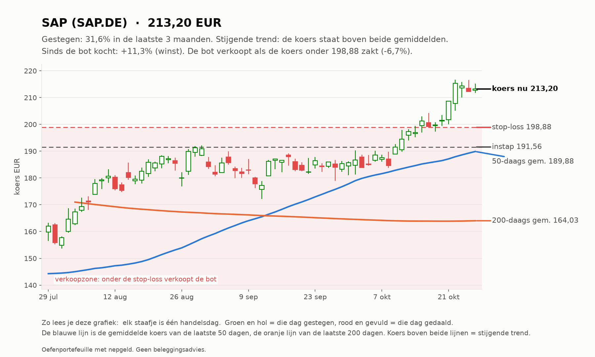
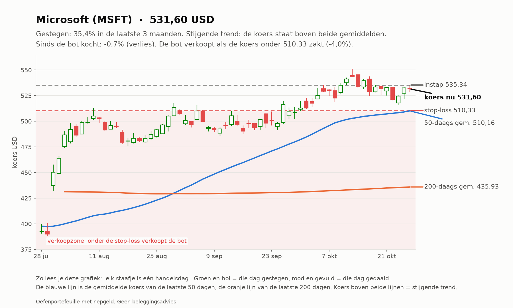

# Trend-agent rapport 2026-10-27

_Oefenportefeuille met nepgeld. Geen beleggingsadvies; resultaten uit het verleden zeggen niets over de toekomst._

**Status:** OK  
**Waarde:** €10,067.25  
**Kas:** €8,550.41  
**Marktregime:** stijgend-laag  
**Strategieversie:** trend-1.1-d373c7  
**Koersbronnen:** 0 bevestigd door 2 bronnen, 50 uit 1 bron, 0 afwijkend; wisselkoers bevestigd  
**Sinds start:** +0.67%  

## Analyse van vandaag

**Wat de bot zag**

- **Markt (IWDA.AS):** koers 131,66, 8,7% boven het 200-daags gemiddelde (121,16); de afgelopen maand +2,4%. Trend: **stijgend**.
- **Beweeglijkheid:** 9% op jaarbasis, tegen normaal 10% het afgelopen jaar: **laag**.
- **Breedte:** 33 van de 50 instrumenten staan boven hun 200-daags gemiddelde (66%; EU 12 van 23, US 21 van 27).
- **Bekeken:** 50 instrumenten.
- **Afgevallen** (een instrument kan op meer regels afvallen): geen stijgende trend (koers niet boven 50- en 200-daags gemiddelde): 30; niet gestegen over 1 of 3 maanden: 28; te weinig handel: 1.
- **Door de zeef:** 17. Koopbare trends: **17**.

**Wat de bot eruit haalt**

- De markt stijgt breed: goede omstandigheden voor trendvolgen.
- De markt is rustig: stops liggen dichterbij, posities kunnen iets groter.
- Amerika staat er duidelijk beter voor dan Europa (78% tegen 52% in een stijgende trend).
- Sterk zonder ver weggelopen te zijn: XLE, MSFT.
- Alle plekken zijn bezet, dus de bot koopt niets bij, hoe sterk een trend ook is.

## Vandaag gedaan

- Niets

## Verlies en risico

| Ticker | Instap | Koers nu | Resultaat | Stop | Afstand tot stop | Als de stop geraakt wordt |
| --- | --- | --- | --- | --- | --- | --- |
| SHELL.AS | 45.06 EUR | 47.13 | €26,94 (+4,6%) | 45.41 | +3,8% | €3,61 winst vastgezet |
| SAP.DE | 191.56 EUR | 213.20 | €43,29 (+11,3%) | 198.88 | +7,2% | €13,66 winst vastgezet |
| MSFT | 535.34 USD | 531.60 | €0,01 (-0,7%) | 510.33 | +4,2% | -€20,10 verlies |

Raken alle stops tegelijk, dan is het verlies hooguit ongeveer €20,10 (bij een koersgat 's ochtends kan het meer zijn).

**Remmen** (bij overschrijden gaat de kill switch aan en koopt de bot niets meer):

- Daling vanaf de top: -0,09% (grens -5%; top was €10.076,18)
- Vandaag: -0,09% (grens -1%)
- Verliestrades op rij: 0 van 3

## Kansen: wat de bot vandaag het sterkst vond

_Dit is wat de oefenbot met zijn nepgeld volgens zijn eigen regels zou doen. Geen advies voor echt geld; het instapmoment is een ongeteste vuistregel en wordt door de bot niet gebruikt._

### 1. SAP (SAP.DE): instapmoment **neutraal**

- **Waarom sterk:** SAP steeg +36,7% in 3 maanden en +15,9% in 1 maand; koers boven het 50-daags en dat boven het 200-daags gemiddelde; MACD positief (de stijging versnelt); handel 0,9x het normale volume; beweegt gemiddeld 2,8% per dag.
- **Instapmoment:** de koers staat +6,4% van het 20-daags gemiddelde, RSI 73.
- **Status:** al in bezit.
- **Plan van de bot:** koop 2 stuks rond 213.31 EUR (inzet €426,61), stop-loss 201.41 EUR (-5,6%). Maximaal verlies als de stop wordt geraakt: ongeveer €25,79. Ter oriëntatie: 2x het risico winst ligt bij 237.10 EUR; de bot verkoopt daar niet vanzelf, hij laat de stop meeschuiven.

### 2. Shell (SHELL.AS): instapmoment **neutraal**

- **Waarom sterk:** Shell steeg +22,4% in 3 maanden en +10,3% in 1 maand; koers boven het 50-daags en dat boven het 200-daags gemiddelde; MACD positief (de stijging versnelt); handel 1,0x het normale volume; beweegt gemiddeld 2,1% per dag.
- **Instapmoment:** de koers staat +3,3% van het 20-daags gemiddelde, RSI 67.
- **Status:** al in bezit.
- **Plan van de bot:** koop 12 stuks rond 47.15 EUR (inzet €565,84), stop-loss 45.16 EUR (-4,2%). Maximaal verlies als de stop wordt geraakt: ongeveer €25,87. Ter oriëntatie: 2x het risico winst ligt bij 51.13 EUR; de bot verkoopt daar niet vanzelf, hij laat de stop meeschuiven.

### 3. Wolters Kluwer (WKL.AS): instapmoment **neutraal**

- **Waarom sterk:** Wolters Kluwer steeg +26,9% in 3 maanden en +27,5% in 1 maand; koers boven het 50-daags en dat boven het 200-daags gemiddelde; MACD positief (de stijging versnelt); handel 0,9x het normale volume; beweegt gemiddeld 2,8% per dag.
- **Instapmoment:** de koers staat +7,9% van het 20-daags gemiddelde, RSI 74.
- **Status:** niet gekocht: alle 3 plekken zijn bezet.
- **Plan van de bot:** koop 5 stuks rond 86.10 EUR (inzet €430,52), stop-loss 81.23 EUR (-5,7%). Maximaal verlies als de stop wordt geraakt: ongeveer €26,37. Ter oriëntatie: 2x het risico winst ligt bij 95.85 EUR; de bot verkoopt daar niet vanzelf, hij laat de stop meeschuiven.

### 4. Energie-ETF (XLE): instapmoment **gunstig**

- **Waarom sterk:** Energie-ETF steeg +17,0% in 3 maanden en +9,9% in 1 maand; koers boven het 50-daags en dat boven het 200-daags gemiddelde; MACD positief (de stijging versnelt); handel 1,0x het normale volume; beweegt gemiddeld 2,2% per dag.
- **Instapmoment:** de trend is sterk maar de koers is niet ver weggelopen (+2,3% van het 20-daags gemiddelde, RSI 61).
- **Status:** niet gekocht: alle 3 plekken zijn bezet.
- **Plan van de bot:** koop 9 stuks rond 68.26 USD (inzet €552,14), stop-loss 65.28 USD (-4,4%). Maximaal verlies als de stop wordt geraakt: ongeveer €26,16. Ter oriëntatie: 2x het risico winst ligt bij 74.24 USD; de bot verkoopt daar niet vanzelf, hij laat de stop meeschuiven.

### 5. Microsoft (MSFT): instapmoment **gunstig**

- **Waarom sterk:** Microsoft steeg +36,4% in 3 maanden en +4,4% in 1 maand; koers boven het 50-daags en dat boven het 200-daags gemiddelde; MACD negatief (de stijging vertraagt); handel 0,9x het normale volume; beweegt gemiddeld 2,1% per dag.
- **Instapmoment:** de trend is sterk maar de koers is niet ver weggelopen (+1,1% van het 20-daags gemiddelde, RSI 56).
- **Status:** al in bezit.
- **Plan van de bot:** koop 1 stuk rond 531.87 USD (inzet €477,99), stop-loss 509.73 USD (-4,2%). Maximaal verlies als de stop wordt geraakt: ongeveer €21,89. Ter oriëntatie: 2x het risico winst ligt bij 576.14 USD; de bot verkoopt daar niet vanzelf, hij laat de stop meeschuiven.

## Wat de bot tot nu toe geleerd heeft

- Nog geen afgesloten trades. Leren begint pas als trades zijn afgesloten: dan weet de bot of een instap goed of slecht uitpakte, en onder welke omstandigheden.

## Klaar voor echt geld?

**Trend-agent:** Nog niet klaar: de bot is nog bezig met bewijzen. Blijven oefenen.

| Eis | Stand | Nu |
| --- | --- | --- |
| Oefentijd | ⏳ | 12 van 63 handelsdagen (ongeveer 3 maanden) |
| Minstens zo goed als de wereld-ETF | ⏳ | verschil tot nu toe +0,98% |
| Grootste daling onder 5% | ✅ | grootste daling tot nu toe -0,10% |
| Genoeg afgesloten trades | ⏳ | 0 van 20 |

Zo analyseert de trend-agent (klik om te openen)

1. **Data controleren.** Koersen van Yahoo, gecontroleerd bij een tweede bron en de wisselkoers bij de ECB.
   Bevroren koersen, rare sprongen of achterlopende markten: dat instrument wordt die dag niet gekocht.
2. **De markt als geheel.** Aan de hand van de wereld-ETF (IWDA) of de S&P 500: staat de koers boven het
   200-daags gemiddelde (stijgend), eronder (dalend) of ertussenin (zijwaarts)? En beweegt de markt meer of
   minder dan normaal vergeleken met het afgelopen jaar? Plus: hoeveel aandelen staan boven hun 200-daags gemiddelde (de breedte).
3. **Elk instrument door de zeef.** Een trend telt alleen als ALLES klopt: koers boven het 50-daags gemiddelde en
   dat boven het 200-daags, plus over 1 en 3 maanden gestegen, genoeg handel en geen verdachte sprong.
4. **Rangschikken.** Score = stijging (60% 3 maanden, 40% 1 maand) gedeeld door de beweeglijkheid. Een rustige,
   stevige stijger wint van een wilde.
5. **Risico bepalen.** Stop-loss op 2x de gemiddelde dagbeweging (ATR) onder de instap. Het aantal stuks wordt zo
   gekozen dat de stop hooguit 0,25% van het vermogen kost.
6. **Beheren.** De stop schuift mee omhoog (3x ATR onder de hoogste slotkoers). Verkopen bij stop of als de koers
   onder het 50-daags gemiddelde sluit.

## Open posities

| Ticker | Aantal | Instap | Stop | Sinds |
| --- | --- | --- | --- | --- |
| SHELL.AS | 13 | 45.06 EUR | 45.41 | 2026-10-10 |
| SAP.DE | 2 | 191.56 EUR | 198.88 | 2026-10-10 |
| MSFT | 1 | 535.34 USD | 510.33 | 2026-10-10 |

## Sterkste trends vandaag

| # | Ticker | Score | 3 mnd | 1 mnd |
| --- | --- | --- | --- | --- |
| 1 | SAP.DE | 0.150 | +36.7% | +15.9% |
| 2 | SHELL.AS | 0.146 | +22.4% | +10.3% |
| 3 | WKL.AS | 0.138 | +26.9% | +27.5% |
| 4 | XLE | 0.108 | +17.0% | +9.9% |
| 5 | MSFT | 0.097 | +36.4% | +4.4% |
| 6 | XOM | 0.090 | +15.5% | +10.7% |
| 7 | OR.PA | 0.086 | +9.5% | +12.0% |
| 8 | PLTR | 0.084 | +61.6% | +6.0% |
| 9 | V | 0.079 | +9.2% | +9.3% |
| 10 | TTE.PA | 0.070 | +11.3% | +5.1% |

## Grafieken (laatste 3 maanden)

_Grafieken worden 20 handelsdagen bewaard._
