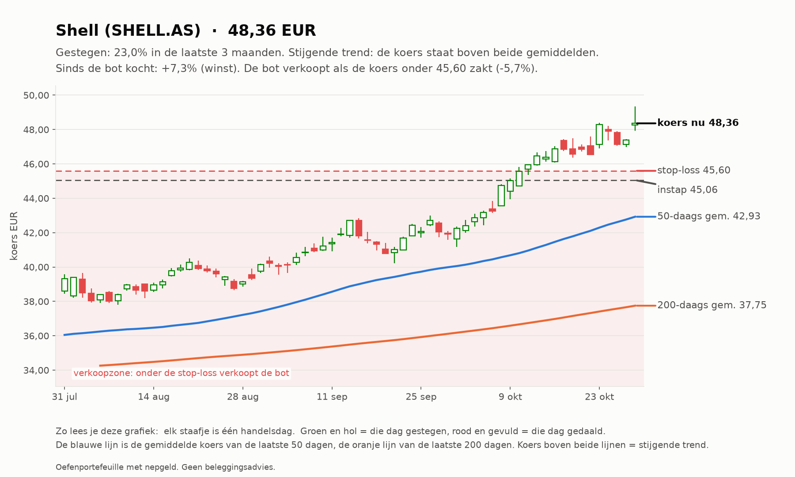
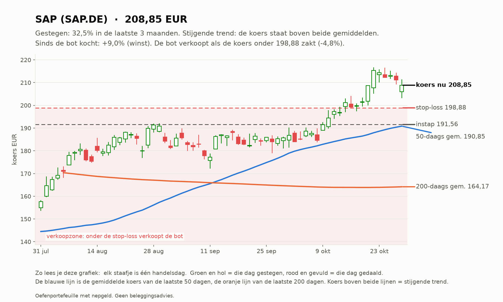
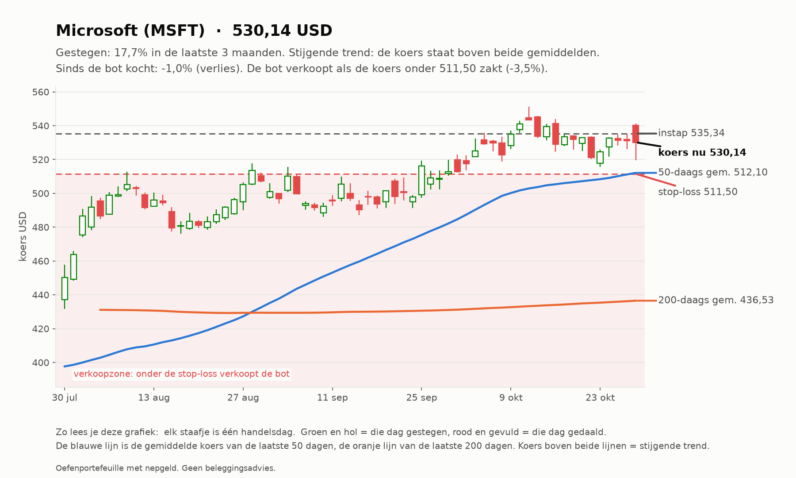
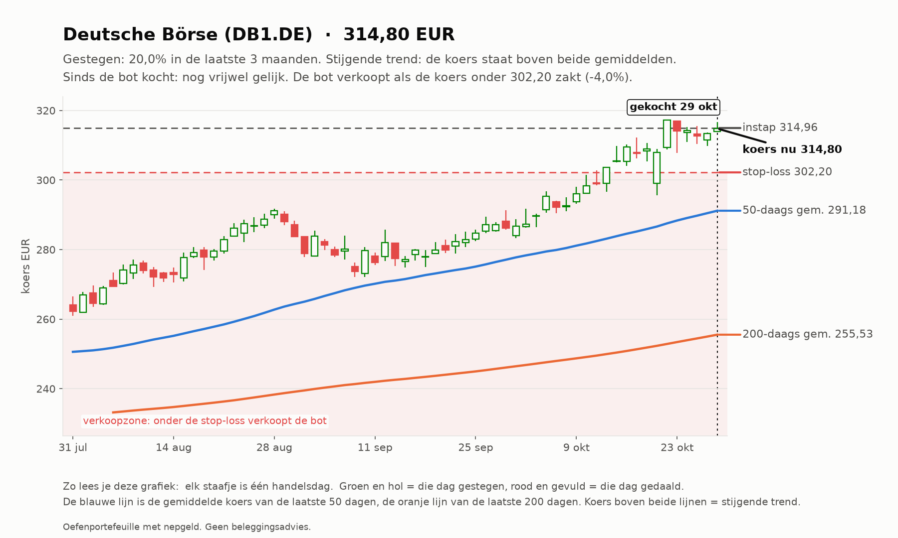
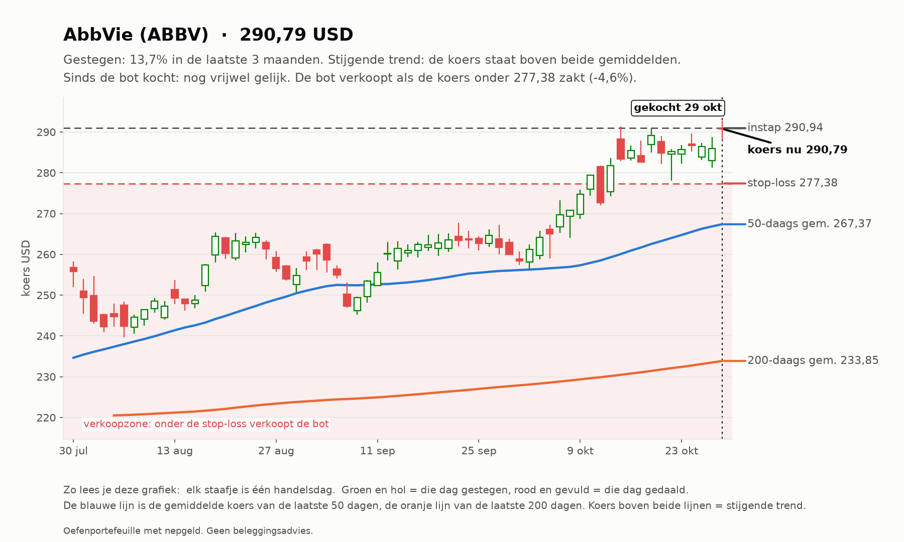

# Trend-agent rapport 2026-10-29

_Oefenportefeuille met nepgeld. Geen beleggingsadvies; resultaten uit het verleden zeggen niets over de toekomst._

**Status:** OK  
**Waarde:** €10,067.79  
**Kas:** €7,713.84  
**Marktregime:** stijgend-laag  
**Strategieversie:** trend-1.1-a0ddd5  
**Koersbronnen:** 0 bevestigd door 2 bronnen, 129 uit 1 bron, 0 afwijkend; wisselkoers bevestigd  
**Sinds start:** +0.68%  

## Analyse van vandaag

**Wat de bot zag**

- **Markt (IWDA.AS):** koers 131,56, 8,4% boven het 200-daags gemiddelde (121,33); de afgelopen maand +1,9%. Trend: **stijgend**.
- **Beweeglijkheid:** 9% op jaarbasis, tegen normaal 10% het afgelopen jaar: **laag**.
- **Breedte:** 75 van de 129 instrumenten staan boven hun 200-daags gemiddelde (58%; EU 33 van 60, US 42 van 69).
- **Bekeken:** 129 instrumenten.
- **Afgevallen** (een instrument kan op meer regels afvallen): geen stijgende trend (koers niet boven 50- en 200-daags gemiddelde): 77; niet gestegen over 1 of 3 maanden: 75; te weinig handel: 2; verdachte dagsprong: 1.
- **Door de zeef:** 36. Koopbare trends: **36**.

**Wat de bot eruit haalt**

- De markt stijgt, maar gedragen door een minderheid van de aandelen: kwetsbaarder dan het lijkt.
- De markt is rustig: stops liggen dichterbij, posities kunnen iets groter.
- De sterkste trends zijn vooral Europese instrumenten.
- Sterk zonder ver weggelopen te zijn: SAP.DE.
- Gekocht vandaag: DB1.DE, ABBV.

## Vandaag gedaan

- BUY 1 x DB1.DE @ 314.96 (trend OK: 3m +17.9%, 1m +10.0%, volume x1.09)
- BUY 2 x ABBV @ 290.94 (trend OK: 3m +16.6%, 1m +11.8%, volume x1.14)

## Waarom

- **BUY DB1.DE**: trend OK: 3m +17.9%, 1m +10.0%, volume x1.09. Omstandigheden: RSI 72, MACD-histogram +0.11%, ATR 2.0% per dag, +23.2% boven SMA200, markt stijgend-laag
- **BUY ABBV**: trend OK: 3m +16.6%, 1m +11.8%, volume x1.14. Omstandigheden: RSI 70, MACD-histogram +0.08%, ATR 2.3% per dag, +24.4% boven SMA200, markt stijgend-laag

## Verlies en risico

| Ticker | Instap | Koers nu | Resultaat | Stop | Afstand tot stop | Als de stop geraakt wordt |
| --- | --- | --- | --- | --- | --- | --- |
| SHELL.AS | 45.06 EUR | 48.36 | €42,93 (+7,3%) | 45.60 | +6,1% | €6,01 winst vastgezet |
| SAP.DE | 191.56 EUR | 208.85 | €34,59 (+9,0%) | 198.88 | +5,0% | €13,66 winst vastgezet |
| MSFT | 535.34 USD | 530.14 | -€4,32 (-1,0%) | 511.50 | +3,6% | -€21,96 verlies |
| DB1.DE | 314.96 EUR | 314.80 | -€0,16 (-0,1%) | 302.20 | +4,2% | -€13,76 verlies |
| ABBV | 290.94 USD | 290.79 | -€0,26 (-0,1%) | 277.38 | +4,8% | -€25,21 verlies |

Raken alle stops tegelijk, dan is het verlies hooguit ongeveer €60,93 (bij een koersgat 's ochtends kan het meer zijn).

**Remmen** (bij overschrijden gaat de kill switch aan en koopt de bot niets meer):

- Daling vanaf de top: -0,08% (grens -5%; top was €10.076,18)
- Vandaag: +0,01% (grens -1%)
- Verliestrades op rij: 0 van 3

## Kansen: wat de bot vandaag het sterkst vond

_Dit is wat de oefenbot met zijn nepgeld volgens zijn eigen regels zou doen. Geen advies voor echt geld; het instapmoment is een ongeteste vuistregel en wordt door de bot niet gebruikt._

### 1. Shell (SHELL.AS): instapmoment **neutraal**

- **Waarom sterk:** Shell steeg +22,7% in 3 maanden en +15,4% in 1 maand; koers boven het 50-daags en dat boven het 200-daags gemiddelde; MACD positief (de stijging versnelt); handel 1,0x het normale volume; beweegt gemiddeld 2,0% per dag.
- **Instapmoment:** de koers staat +5,0% van het 20-daags gemiddelde, RSI 73.
- **Status:** al in bezit.
- **Plan van de bot:** koop 12 stuks rond 48.38 EUR (inzet €580,61), stop-loss 46.45 EUR (-4,0%). Maximaal verlies als de stop wordt geraakt: ongeveer €25,25. Ter oriëntatie: 2x het risico winst ligt bij 52.26 EUR; de bot verkoopt daar niet vanzelf, hij laat de stop meeschuiven.

### 2. Deutsche Börse (DB1.DE): instapmoment **neutraal**

- **Waarom sterk:** Deutsche Börse steeg +17,9% in 3 maanden en +10,0% in 1 maand; koers boven het 50-daags en dat boven het 200-daags gemiddelde; MACD positief (de stijging versnelt); handel 1,1x het normale volume; beweegt gemiddeld 2,0% per dag.
- **Instapmoment:** de koers staat +3,2% van het 20-daags gemiddelde, RSI 72.
- **Status:** vandaag gekocht door de bot.
- **Plan van de bot:** koop 1 stuk rond 314.96 EUR (inzet €314,96), stop-loss 302.20 EUR (-4,0%). Maximaal verlies als de stop wordt geraakt: ongeveer €14,76. Ter oriëntatie: 2x het risico winst ligt bij 340.47 EUR; de bot verkoopt daar niet vanzelf, hij laat de stop meeschuiven.

### 3. AbbVie (ABBV): instapmoment **neutraal**

- **Waarom sterk:** AbbVie steeg +16,6% in 3 maanden en +11,8% in 1 maand; koers boven het 50-daags en dat boven het 200-daags gemiddelde; MACD positief (de stijging versnelt); handel 1,1x het normale volume; beweegt gemiddeld 2,3% per dag.
- **Instapmoment:** de koers staat +3,8% van het 20-daags gemiddelde, RSI 70.
- **Status:** vandaag gekocht door de bot.
- **Plan van de bot:** koop 2 stuks rond 290.94 USD (inzet €519,61), stop-loss 277.38 USD (-4,7%). Maximaal verlies als de stop wordt geraakt: ongeveer €26,21. Ter oriëntatie: 2x het risico winst ligt bij 318.04 USD; de bot verkoopt daar niet vanzelf, hij laat de stop meeschuiven.

### 4. Wolters Kluwer (WKL.AS): instapmoment **neutraal**

- **Waarom sterk:** Wolters Kluwer steeg +23,3% in 3 maanden en +25,0% in 1 maand; koers boven het 50-daags en dat boven het 200-daags gemiddelde; MACD positief (de stijging versnelt); handel 0,9x het normale volume; beweegt gemiddeld 2,7% per dag.
- **Instapmoment:** de koers staat +5,0% van het 20-daags gemiddelde, RSI 67.
- **Status:** niet gekocht: alle 5 plekken zijn bezet.
- **Plan van de bot:** koop 5 stuks rond 84.68 EUR (inzet €423,41), stop-loss 80.06 EUR (-5,5%). Maximaal verlies als de stop wordt geraakt: ongeveer €25,13. Ter oriëntatie: 2x het risico winst ligt bij 93.93 EUR; de bot verkoopt daar niet vanzelf, hij laat de stop meeschuiven.

### 5. SAP (SAP.DE): instapmoment **gunstig**

- **Waarom sterk:** SAP steeg +26,9% in 3 maanden en +12,5% in 1 maand; koers boven het 50-daags en dat boven het 200-daags gemiddelde; MACD positief (de stijging versnelt); handel 0,9x het normale volume; beweegt gemiddeld 2,8% per dag.
- **Instapmoment:** de trend is sterk maar de koers is niet ver weggelopen (+3,3% van het 20-daags gemiddelde, RSI 65).
- **Status:** al in bezit.
- **Plan van de bot:** koop 2 stuks rond 208.95 EUR (inzet €417,91), stop-loss 197.15 EUR (-5,7%). Maximaal verlies als de stop wordt geraakt: ongeveer €25,60. Ter oriëntatie: 2x het risico winst ligt bij 232.56 EUR; de bot verkoopt daar niet vanzelf, hij laat de stop meeschuiven.

## Wat de bot tot nu toe geleerd heeft

- Nog geen afgesloten trades. Leren begint pas als trades zijn afgesloten: dan weet de bot of een instap goed of slecht uitpakte, en onder welke omstandigheden.

## Klaar voor echt geld?

**Trend-agent:** Nog niet klaar: de bot is nog bezig met bewijzen. Blijven oefenen.

| Eis | Stand | Nu |
| --- | --- | --- |
| Oefentijd | ⏳ | 14 van 63 handelsdagen (ongeveer 3 maanden) |
| Minstens zo goed als de wereld-ETF | ⏳ | verschil tot nu toe +1,06% |
| Grootste daling onder 5% | ✅ | grootste daling tot nu toe -0,10% |
| Genoeg afgesloten trades | ⏳ | 0 van 20 |

Zo analyseert de trend-agent (klik om te openen)

1. **Data controleren.** Koersen van Yahoo, gecontroleerd bij een tweede bron en de wisselkoers bij de ECB.
   Bevroren koersen, rare sprongen of achterlopende markten: dat instrument wordt die dag niet gekocht.
2. **De markt als geheel.** Aan de hand van de wereld-ETF (IWDA) of de S&P 500: staat de koers boven het
   200-daags gemiddelde (stijgend), eronder (dalend) of ertussenin (zijwaarts)? En beweegt de markt meer of
   minder dan normaal vergeleken met het afgelopen jaar? Plus: hoeveel aandelen staan boven hun 200-daags gemiddelde (de breedte).
3. **Elk instrument door de zeef.** Een trend telt alleen als ALLES klopt: koers boven het 50-daags gemiddelde en
   dat boven het 200-daags, plus over 1 en 3 maanden gestegen, genoeg handel en geen verdachte sprong.
4. **Rangschikken.** Score = stijging (60% 3 maanden, 40% 1 maand) gedeeld door de beweeglijkheid. Een rustige,
   stevige stijger wint van een wilde.
5. **Risico bepalen.** Stop-loss op 2x de gemiddelde dagbeweging (ATR) onder de instap. Het aantal stuks wordt zo
   gekozen dat de stop hooguit 0,25% van het vermogen kost.
6. **Beheren.** De stop schuift mee omhoog (3x ATR onder de hoogste slotkoers). Verkopen bij stop of als de koers
   onder het 50-daags gemiddelde sluit.

## Open posities

| Ticker | Aantal | Instap | Stop | Sinds |
| --- | --- | --- | --- | --- |
| SHELL.AS | 13 | 45.06 EUR | 45.60 | 2026-10-10 |
| SAP.DE | 2 | 191.56 EUR | 198.88 | 2026-10-10 |
| MSFT | 1 | 535.34 USD | 511.50 | 2026-10-10 |
| DB1.DE | 1 | 314.96 EUR | 302.20 | 2026-10-29 |
| ABBV | 2 | 290.94 USD | 277.38 | 2026-10-29 |

## Sterkste trends vandaag

| # | Ticker | Score | 3 mnd | 1 mnd |
| --- | --- | --- | --- | --- |
| 1 | SHELL.AS | 0.165 | +22.7% | +15.4% |
| 2 | DB1.DE | 0.149 | +17.9% | +10.0% |
| 3 | ABBV | 0.130 | +16.6% | +11.8% |
| 4 | WKL.AS | 0.121 | +23.3% | +25.0% |
| 5 | SAP.DE | 0.115 | +26.9% | +12.5% |
| 6 | CVX | 0.114 | +18.6% | +13.3% |
| 7 | TMO | 0.114 | +23.6% | +5.1% |
| 8 | MA | 0.110 | +11.1% | +15.4% |
| 9 | V | 0.109 | +12.3% | +14.3% |
| 10 | XLE | 0.108 | +16.1% | +11.7% |

## Grafieken (laatste 3 maanden)

_Grafieken worden 20 handelsdagen bewaard._
