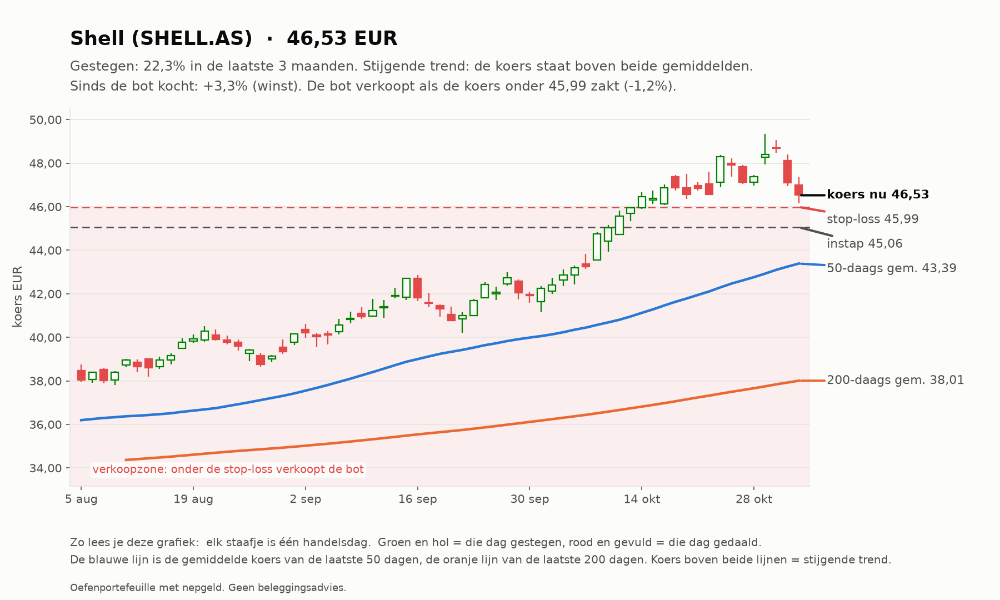
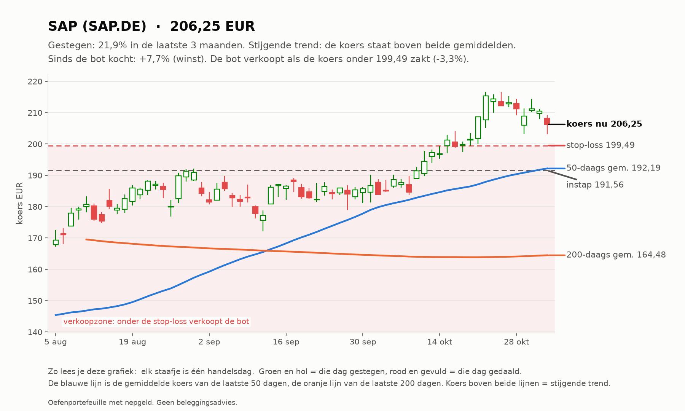
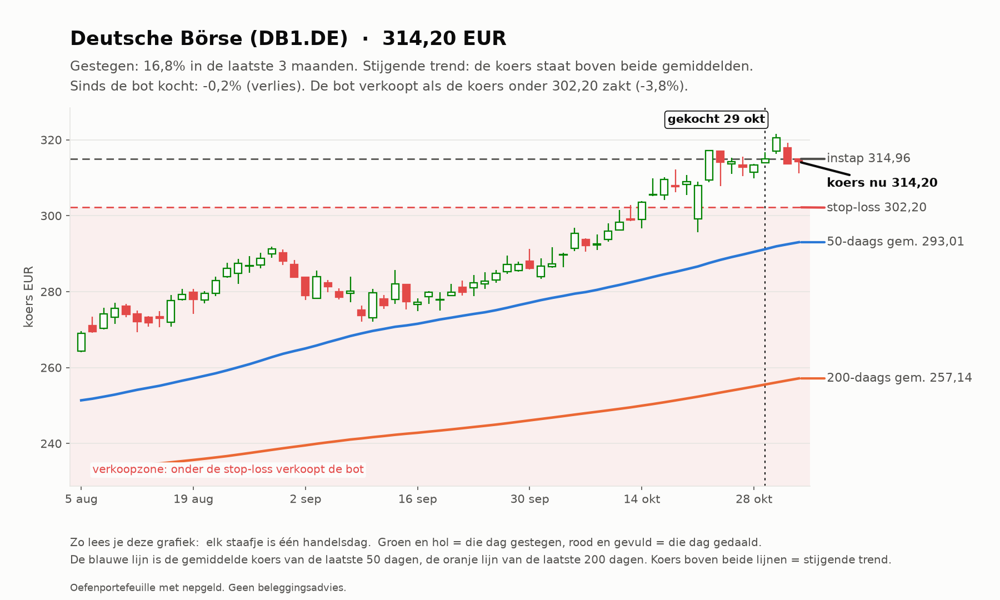
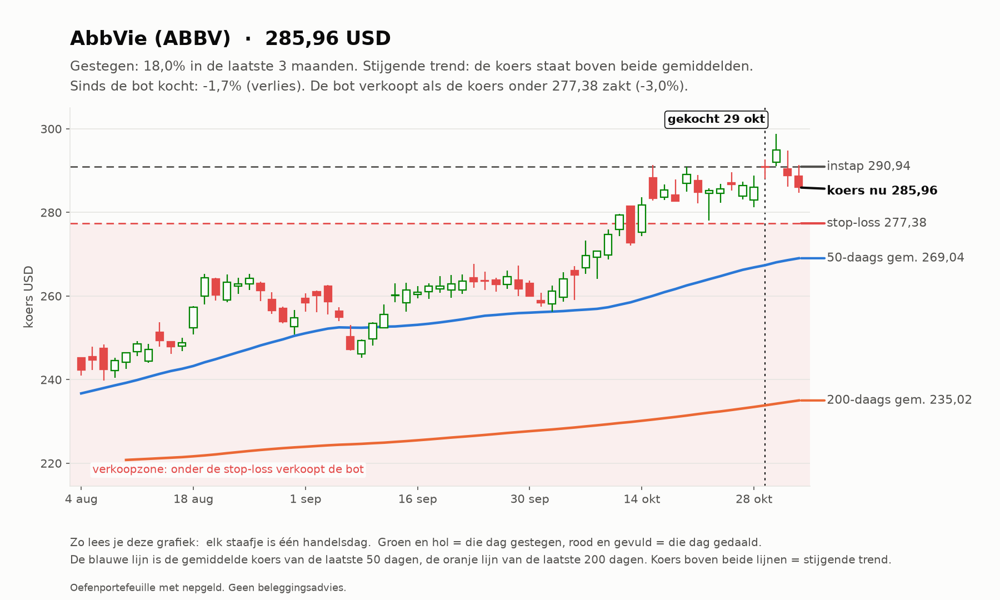
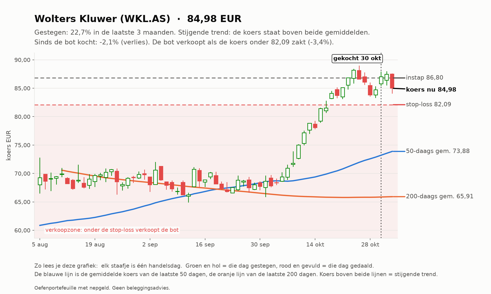
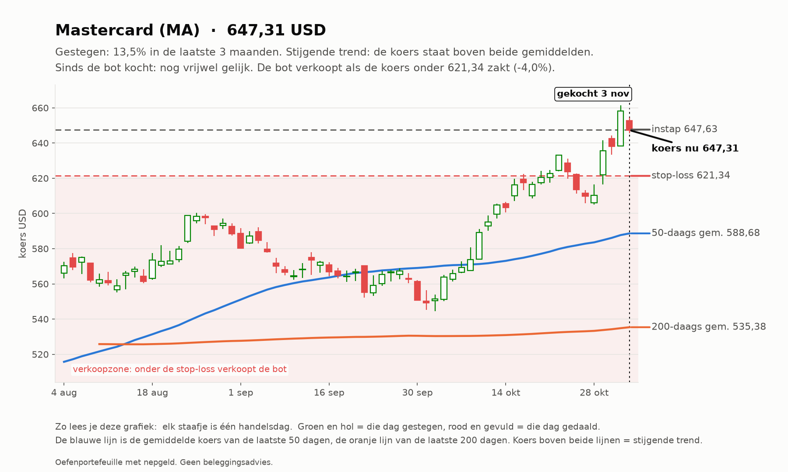
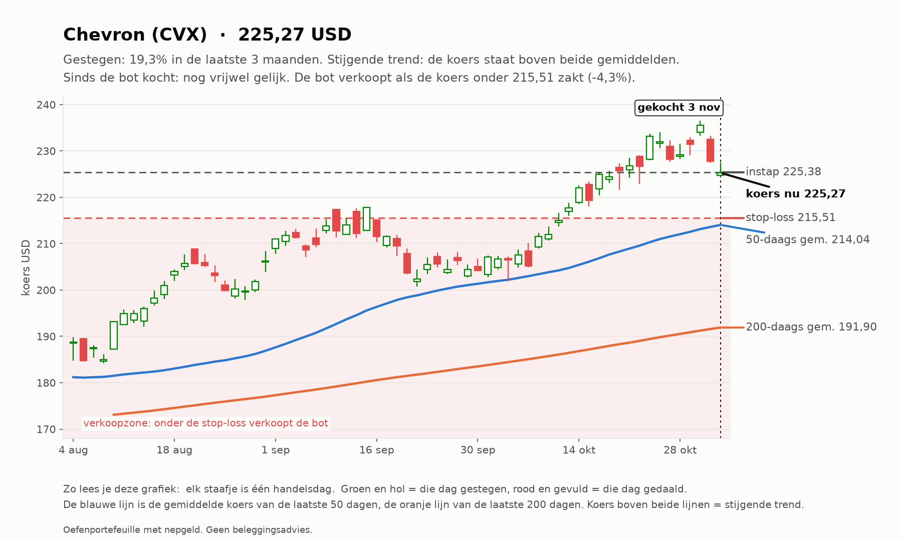
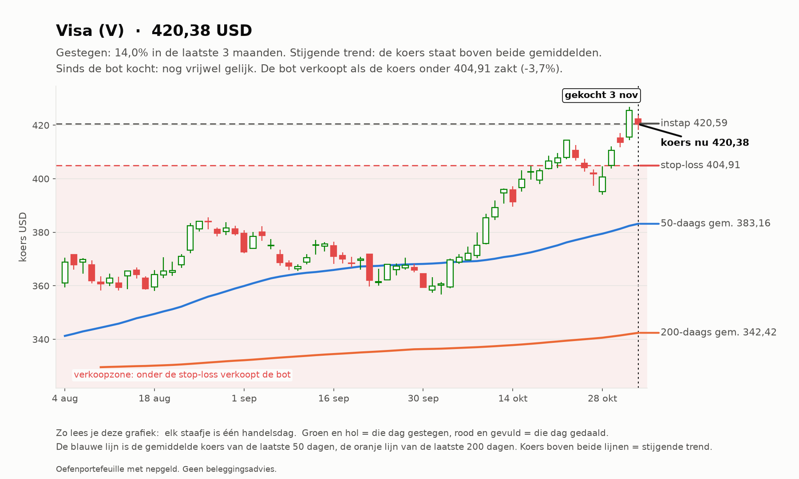
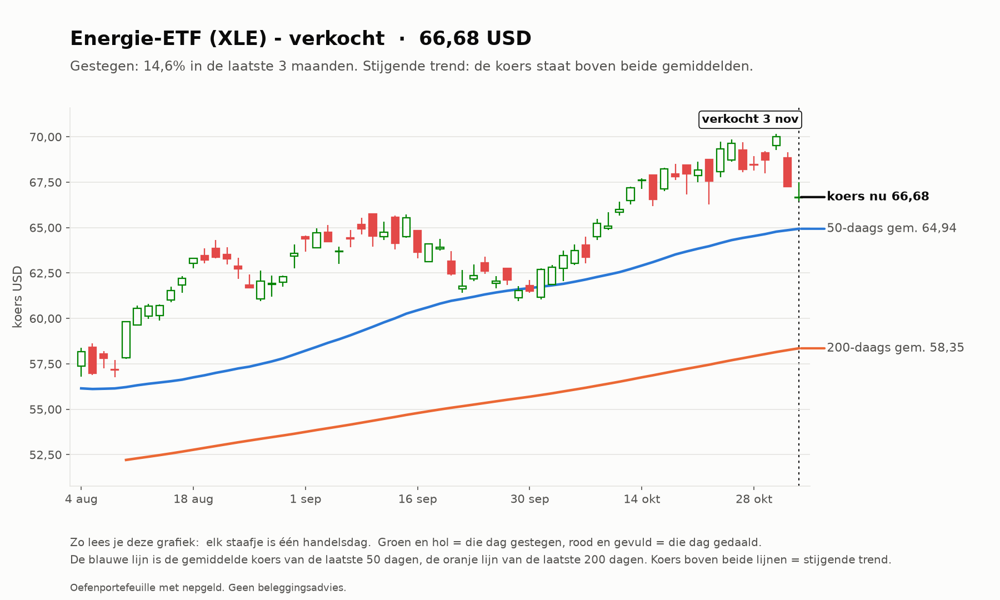

# Trend-agent rapport 2026-11-03

_Oefenportefeuille met nepgeld. Geen beleggingsadvies; resultaten uit het verleden zeggen niets over de toekomst._

**Status:** OK  
**Waarde:** €9,858.52  
**Kas:** €3,894.94  
**Marktregime:** stijgend-normaal  
**Strategieversie:** trend-1.1-081d85  
**Koersbronnen:** 69 bevestigd door 2 bronnen, 60 uit 1 bron, 0 afwijkend; wisselkoers bevestigd  
**Sinds start:** -1.41%  

## Analyse van vandaag

**Wat de bot zag**

- **Markt (IWDA.AS):** koers 129,13, 6,2% boven het 200-daags gemiddelde (121,59); de afgelopen maand -1,6%. Trend: **stijgend**.
- **Beweeglijkheid:** 9% op jaarbasis, tegen normaal 10% het afgelopen jaar: **normaal**.
- **Breedte:** 75 van de 129 instrumenten staan boven hun 200-daags gemiddelde (58%; EU 34 van 60, US 41 van 69).
- **Bekeken:** 129 instrumenten.
- **Afgevallen** (een instrument kan op meer regels afvallen): geen stijgende trend (koers niet boven 50- en 200-daags gemiddelde): 88; niet gestegen over 1 of 3 maanden: 81; te weinig handel: 2; verdachte dagsprong: 1.
- **Door de zeef:** 33. Koopbare trends: **33**.

**Wat de bot eruit haalt**

- De markt stijgt, maar gedragen door een minderheid van de aandelen: kwetsbaarder dan het lijkt.
- Sterk zonder ver weggelopen te zijn: DB1.DE, SHELL.AS, WKL.AS, ABBV.
- Gekocht vandaag: MA, CVX, V.

## Vandaag gedaan

- SELL 5 x CVX @ 224.60 (stop-loss geraakt, resultaat €-58.74)
- SELL 19 x XLE @ 66.60 (stop-loss geraakt, resultaat €-68.73)
- LLY: overgeslagen (RSI 76 boven 75)
- BUY 2 x MA @ 647.63 (trend OK: 3m +13.6%, 1m +14.8%, volume x1.12)
- BUY 5 x CVX @ 225.38 (trend OK: 3m +21.9%, 1m +9.1%, volume x0.93)
- BUY 3 x V @ 420.59 (trend OK: 3m +14.3%, 1m +13.7%, volume x1.02)

## Waarom

- **SELL CVX**: stop-loss geraakt. Omstandigheden: RSI 55, MACD-histogram -0.13%, ATR 2.2% per dag, +17.4% boven SMA200, markt stijgend-normaal, R = -1.35 na 4 dagen
- **SELL XLE**: stop-loss geraakt. Omstandigheden: RSI 50, MACD-histogram -0.33%, ATR 2.4% per dag, +14.3% boven SMA200, markt stijgend-normaal, R = -1.39 na 4 dagen
- **BUY MA**: trend OK: 3m +13.6%, 1m +14.8%, volume x1.12. Omstandigheden: RSI 69, MACD-histogram +0.44%, ATR 2.0% per dag, +20.9% boven SMA200, markt stijgend-normaal
- **BUY CVX**: trend OK: 3m +21.9%, 1m +9.1%, volume x0.93. Omstandigheden: RSI 55, MACD-histogram -0.13%, ATR 2.2% per dag, +17.4% boven SMA200, markt stijgend-normaal
- **BUY V**: trend OK: 3m +14.3%, 1m +13.7%, volume x1.02. Omstandigheden: RSI 69, MACD-histogram +0.30%, ATR 1.9% per dag, +22.8% boven SMA200, markt stijgend-normaal

## Verlies en risico

| Ticker | Instap | Koers nu | Resultaat | Stop | Afstand tot stop | Als de stop geraakt wordt |
| --- | --- | --- | --- | --- | --- | --- |
| SHELL.AS | 45.06 EUR | 46.52 | €19,08 (+3,3%) | 45.99 | +1,2% | €11,07 winst vastgezet |
| SAP.DE | 191.56 EUR | 206.25 | €29,39 (+7,7%) | 199.49 | +3,4% | €14,87 winst vastgezet |
| DB1.DE | 314.96 EUR | 314.20 | -€0,76 (-0,2%) | 302.20 | +4,0% | -€13,76 verlies |
| ABBV | 290.94 USD | 285.96 | -€11,12 (-1,7%) | 277.38 | +3,1% | -€27,37 verlies |
| WKL.AS | 86.80 EUR | 84.98 | -€18,23 (-2,1%) | 82.09 | +3,5% | -€48,09 verlies |
| MA | 647.63 USD | 647.31 | -€0,58 (-0,1%) | 621.34 | +4,2% | -€47,75 verlies |
| CVX | 225.38 USD | 225.27 | -€0,50 (-0,1%) | 215.51 | +4,5% | -€44,88 verlies |
| V | 420.59 USD | 420.38 | -€0,56 (-0,1%) | 404.91 | +3,8% | -€42,83 verlies |

Raken alle stops tegelijk, dan is het verlies hooguit ongeveer €224,68 (bij een koersgat 's ochtends kan het meer zijn).

**Remmen** (bij overschrijden gaat de kill switch aan en koopt de bot niets meer):

- Daling vanaf de top: -0,86% (grens -10%; top was €9.944,33)
- Vandaag: -0,86% (grens -1%)
- Verliestrades op rij: 2 van 3

## Kansen: wat de bot vandaag het sterkst vond

_Dit is wat de oefenbot met zijn nepgeld volgens zijn eigen regels zou doen. Geen advies voor echt geld; het instapmoment is een ongeteste vuistregel en wordt door de bot niet gebruikt._

### 1. Deutsche Börse (DB1.DE): instapmoment **gunstig**

- **Waarom sterk:** Deutsche Börse steeg +16,6% in 3 maanden en +8,5% in 1 maand; koers boven het 50-daags en dat boven het 200-daags gemiddelde; MACD negatief (de stijging vertraagt); handel 1,1x het normale volume; beweegt gemiddeld 2,0% per dag.
- **Instapmoment:** de trend is sterk maar de koers is niet ver weggelopen (+2,1% van het 20-daags gemiddelde, RSI 64).
- **Status:** al in bezit.
- **Plan van de bot:** koop 3 stuks rond 314.36 EUR (inzet €943,07), stop-loss 301.57 EUR (-4,1%). Maximaal verlies als de stop wordt geraakt: ongeveer €40,36. Ter oriëntatie: 2x het risico winst ligt bij 339.93 EUR; de bot verkoopt daar niet vanzelf, hij laat de stop meeschuiven.

### 2. Shell (SHELL.AS): instapmoment **gunstig**

- **Waarom sterk:** Shell steeg +21,2% in 3 maanden en +8,5% in 1 maand; koers boven het 50-daags en dat boven het 200-daags gemiddelde; MACD negatief (de stijging vertraagt); handel 1,0x het normale volume; beweegt gemiddeld 2,2% per dag.
- **Instapmoment:** de trend is sterk maar de koers is niet ver weggelopen (+0,3% van het 20-daags gemiddelde, RSI 55).
- **Status:** al in bezit.
- **Plan van de bot:** koop 23 stuks rond 46.55 EUR (inzet €1.070,61), stop-loss 44.45 EUR (-4,5%). Maximaal verlies als de stop wordt geraakt: ongeveer €50,22. Ter oriëntatie: 2x het risico winst ligt bij 50.74 EUR; de bot verkoopt daar niet vanzelf, hij laat de stop meeschuiven.

### 3. Wolters Kluwer (WKL.AS): instapmoment **gunstig**

- **Waarom sterk:** Wolters Kluwer steeg +23,8% in 3 maanden en +24,4% in 1 maand; koers boven het 50-daags en dat boven het 200-daags gemiddelde; MACD negatief (de stijging vertraagt); handel 0,9x het normale volume; beweegt gemiddeld 3,0% per dag.
- **Instapmoment:** de trend is sterk maar de koers is niet ver weggelopen (+3,5% van het 20-daags gemiddelde, RSI 63).
- **Status:** al in bezit.
- **Plan van de bot:** koop 9 stuks rond 85.02 EUR (inzet €765,20), stop-loss 79.94 EUR (-6,0%). Maximaal verlies als de stop wordt geraakt: ongeveer €47,75. Ter oriëntatie: 2x het risico winst ligt bij 95.19 EUR; de bot verkoopt daar niet vanzelf, hij laat de stop meeschuiven.

### 4. AbbVie (ABBV): instapmoment **gunstig**

- **Waarom sterk:** AbbVie steeg +16,9% in 3 maanden en +8,3% in 1 maand; koers boven het 50-daags en dat boven het 200-daags gemiddelde; MACD negatief (de stijging vertraagt); handel 1,1x het normale volume; beweegt gemiddeld 2,3% per dag.
- **Instapmoment:** de trend is sterk maar de koers is niet ver weggelopen (+1,2% van het 20-daags gemiddelde, RSI 58).
- **Status:** al in bezit.
- **Plan van de bot:** koop 4 stuks rond 286.10 USD (inzet €1.017,50), stop-loss 272.92 USD (-4,6%). Maximaal verlies als de stop wordt geraakt: ongeveer €48,89. Ter oriëntatie: 2x het risico winst ligt bij 312.48 USD; de bot verkoopt daar niet vanzelf, hij laat de stop meeschuiven.

### 5. Eli Lilly (LLY): instapmoment **opgelopen**

- **Waarom sterk:** Eli Lilly steeg +20,6% in 3 maanden en +23,3% in 1 maand; koers boven het 50-daags en dat boven het 200-daags gemiddelde; MACD positief (de stijging versnelt); handel 1,1x het normale volume; beweegt gemiddeld 3,4% per dag.
- **Instapmoment:** de koers staat +9,0% van het 20-daags gemiddelde (2,7x de normale dagbeweging) en RSI is 76; na zo'n sprint volgt vaak eerst een terugval.
- **Status:** niet gekocht: RSI 76 boven de grens 75.
- **Plan van de bot:** instap rond 1410.09 USD, stop 1313.84 USD (-6,8%). Met een risicobudget van €49,29 past er geen heel stuk in.

## Wat de bot tot nu toe geleerd heeft

- 3 afgesloten trades: 0 met winst (0%), gemiddeld -1,23 R per trade (R = winst of verlies gedeeld door het risico bij instap), totaal -€150,20.
- Pas vanaf 20 trades trekt de bot conclusies over welke omstandigheden goed of slecht uitpakken; met minder is het vooral toeval. Het wekelijkse onderzoek (zaterdag) doet dat.

## Klaar voor echt geld?

**Trend-agent:** Nog niet klaar: de bot is nog bezig met bewijzen. Blijven oefenen.

| Eis | Stand | Nu |
| --- | --- | --- |
| Oefentijd | ⏳ | 17 van 63 handelsdagen (ongeveer 3 maanden) |
| Minstens zo goed als de wereld-ETF | ⏳ | verschil tot nu toe +0,81% |
| Grootste daling onder 5% | ✅ | grootste daling tot nu toe -2,18% |
| Genoeg afgesloten trades | ⏳ | 3 van 20 |

Zo analyseert de trend-agent (klik om te openen)

1. **Data controleren.** Koersen van Yahoo, gecontroleerd bij een tweede bron en de wisselkoers bij de ECB.
   Bevroren koersen, rare sprongen of achterlopende markten: dat instrument wordt die dag niet gekocht.
2. **De markt als geheel.** Aan de hand van de wereld-ETF (IWDA) of de S&P 500: staat de koers boven het
   200-daags gemiddelde (stijgend), eronder (dalend) of ertussenin (zijwaarts)? En beweegt de markt meer of
   minder dan normaal vergeleken met het afgelopen jaar? Plus: hoeveel aandelen staan boven hun 200-daags gemiddelde (de breedte).
3. **Elk instrument door de zeef.** Een trend telt alleen als ALLES klopt: koers boven het 50-daags gemiddelde en
   dat boven het 200-daags, plus over 1 en 3 maanden gestegen, genoeg handel en geen verdachte sprong.
4. **Rangschikken.** Score = stijging (60% 3 maanden, 40% 1 maand) gedeeld door de beweeglijkheid. Een rustige,
   stevige stijger wint van een wilde.
5. **Risico bepalen.** Stop-loss op 2x de gemiddelde dagbeweging (ATR) onder de instap. Het aantal stuks wordt zo
   gekozen dat de stop hooguit 0,25% van het vermogen kost.
6. **Beheren.** De stop schuift mee omhoog (3x ATR onder de hoogste slotkoers). Verkopen bij stop of als de koers
   onder het 50-daags gemiddelde sluit.

## Open posities

| Ticker | Aantal | Instap | Stop | Sinds |
| --- | --- | --- | --- | --- |
| SHELL.AS | 13 | 45.06 EUR | 45.99 | 2026-10-10 |
| SAP.DE | 2 | 191.56 EUR | 199.49 | 2026-10-10 |
| DB1.DE | 1 | 314.96 EUR | 302.20 | 2026-10-29 |
| ABBV | 2 | 290.94 USD | 277.38 | 2026-10-29 |
| WKL.AS | 10 | 86.80 EUR | 82.09 | 2026-10-30 |
| MA | 2 | 647.63 USD | 621.34 | 2026-11-03 |
| CVX | 5 | 225.38 USD | 215.51 | 2026-11-03 |
| V | 3 | 420.59 USD | 404.91 | 2026-11-03 |

## Sterkste trends vandaag

| # | Ticker | Score | 3 mnd | 1 mnd |
| --- | --- | --- | --- | --- |
| 1 | DB1.DE | 0.134 | +16.6% | +8.5% |
| 2 | SHELL.AS | 0.130 | +21.2% | +8.5% |
| 3 | WKL.AS | 0.121 | +23.8% | +24.4% |
| 4 | ABBV | 0.119 | +16.9% | +8.3% |
| 5 | LLY | 0.119 | +20.6% | +23.3% |
| 6 | MA | 0.119 | +13.6% | +14.8% |
| 7 | CVX | 0.114 | +21.9% | +9.1% |
| 8 | V | 0.114 | +14.3% | +13.7% |
| 9 | OR.PA | 0.105 | +10.8% | +15.9% |
| 10 | MUV2.DE | 0.104 | +9.1% | +11.8% |

## Afgesloten trades

3 trades, 0 winst (0%), totaal €-150.20 na kosten.

## Grafieken (laatste 3 maanden)

_Grafieken worden 20 handelsdagen bewaard._
