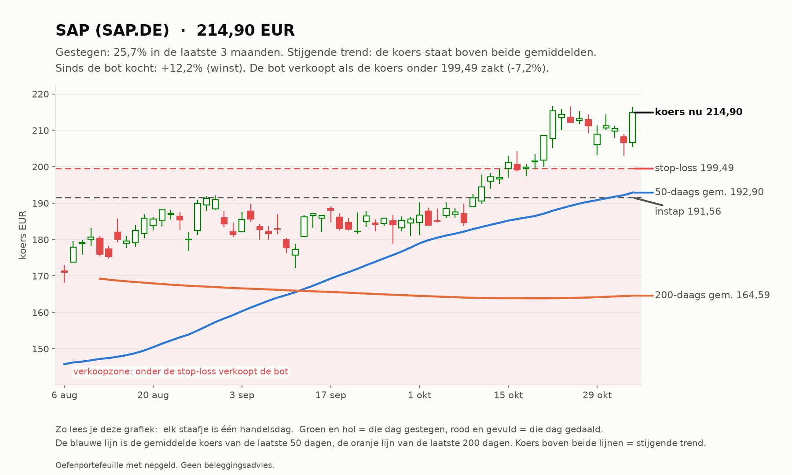
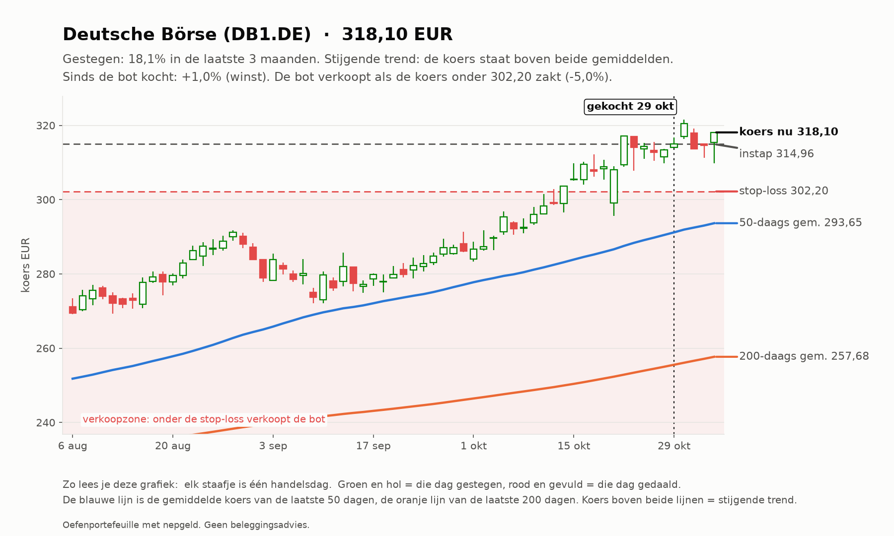
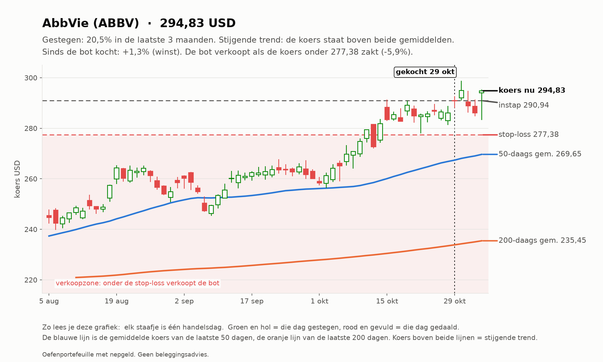
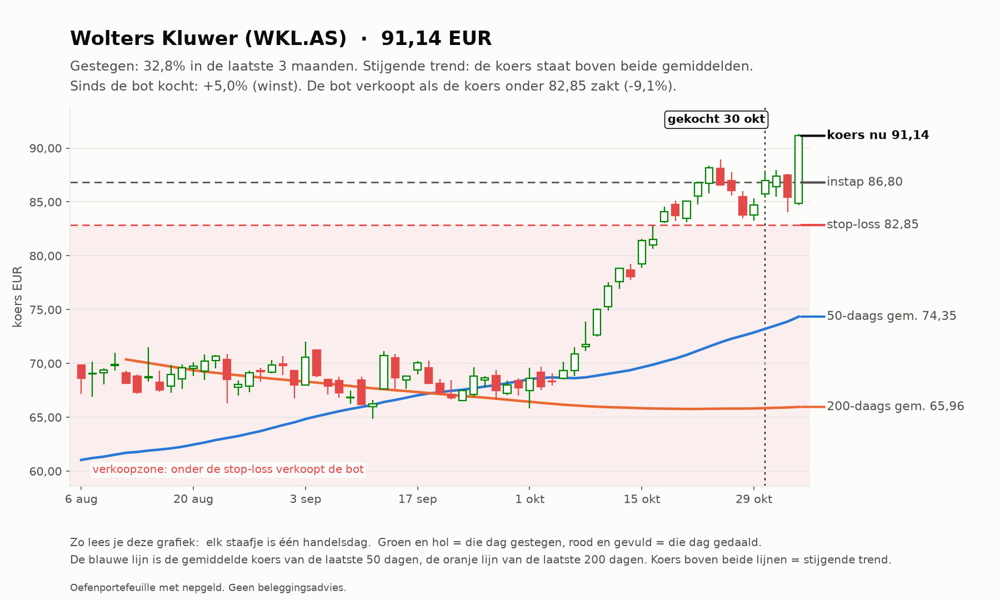
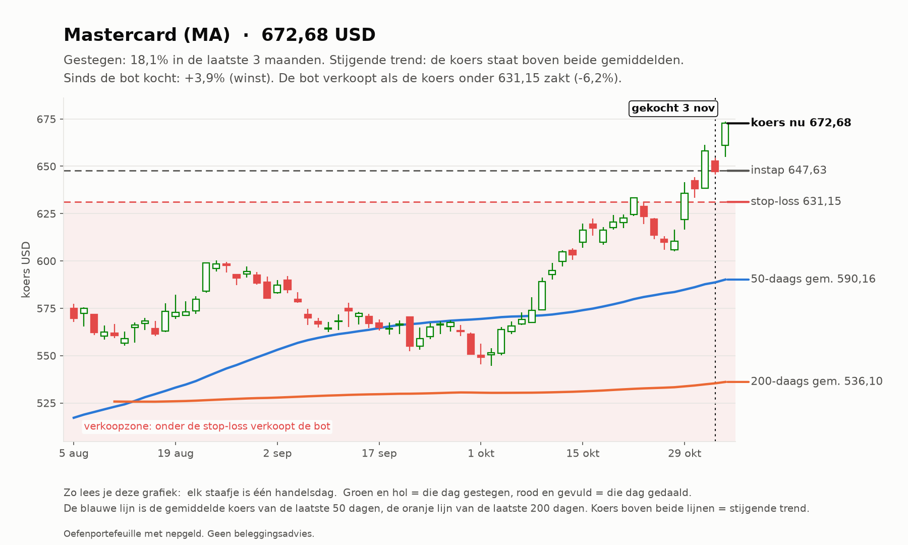
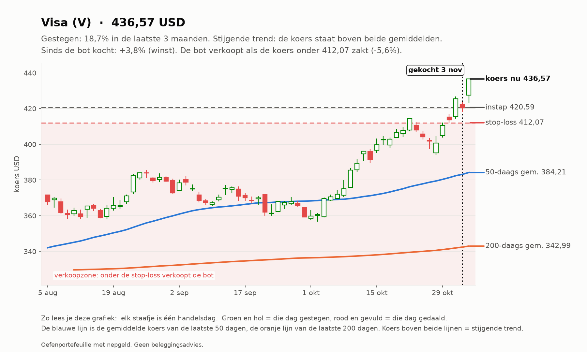
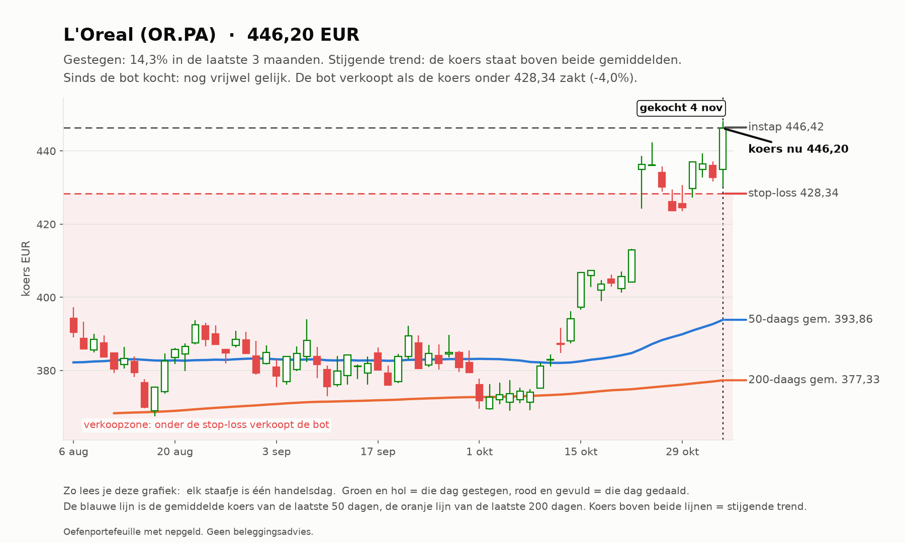
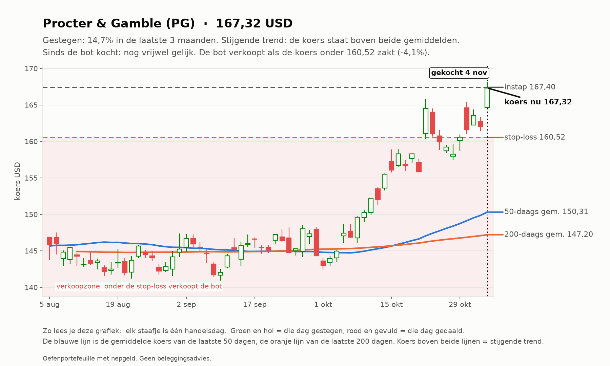
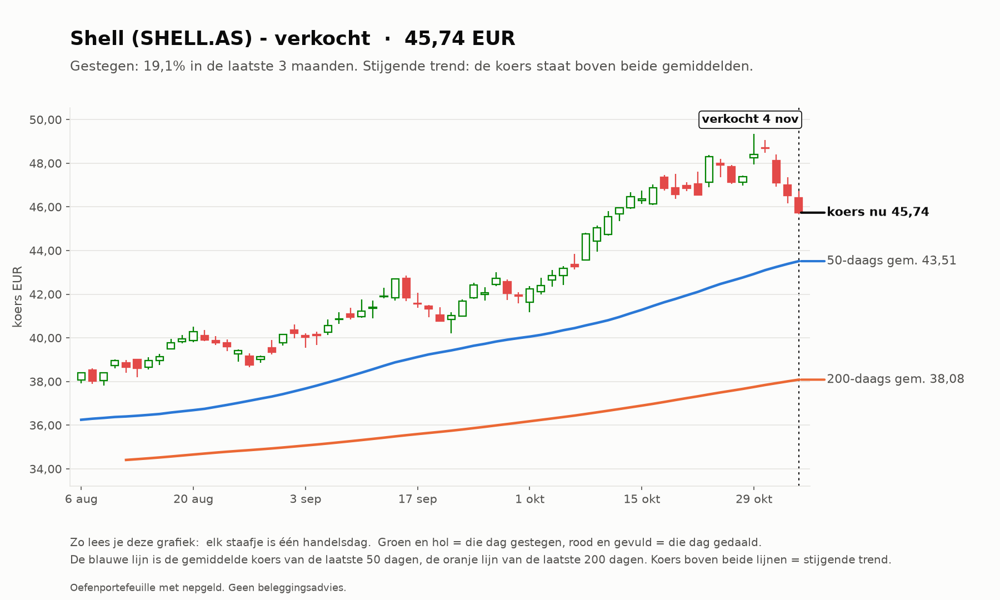
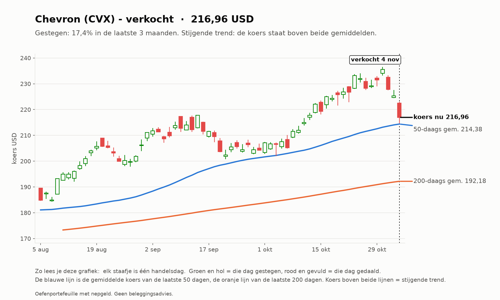

# Trend-agent rapport 2026-11-04

_Oefenportefeuille met nepgeld. Geen beleggingsadvies; resultaten uit het verleden zeggen niets over de toekomst._

**Status:** OK  
**Waarde:** €9,987.03  
**Kas:** €3,362.61  
**Marktregime:** stijgend-normaal  
**Strategieversie:** trend-1.1-081d85  
**Koersbronnen:** 69 bevestigd door 2 bronnen, 60 uit 1 bron, 0 afwijkend; wisselkoers bevestigd  
**Sinds start:** -0.13%  

## Analyse van vandaag

**Wat de bot zag**

- **Markt (IWDA.AS):** koers 130,33, 7,1% boven het 200-daags gemiddelde (121,67); de afgelopen maand -1,2%. Trend: **stijgend**.
- **Beweeglijkheid:** 10% op jaarbasis, tegen normaal 10% het afgelopen jaar: **normaal**.
- **Breedte:** 86 van de 129 instrumenten staan boven hun 200-daags gemiddelde (67%; EU 39 van 60, US 47 van 69).
- **Bekeken:** 129 instrumenten.
- **Afgevallen** (een instrument kan op meer regels afvallen): geen stijgende trend (koers niet boven 50- en 200-daags gemiddelde): 81; niet gestegen over 1 of 3 maanden: 69; te weinig handel: 2; verdachte dagsprong: 1.
- **Door de zeef:** 39. Koopbare trends: **39**.

**Wat de bot eruit haalt**

- De markt stijgt breed: goede omstandigheden voor trendvolgen.
- 4 van de 5 sterkste staan al ver boven hun gemiddelde (WKL.AS, MA, V, MUV2.DE): de trend is sterk, maar instappen op zo'n moment kost vaker een terugval.
- Gekocht vandaag: OR.PA, PG.

## Vandaag gedaan

- SELL 13 x SHELL.AS @ 45.96 (stop-loss geraakt, resultaat €+9.77)
- WKL.AS: stop omhoog van 82.09 naar 82.85
- MA: stop omhoog van 621.34 naar 631.15
- SELL 5 x CVX @ 215.40 (stop-loss geraakt, resultaat €-46.89)
- V: stop omhoog van 404.91 naar 412.07
- MUV2.DE: overgeslagen (RSI 84 boven 75)
- BUY 2 x OR.PA @ 446.42 (trend OK: 3m +15.6%, 1m +19.4%, volume x1.18)
- BRK-B: overgeslagen (RSI 83 boven 75)
- BUY 8 x PG @ 167.40 (trend OK: 3m +14.6%, 1m +13.5%, volume x1.13)

## Waarom

- **SELL SHELL.AS**: stop-loss geraakt. Omstandigheden: RSI 50, MACD-histogram -0.66%, ATR 2.4% per dag, +20.1% boven SMA200, markt stijgend-normaal, R = +0.40 na 25 dagen
- **SELL CVX**: stop-loss geraakt. Omstandigheden: RSI 45, MACD-histogram -0.56%, ATR 2.5% per dag, +12.9% boven SMA200, markt stijgend-normaal, R = -1.04 na 1 dagen
- **BUY OR.PA**: trend OK: 3m +15.6%, 1m +19.4%, volume x1.18. Omstandigheden: RSI 74, MACD-histogram +0.54%, ATR 2.0% per dag, +18.2% boven SMA200, markt stijgend-normaal
- **BUY PG**: trend OK: 3m +14.6%, 1m +13.5%, volume x1.13. Omstandigheden: RSI 70, MACD-histogram +0.25%, ATR 2.1% per dag, +13.7% boven SMA200, markt stijgend-normaal

## Verlies en risico

| Ticker | Instap | Koers nu | Resultaat | Stop | Afstand tot stop | Als de stop geraakt wordt |
| --- | --- | --- | --- | --- | --- | --- |
| SAP.DE | 191.56 EUR | 214.90 | €46,69 (+12,2%) | 199.49 | +7,7% | €14,87 winst vastgezet |
| DB1.DE | 314.96 EUR | 318.10 | €3,14 (+1,0%) | 302.20 | +5,3% | -€13,76 verlies |
| ABBV | 290.94 USD | 294.83 | €4,36 (+1,3%) | 277.38 | +6,3% | -€27,65 verlies |
| WKL.AS | 86.80 EUR | 91.14 | €43,37 (+5,0%) | 82.85 | +10,0% | -€40,52 verlies |
| MA | 647.63 USD | 672.68 | €43,86 (+3,9%) | 631.15 | +6,6% | -€30,94 verlies |
| V | 420.59 USD | 436.57 | €41,97 (+3,8%) | 412.07 | +5,9% | -€24,35 verlies |
| OR.PA | 446.42 EUR | 446.20 | -€0,45 (-0,1%) | 428.34 | +4,2% | -€37,16 verlies |
| PG | 167.40 USD | 167.32 | -€0,59 (-0,1%) | 160.52 | +4,2% | -€49,90 verlies |

Raken alle stops tegelijk, dan is het verlies hooguit ongeveer €224,28 (bij een koersgat 's ochtends kan het meer zijn).

**Remmen** (bij overschrijden gaat de kill switch aan en koopt de bot niets meer):

- Daling vanaf de top: +0,00% (grens -10%; top was €9.987,03)
- Vandaag: +1,30% (grens -1%)
- Verliestrades op rij: 1 van 3

## Kansen: wat de bot vandaag het sterkst vond

_Dit is wat de oefenbot met zijn nepgeld volgens zijn eigen regels zou doen. Geen advies voor echt geld; het instapmoment is een ongeteste vuistregel en wordt door de bot niet gebruikt._

### 1. Wolters Kluwer (WKL.AS): instapmoment **opgelopen**

- **Waarom sterk:** Wolters Kluwer steeg +31,9% in 3 maanden en +31,4% in 1 maand; koers boven het 50-daags en dat boven het 200-daags gemiddelde; MACD positief (de stijging versnelt); handel 0,9x het normale volume; beweegt gemiddeld 3,0% per dag.
- **Instapmoment:** de koers staat +9,8% van het 20-daags gemiddelde (3,2x de normale dagbeweging) en RSI is 73; na zo'n sprint volgt vaak eerst een terugval.
- **Status:** al in bezit.
- **Plan van de bot:** koop 9 stuks rond 91.19 EUR (inzet €820,67), stop-loss 85.66 EUR (-6,1%). Maximaal verlies als de stop wordt geraakt: ongeveer €51,73. Ter oriëntatie: 2x het risico winst ligt bij 102.24 EUR; de bot verkoopt daar niet vanzelf, hij laat de stop meeschuiven.

### 2. AbbVie (ABBV): instapmoment **neutraal**

- **Waarom sterk:** AbbVie steeg +21,6% in 3 maanden en +11,2% in 1 maand; koers boven het 50-daags en dat boven het 200-daags gemiddelde; MACD negatief (de stijging vertraagt); handel 1,2x het normale volume; beweegt gemiddeld 2,3% per dag.
- **Instapmoment:** de koers staat +3,9% van het 20-daags gemiddelde, RSI 66.
- **Status:** al in bezit.
- **Plan van de bot:** koop 4 stuks rond 294.98 USD (inzet €1.048,47), stop-loss 281.44 USD (-4,6%). Maximaal verlies als de stop wordt geraakt: ongeveer €50,10. Ter oriëntatie: 2x het risico winst ligt bij 322.04 USD; de bot verkoopt daar niet vanzelf, hij laat de stop meeschuiven.

### 3. Mastercard (MA): instapmoment **opgelopen**

- **Waarom sterk:** Mastercard steeg +17,0% in 3 maanden en +18,9% in 1 maand; koers boven het 50-daags en dat boven het 200-daags gemiddelde; MACD positief (de stijging versnelt); handel 1,2x het normale volume; beweegt gemiddeld 2,1% per dag.
- **Instapmoment:** de koers staat +8,2% van het 20-daags gemiddelde (4,0x de normale dagbeweging) en RSI is 75; na zo'n sprint volgt vaak eerst een terugval.
- **Status:** al in bezit.
- **Plan van de bot:** koop 2 stuks rond 673.02 USD (inzet €1.196,08), stop-loss 645.33 USD (-4,1%). Maximaal verlies als de stop wordt geraakt: ongeveer €51,20. Ter oriëntatie: 2x het risico winst ligt bij 728.39 USD; de bot verkoopt daar niet vanzelf, hij laat de stop meeschuiven.

### 4. Visa (V): instapmoment **opgelopen**

- **Waarom sterk:** Visa steeg +18,1% in 3 maanden en +17,8% in 1 maand; koers boven het 50-daags en dat boven het 200-daags gemiddelde; MACD positief (de stijging versnelt); handel 1,1x het normale volume; beweegt gemiddeld 1,9% per dag.
- **Instapmoment:** de koers staat +7,7% van het 20-daags gemiddelde (4,1x de normale dagbeweging) en RSI is 76; na zo'n sprint volgt vaak eerst een terugval.
- **Status:** al in bezit.
- **Plan van de bot:** koop 3 stuks rond 436.79 USD (inzet €1.164,39), stop-loss 420.45 USD (-3,7%). Maximaal verlies als de stop wordt geraakt: ongeveer €45,54. Ter oriëntatie: 2x het risico winst ligt bij 469.46 USD; de bot verkoopt daar niet vanzelf, hij laat de stop meeschuiven.

### 5. Munich Re (MUV2.DE): instapmoment **opgelopen**

- **Waarom sterk:** Munich Re steeg +13,5% in 3 maanden en +14,2% in 1 maand; koers boven het 50-daags en dat boven het 200-daags gemiddelde; MACD positief (de stijging versnelt); handel 0,9x het normale volume; beweegt gemiddeld 1,6% per dag.
- **Instapmoment:** de koers staat +6,0% van het 20-daags gemiddelde (3,8x de normale dagbeweging) en RSI is 84; na zo'n sprint volgt vaak eerst een terugval.
- **Status:** niet gekocht: RSI 84 boven de grens 75.
- **Plan van de bot:** koop 2 stuks rond 585.09 EUR (inzet €1.170,18), stop-loss 566.58 EUR (-3,2%). Maximaal verlies als de stop wordt geraakt: ongeveer €39,03. Ter oriëntatie: 2x het risico winst ligt bij 622.12 EUR; de bot verkoopt daar niet vanzelf, hij laat de stop meeschuiven.

## Wat de bot tot nu toe geleerd heeft

- 5 afgesloten trades: 1 met winst (20%), gemiddeld -0,87 R per trade (R = winst of verlies gedeeld door het risico bij instap), totaal -€187,32.
- Pas vanaf 20 trades trekt de bot conclusies over welke omstandigheden goed of slecht uitpakken; met minder is het vooral toeval. Het wekelijkse onderzoek (zaterdag) doet dat.

## Klaar voor echt geld?

**Trend-agent:** Nog niet klaar: de bot is nog bezig met bewijzen. Blijven oefenen.

| Eis | Stand | Nu |
| --- | --- | --- |
| Oefentijd | ⏳ | 18 van 63 handelsdagen (ongeveer 3 maanden) |
| Minstens zo goed als de wereld-ETF | ⏳ | verschil tot nu toe +1,19% |
| Grootste daling onder 5% | ✅ | grootste daling tot nu toe -2,18% |
| Genoeg afgesloten trades | ⏳ | 5 van 20 |

Zo analyseert de trend-agent (klik om te openen)

1. **Data controleren.** Koersen van Yahoo, gecontroleerd bij een tweede bron en de wisselkoers bij de ECB.
   Bevroren koersen, rare sprongen of achterlopende markten: dat instrument wordt die dag niet gekocht.
2. **De markt als geheel.** Aan de hand van de wereld-ETF (IWDA) of de S&P 500: staat de koers boven het
   200-daags gemiddelde (stijgend), eronder (dalend) of ertussenin (zijwaarts)? En beweegt de markt meer of
   minder dan normaal vergeleken met het afgelopen jaar? Plus: hoeveel aandelen staan boven hun 200-daags gemiddelde (de breedte).
3. **Elk instrument door de zeef.** Een trend telt alleen als ALLES klopt: koers boven het 50-daags gemiddelde en
   dat boven het 200-daags, plus over 1 en 3 maanden gestegen, genoeg handel en geen verdachte sprong.
4. **Rangschikken.** Score = stijging (60% 3 maanden, 40% 1 maand) gedeeld door de beweeglijkheid. Een rustige,
   stevige stijger wint van een wilde.
5. **Risico bepalen.** Stop-loss op 2x de gemiddelde dagbeweging (ATR) onder de instap. Het aantal stuks wordt zo
   gekozen dat de stop hooguit 0,25% van het vermogen kost.
6. **Beheren.** De stop schuift mee omhoog (3x ATR onder de hoogste slotkoers). Verkopen bij stop of als de koers
   onder het 50-daags gemiddelde sluit.

## Open posities

| Ticker | Aantal | Instap | Stop | Sinds |
| --- | --- | --- | --- | --- |
| SAP.DE | 2 | 191.56 EUR | 199.49 | 2026-10-10 |
| DB1.DE | 1 | 314.96 EUR | 302.20 | 2026-10-29 |
| ABBV | 2 | 290.94 USD | 277.38 | 2026-10-29 |
| WKL.AS | 10 | 86.80 EUR | 82.85 | 2026-10-30 |
| MA | 2 | 647.63 USD | 631.15 | 2026-11-03 |
| V | 3 | 420.59 USD | 412.07 | 2026-11-03 |
| OR.PA | 2 | 446.42 EUR | 428.34 | 2026-11-04 |
| PG | 8 | 167.40 USD | 160.52 | 2026-11-04 |

## Sterkste trends vandaag

| # | Ticker | Score | 3 mnd | 1 mnd |
| --- | --- | --- | --- | --- |
| 1 | WKL.AS | 0.149 | +31.9% | +31.4% |
| 2 | ABBV | 0.149 | +21.6% | +11.2% |
| 3 | MA | 0.143 | +17.0% | +18.9% |
| 4 | V | 0.139 | +18.1% | +17.8% |
| 5 | MUV2.DE | 0.137 | +13.5% | +14.2% |
| 6 | OR.PA | 0.134 | +15.6% | +19.4% |
| 7 | DB1.DE | 0.130 | +16.1% | +7.7% |
| 8 | BRK-B | 0.126 | +10.4% | +14.5% |
| 9 | PG | 0.122 | +14.6% | +13.5% |
| 10 | SHELL.AS | 0.116 | +20.3% | +5.9% |

## Afgesloten trades

5 trades, 1 winst (20%), totaal €-187.32 na kosten.

## Grafieken (laatste 3 maanden)

_Grafieken worden 20 handelsdagen bewaard._
