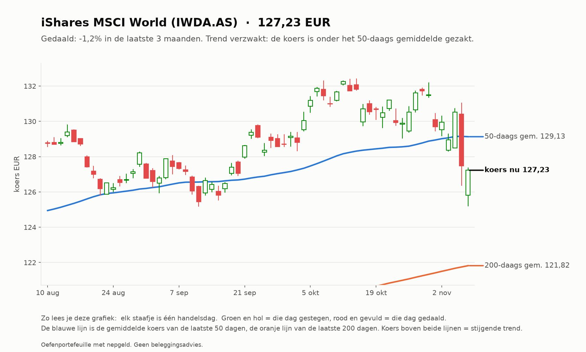
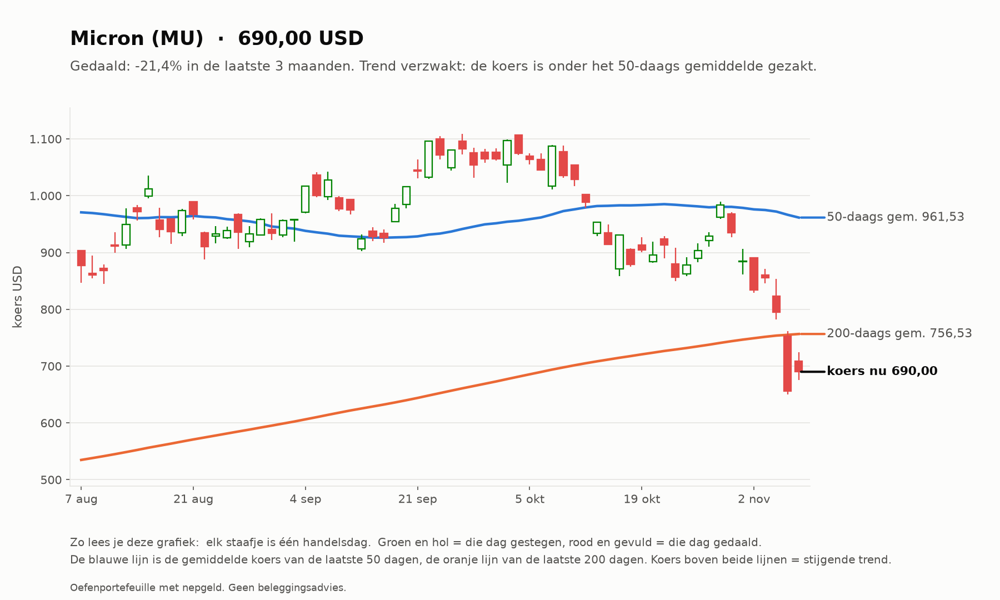
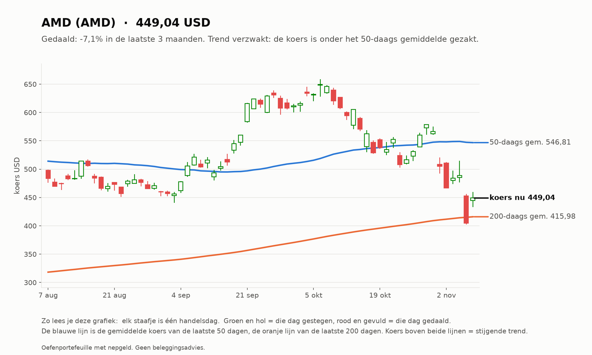
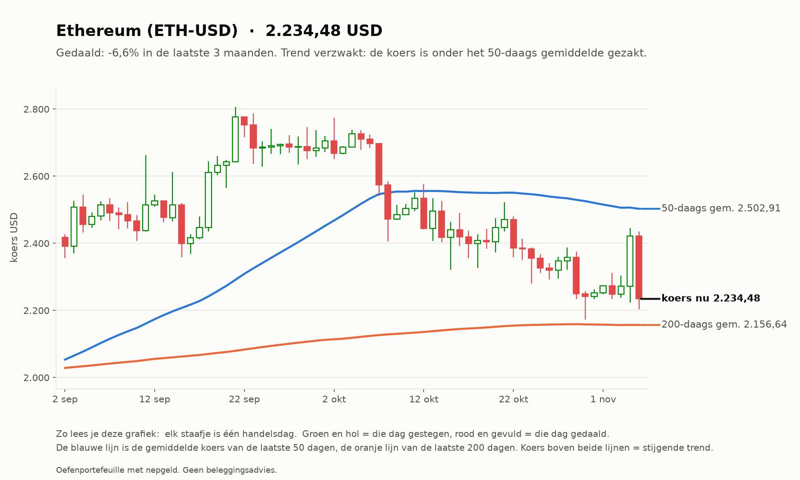
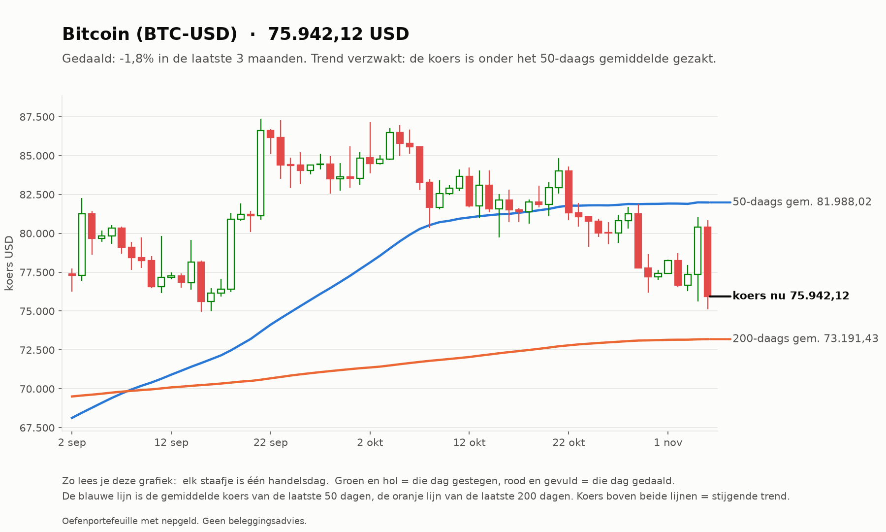

# Investeerder 2026-11-06

_Oefenportefeuille met nepgeld. Geen beleggingsadvies._

**Status:** OK  
**Waarde:** €9,133.17  
**Marktregime:** stijgend-hoog  
**Strategieversie:** investeerder-1.0-64ce27  
**Koersbronnen:** 69 bevestigd door 2 bronnen, 62 uit 1 bron, 0 afwijkend; wisselkoers bevestigd  
**Sinds start:** -8.67%  

## Verdeling

| Instrument | Aandeel |
| --- | --- |
| iShares MSCI World (IWDA.AS) | 60.4% |
| Bitcoin (BTC-USD) | 5.0% |
| AMD (AMD) | 4.9% |
| Ethereum (ETH-USD) | 4.9% |
| Micron (MU) | 4.5% |
| Kas | 20.2% |

## Analyse van vandaag

**Wat de bot zag**

- **Markt (IWDA.AS):** koers 127,23, 4,4% boven het 200-daags gemiddelde (121,82); de afgelopen maand -2,9%. Trend: **stijgend**.
- **Beweeglijkheid:** 13% op jaarbasis, tegen normaal 10% het afgelopen jaar: **hoog**.
- **Breedte:** 75 van de 129 instrumenten staan boven hun 200-daags gemiddelde (58%; EU 38 van 60, US 37 van 69).
- **Sterkste momentum nu (12 maanden, zonder laatste maand):** AMD +142%, CrowdStrike +97%, Palo Alto Networks +87%, Texas Instruments +79%, Merck & Co +74%.
- **BTC-USD:** 3,8% boven het 200-daags gemiddelde (mag in de mix).
- **ETH-USD:** 3,6% boven het 200-daags gemiddelde (mag in de mix).

**Wat de bot eruit haalt**

- De markt stijgt: de kern (wereld-ETF) doet zijn werk, de sterkste aandelen lopen mee.
- De markt beweegt meer dan normaal: grotere schommelingen in de waarde zijn te verwachten; de spreiding over 60% wereld-ETF dempt dat.
- Uit de top gevallen: MU. Blijft dat zo, dan worden ze bij de volgende herverdeling (eerste handelsdag van 2026-12) vervangen door CRWD, PANW, TXN, MRK.

## Verlies en winst per belegging

| Instrument | Waarde | Ingelegd | Resultaat |
| --- | --- | --- | --- |
| IWDA.AS | €5.516,59 | €5.714,81 | -€198,23 (-3,5%) |
| MU | €415,82 | €600,00 | -€184,18 (-30,7%) |
| AMD | €450,39 | €600,00 | -€149,61 (-24,9%) |
| ETH-USD | €447,15 | €500,00 | -€52,85 (-10,6%) |
| BTC-USD | €455,85 | €500,00 | -€44,15 (-8,8%) |

Totaal op de beleggingen: -€629,02 (inclusief aankoopkosten).
Daling vanaf de hoogste waarde ooit: -8,67% (top €10.000,00). De investeerder heeft geen stop-loss: hij houdt een spreiding vast en herverdeelt maandelijks.

## Vandaag gedaan

- Niets (herverdelen gebeurt één keer per maand)

## Klaar voor echt geld?

**Investeerder:** Nog niet klaar: de bot is nog bezig met bewijzen. Blijven oefenen.

| Eis | Stand | Nu |
| --- | --- | --- |
| Oefentijd | ⏳ | 19 van 63 handelsdagen (ongeveer 3 maanden) |
| Minstens zo goed als de wereld-ETF | ⏳ | verschil tot nu toe -4,73% |
| Daling niet veel dieper dan de ETF | ✅ | bot -8,67%, ETF -3,80% |

Zo analyseert de investeerder (klik om te openen)

1. **Kern (60%):** de wereld-ETF (IWDA), altijd.
2. **Satelliet (30%):** de 5 aandelen of ETF's met de grootste stijging over 12 maanden (de laatste maand niet
   meegeteld, omdat die vaak terugveert), alleen als ze boven hun 200-daags gemiddelde staan en genoeg verhandeld worden.
3. **Crypto (10%):** Bitcoin en Ethereum, alleen als ze boven hun 200-daags gemiddelde staan; anders kas.
4. **Eén keer per maand** wordt alles teruggezet naar deze verdeling. Tussendoor kijkt hij elke dag mee, maar handelt niet.

## Grafieken (laatste 3 maanden)

_Grafieken worden 20 handelsdagen bewaard._
