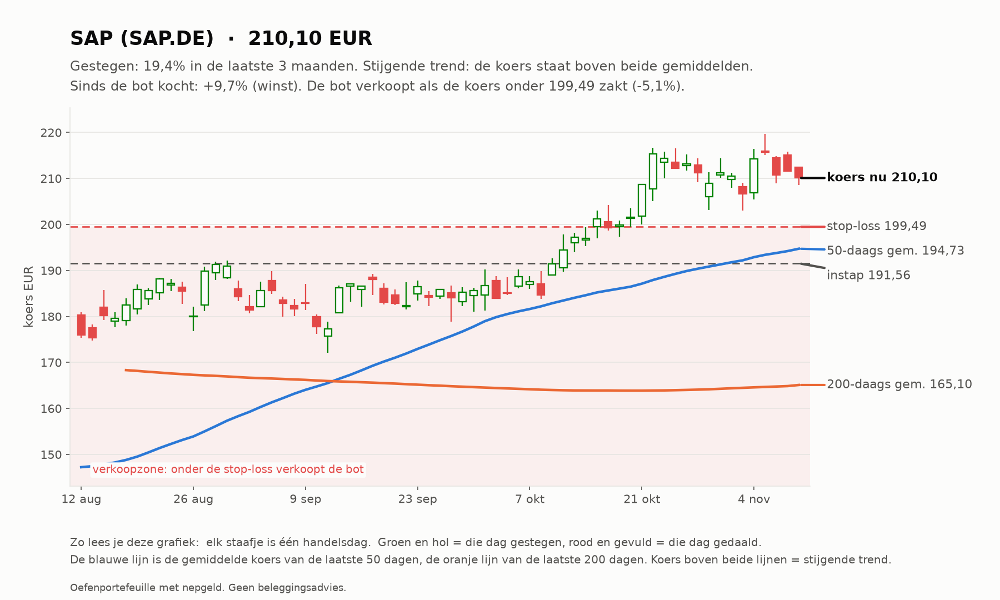
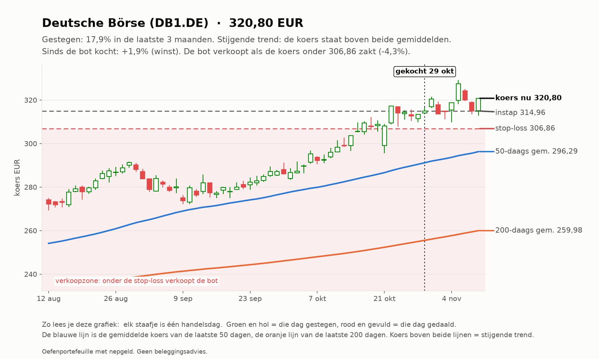
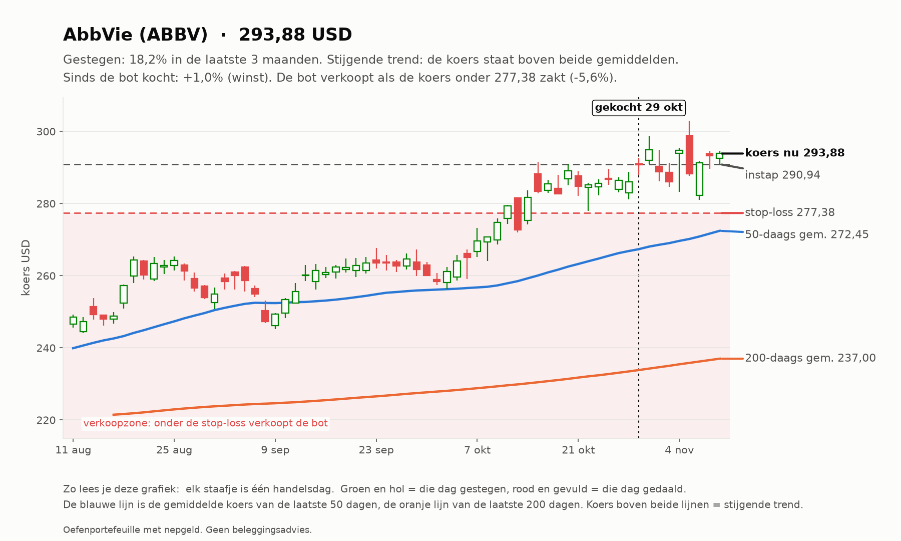
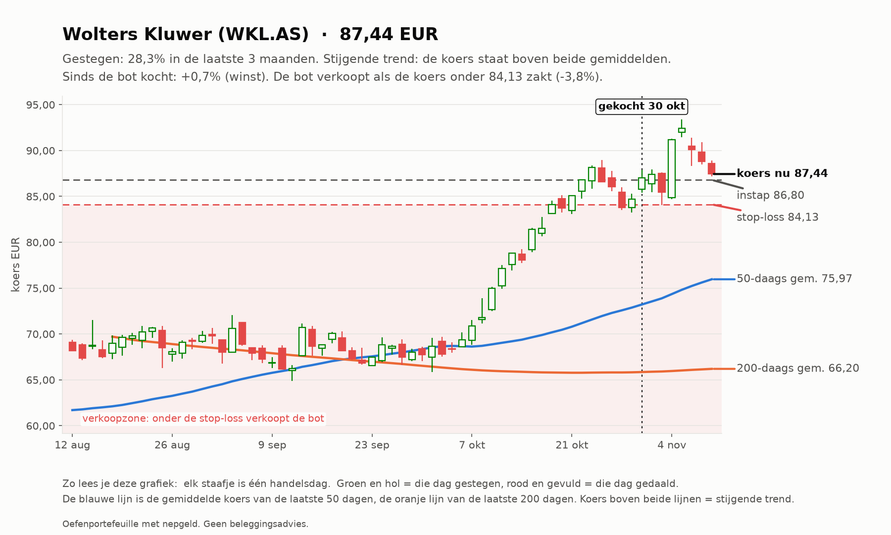
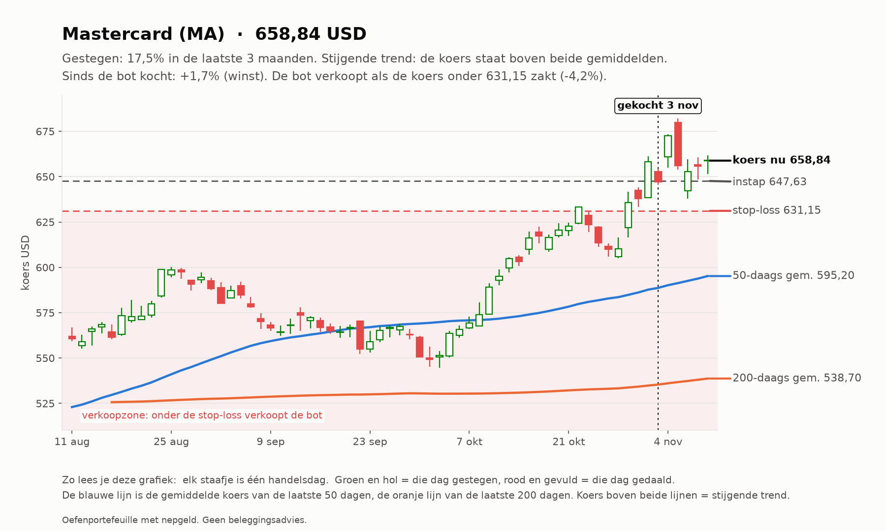
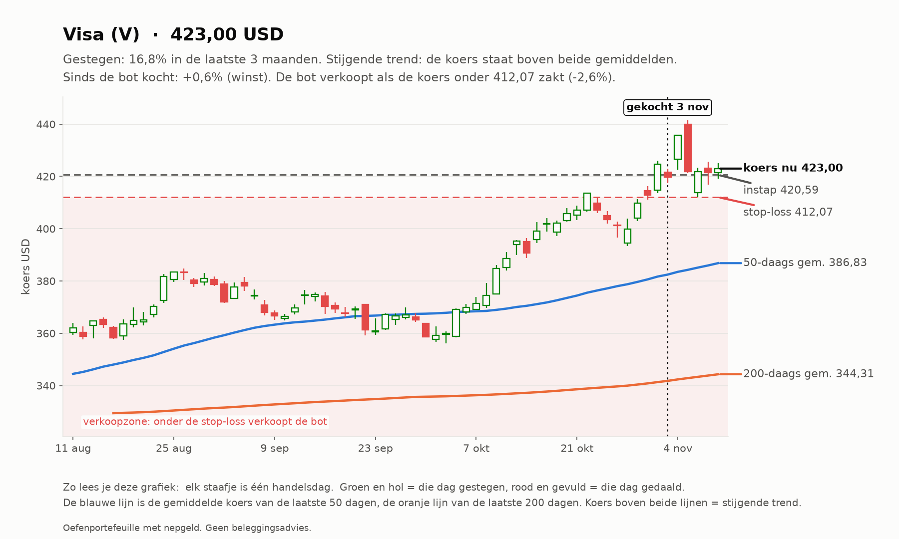
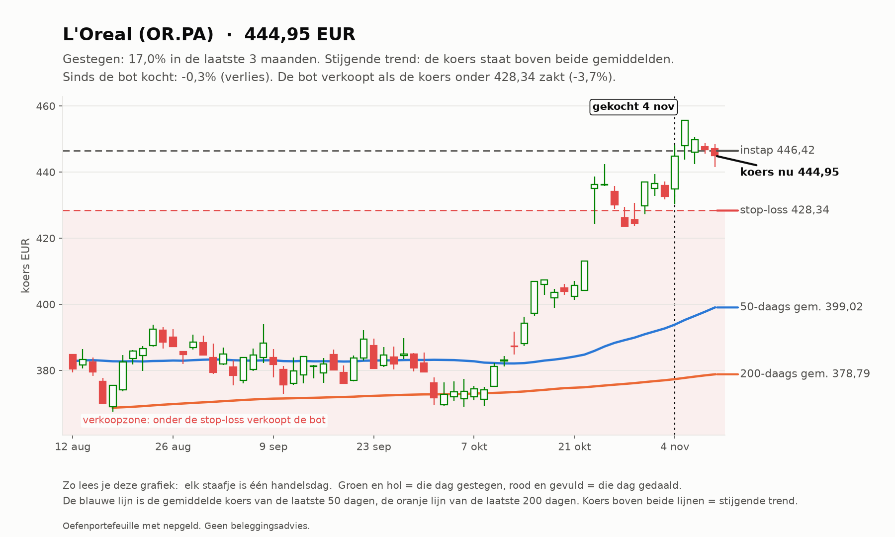
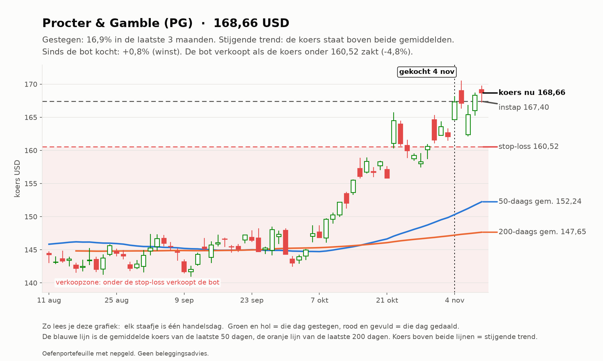

# Trend-agent rapport 2026-11-10

_Oefenportefeuille met nepgeld. Geen beleggingsadvies; resultaten uit het verleden zeggen niets over de toekomst._

**Status:** OK  
**Waarde:** €9,917.09  
**Kas:** €3,362.61  
**Marktregime:** stijgend-hoog  
**Strategieversie:** trend-1.1-f132c3  
**Koersbronnen:** 69 bevestigd door 2 bronnen, 60 uit 1 bron, 0 afwijkend; wisselkoers bevestigd  
**Sinds start:** -0.83%  

## Analyse van vandaag

**Wat de bot zag**

- **Markt (IWDA.AS):** koers 128,69, 5,5% boven het 200-daags gemiddelde (121,99); de afgelopen maand -2,7%. Trend: **stijgend**.
- **Beweeglijkheid:** 13% op jaarbasis, tegen normaal 10% het afgelopen jaar: **hoog**.
- **Breedte:** 81 van de 129 instrumenten staan boven hun 200-daags gemiddelde (63%; EU 40 van 60, US 41 van 69).
- **Bekeken:** 129 instrumenten.
- **Afgevallen** (een instrument kan op meer regels afvallen): geen stijgende trend (koers niet boven 50- en 200-daags gemiddelde): 81; niet gestegen over 1 of 3 maanden: 71; te weinig handel: 2; verdachte dagsprong: 1.
- **Door de zeef:** 38. Koopbare trends: **38**.

**Wat de bot eruit haalt**

- De markt stijgt breed: goede omstandigheden voor trendvolgen.
- De markt beweegt meer dan normaal: stops worden sneller geraakt. Het risico per trade blijft gelijk, dus de posities worden vanzelf kleiner.
- De sterkste trends zijn vooral Europese instrumenten.
- 4 van de 5 sterkste staan al ver boven hun gemiddelde (BRK-B, HEIA.AS, BAYN.DE, AI.PA): de trend is sterk, maar instappen op zo'n moment kost vaker een terugval.
- Sterk zonder ver weggelopen te zijn: DB1.DE.
- Alle plekken zijn bezet, dus de bot koopt niets bij, hoe sterk een trend ook is.

## Vandaag gedaan

- DB1.DE: stop omhoog van 306.40 naar 306.86

## Verlies en risico

| Ticker | Instap | Koers nu | Resultaat | Stop | Afstand tot stop | Als de stop geraakt wordt |
| --- | --- | --- | --- | --- | --- | --- |
| SAP.DE | 191.56 EUR | 210.10 | €37,09 (+9,7%) | 199.49 | +5,3% | €14,87 winst vastgezet |
| DB1.DE | 314.96 EUR | 320.80 | €5,84 (+1,9%) | 306.86 | +4,5% | -€9,09 verlies |
| ABBV | 290.94 USD | 293.88 | €6,49 (+1,0%) | 277.38 | +5,9% | -€24,04 verlies |
| WKL.AS | 86.80 EUR | 87.44 | €6,37 (+0,7%) | 84.13 | +3,9% | -€27,73 verlies |
| MA | 647.63 USD | 658.84 | €27,83 (+1,7%) | 631.15 | +4,4% | -€22,73 verlies |
| V | 420.59 USD | 423.00 | €14,04 (+0,6%) | 412.07 | +2,6% | -€16,31 verlies |
| OR.PA | 446.42 EUR | 444.95 | -€2,95 (-0,3%) | 428.34 | +3,9% | -€37,16 verlies |
| PG | 167.40 USD | 168.66 | €17,70 (+0,8%) | 160.52 | +5,1% | -€41,55 verlies |

Raken alle stops tegelijk, dan is het verlies hooguit ongeveer €178,61 (bij een koersgat 's ochtends kan het meer zijn).

**Remmen** (bij overschrijden gaat de kill switch aan en koopt de bot niets meer):

- Daling vanaf de top: -0,70% (grens -10%; top was €9.987,03)
- Vandaag: +0,16% (grens -2%)
- Verliestrades op rij: 1 van 3

## Kansen: wat de bot vandaag het sterkst vond

_Dit is wat de oefenbot met zijn nepgeld volgens zijn eigen regels zou doen. Geen advies voor echt geld; het instapmoment is een ongeteste vuistregel en wordt door de bot niet gebruikt._

### 1. Berkshire Hathaway (BRK-B): instapmoment **opgelopen**

- **Waarom sterk:** Berkshire Hathaway steeg +14,4% in 3 maanden en +12,7% in 1 maand; koers boven het 50-daags en dat boven het 200-daags gemiddelde; MACD positief (de stijging versnelt); handel 1,1x het normale volume; beweegt gemiddeld 1,9% per dag.
- **Instapmoment:** de koers staat +5,7% van het 20-daags gemiddelde (2,9x de normale dagbeweging) en RSI is 78; na zo'n sprint volgt vaak eerst een terugval.
- **Status:** niet gekocht: RSI 78 boven de grens 75.
- **Plan van de bot:** koop 2 stuks rond 583.63 USD (inzet €1.044,82), stop-loss 560.99 USD (-3,9%). Maximaal verlies als de stop wordt geraakt: ongeveer €42,54. Ter oriëntatie: 2x het risico winst ligt bij 628.92 USD; de bot verkoopt daar niet vanzelf, hij laat de stop meeschuiven.

### 2. Heineken (HEIA.AS): instapmoment **opgelopen**

- **Waarom sterk:** Heineken steeg +14,0% in 3 maanden en +16,7% in 1 maand; koers boven het 50-daags en dat boven het 200-daags gemiddelde; MACD positief (de stijging versnelt); handel 1,1x het normale volume; beweegt gemiddeld 2,1% per dag.
- **Instapmoment:** de koers staat +6,1% van het 20-daags gemiddelde (3,0x de normale dagbeweging) en RSI is 79; na zo'n sprint volgt vaak eerst een terugval.
- **Status:** niet gekocht: RSI 79 boven de grens 75.
- **Plan van de bot:** koop 14 stuks rond 84.32 EUR (inzet €1.180,51), stop-loss 80.84 EUR (-4,1%). Maximaal verlies als de stop wordt geraakt: ongeveer €50,68. Ter oriëntatie: 2x het risico winst ligt bij 91.28 EUR; de bot verkoopt daar niet vanzelf, hij laat de stop meeschuiven.

### 3. Bayer (BAYN.DE): instapmoment **opgelopen**

- **Waarom sterk:** Bayer steeg +18,7% in 3 maanden en +30,1% in 1 maand; koers boven het 50-daags en dat boven het 200-daags gemiddelde; MACD positief (de stijging versnelt); handel 1,2x het normale volume; beweegt gemiddeld 3,3% per dag.
- **Instapmoment:** de koers staat +12,9% van het 20-daags gemiddelde (3,9x de normale dagbeweging) en RSI is 78; na zo'n sprint volgt vaak eerst een terugval.
- **Status:** niet gekocht: RSI 78 boven de grens 75.
- **Plan van de bot:** koop 13 stuks rond 57.07 EUR (inzet €741,89), stop-loss 53.33 EUR (-6,6%). Maximaal verlies als de stop wordt geraakt: ongeveer €50,58. Ter oriëntatie: 2x het risico winst ligt bij 64.54 EUR; de bot verkoopt daar niet vanzelf, hij laat de stop meeschuiven.

### 4. Deutsche Börse (DB1.DE): instapmoment **gunstig**

- **Waarom sterk:** Deutsche Börse steeg +18,0% in 3 maanden en +7,5% in 1 maand; koers boven het 50-daags en dat boven het 200-daags gemiddelde; MACD negatief (de stijging vertraagt); handel 1,2x het normale volume; beweegt gemiddeld 2,1% per dag.
- **Instapmoment:** de trend is sterk maar de koers is niet ver weggelopen (+2,6% van het 20-daags gemiddelde, RSI 62).
- **Status:** al in bezit.
- **Plan van de bot:** koop 3 stuks rond 320.96 EUR (inzet €962,88), stop-loss 307.40 EUR (-4,2%). Maximaal verlies als de stop wordt geraakt: ongeveer €42,67. Ter oriëntatie: 2x het risico winst ligt bij 348.07 EUR; de bot verkoopt daar niet vanzelf, hij laat de stop meeschuiven.

### 5. Air Liquide (AI.PA): instapmoment **opgelopen**

- **Waarom sterk:** Air Liquide steeg +12,5% in 3 maanden en +12,8% in 1 maand; koers boven het 50-daags en dat boven het 200-daags gemiddelde; MACD positief (de stijging versnelt); handel 1,1x het normale volume; beweegt gemiddeld 1,6% per dag.
- **Instapmoment:** de koers staat +5,5% van het 20-daags gemiddelde (3,4x de normale dagbeweging) en RSI is 79; na zo'n sprint volgt vaak eerst een terugval.
- **Status:** niet gekocht: RSI 79 boven de grens 75.
- **Plan van de bot:** koop 8 stuks rond 190.46 EUR (inzet €1.523,64), stop-loss 184.27 EUR (-3,2%). Maximaal verlies als de stop wordt geraakt: ongeveer €51,46. Ter oriëntatie: 2x het risico winst ligt bij 202.82 EUR; de bot verkoopt daar niet vanzelf, hij laat de stop meeschuiven.

## Wat de bot tot nu toe geleerd heeft

- 5 afgesloten trades: 1 met winst (20%), gemiddeld -0,87 R per trade (R = winst of verlies gedeeld door het risico bij instap), totaal -€187,32.
- Pas vanaf 20 trades trekt de bot conclusies over welke omstandigheden goed of slecht uitpakken; met minder is het vooral toeval. Het wekelijkse onderzoek (zaterdag) doet dat.

## Klaar voor echt geld?

**Trend-agent:** Nog niet klaar: de bot is nog bezig met bewijzen. Blijven oefenen.

| Eis | Stand | Nu |
| --- | --- | --- |
| Oefentijd | ⏳ | 22 van 63 handelsdagen (ongeveer 3 maanden) |
| Minstens zo goed als de wereld-ETF | ⏳ | verschil tot nu toe +1,73% |
| Grootste daling onder 5% | ✅ | grootste daling tot nu toe -2,18% |
| Genoeg afgesloten trades | ⏳ | 5 van 20 |

Zo analyseert de trend-agent (klik om te openen)

1. **Data controleren.** Koersen van Yahoo, gecontroleerd bij een tweede bron en de wisselkoers bij de ECB.
   Bevroren koersen, rare sprongen of achterlopende markten: dat instrument wordt die dag niet gekocht.
2. **De markt als geheel.** Aan de hand van de wereld-ETF (IWDA) of de S&P 500: staat de koers boven het
   200-daags gemiddelde (stijgend), eronder (dalend) of ertussenin (zijwaarts)? En beweegt de markt meer of
   minder dan normaal vergeleken met het afgelopen jaar? Plus: hoeveel aandelen staan boven hun 200-daags gemiddelde (de breedte).
3. **Elk instrument door de zeef.** Een trend telt alleen als ALLES klopt: koers boven het 50-daags gemiddelde en
   dat boven het 200-daags, plus over 1 en 3 maanden gestegen, genoeg handel en geen verdachte sprong.
4. **Rangschikken.** Score = stijging (60% 3 maanden, 40% 1 maand) gedeeld door de beweeglijkheid. Een rustige,
   stevige stijger wint van een wilde.
5. **Risico bepalen.** Stop-loss op 2x de gemiddelde dagbeweging (ATR) onder de instap. Het aantal stuks wordt zo
   gekozen dat de stop hooguit 0,25% van het vermogen kost.
6. **Beheren.** De stop schuift mee omhoog (3x ATR onder de hoogste slotkoers). Verkopen bij stop of als de koers
   onder het 50-daags gemiddelde sluit.

## Open posities

| Ticker | Aantal | Instap | Stop | Sinds |
| --- | --- | --- | --- | --- |
| SAP.DE | 2 | 191.56 EUR | 199.49 | 2026-10-10 |
| DB1.DE | 1 | 314.96 EUR | 306.86 | 2026-10-29 |
| ABBV | 2 | 290.94 USD | 277.38 | 2026-10-29 |
| WKL.AS | 10 | 86.80 EUR | 84.13 | 2026-10-30 |
| MA | 2 | 647.63 USD | 631.15 | 2026-11-03 |
| V | 3 | 420.59 USD | 412.07 | 2026-11-03 |
| OR.PA | 2 | 446.42 EUR | 428.34 | 2026-11-04 |
| PG | 8 | 167.40 USD | 160.52 | 2026-11-04 |

## Sterkste trends vandaag

| # | Ticker | Score | 3 mnd | 1 mnd |
| --- | --- | --- | --- | --- |
| 1 | BRK-B | 0.159 | +14.4% | +12.7% |
| 2 | HEIA.AS | 0.151 | +14.0% | +16.7% |
| 3 | BAYN.DE | 0.138 | +18.7% | +30.1% |
| 4 | DB1.DE | 0.136 | +18.0% | +7.5% |
| 5 | AI.PA | 0.136 | +12.5% | +12.8% |
| 6 | OR.PA | 0.135 | +16.1% | +16.2% |
| 7 | PG | 0.132 | +17.8% | +10.8% |
| 8 | IBE.MC | 0.131 | +13.6% | +6.4% |
| 9 | ASRNL.AS | 0.131 | +14.7% | +9.1% |
| 10 | MA | 0.122 | +17.9% | +10.7% |

## Afgesloten trades

5 trades, 1 winst (20%), totaal €-187.32 na kosten.

## Grafieken (laatste 3 maanden)

_Grafieken worden 20 handelsdagen bewaard._
