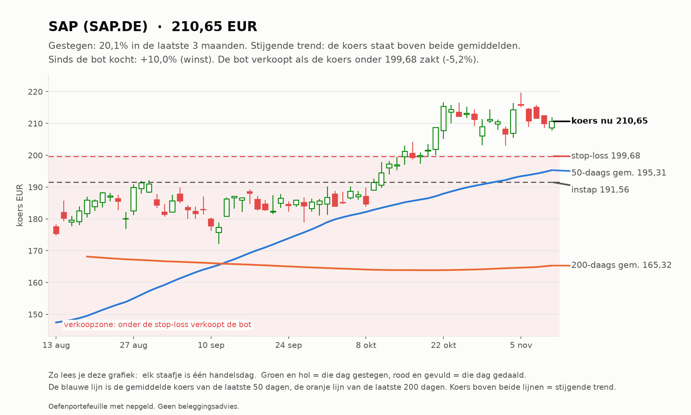
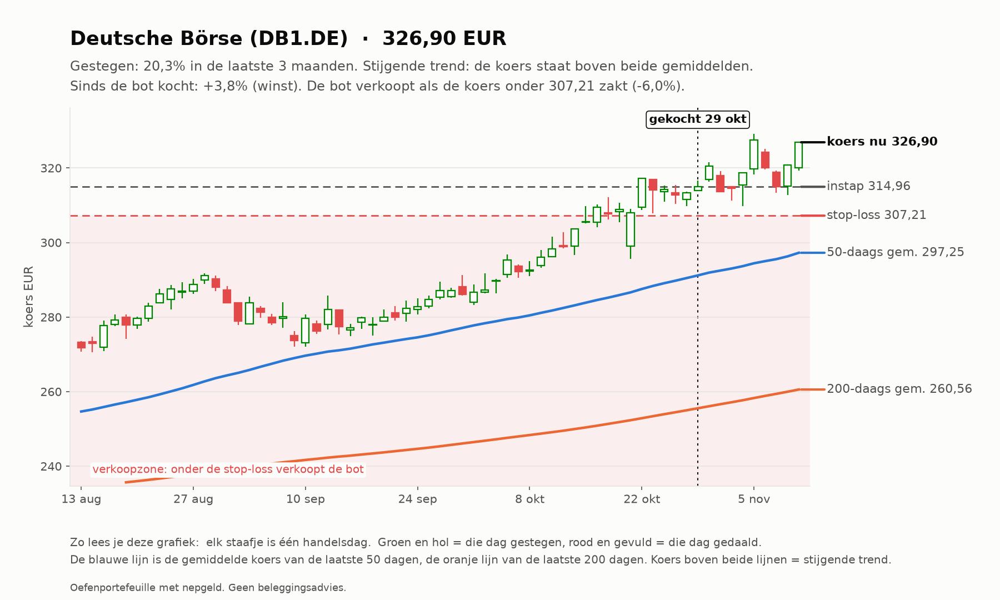
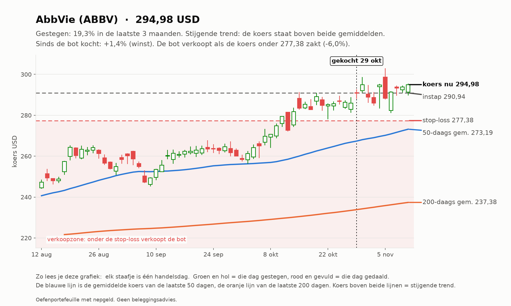
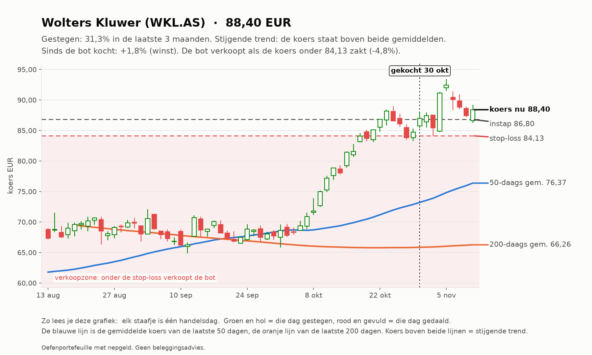
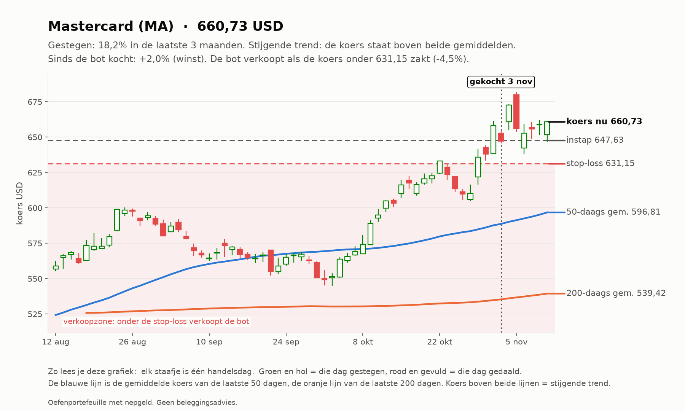
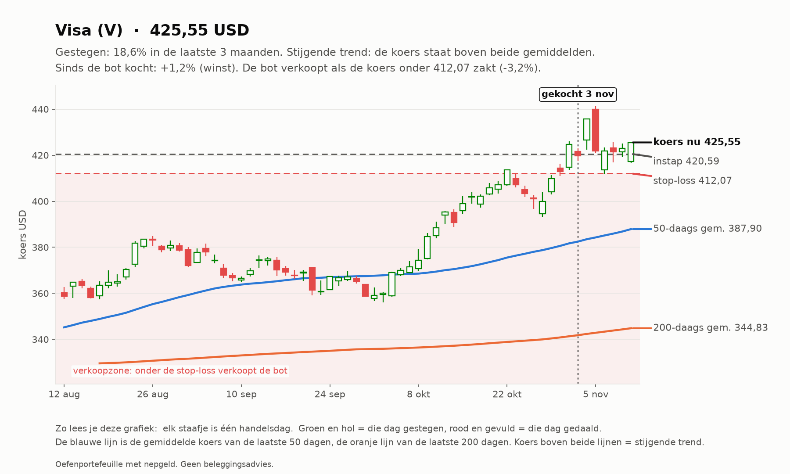
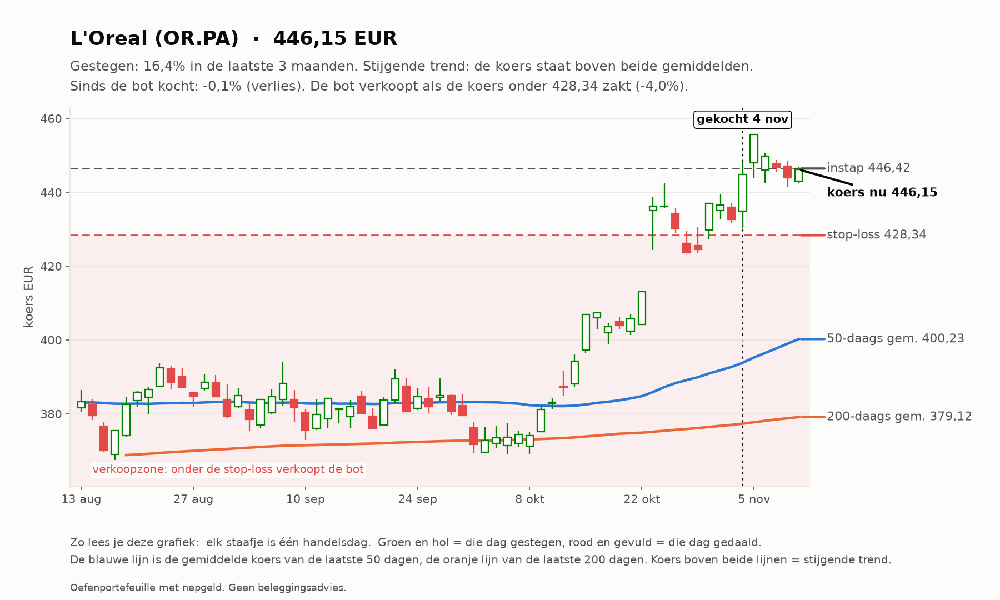
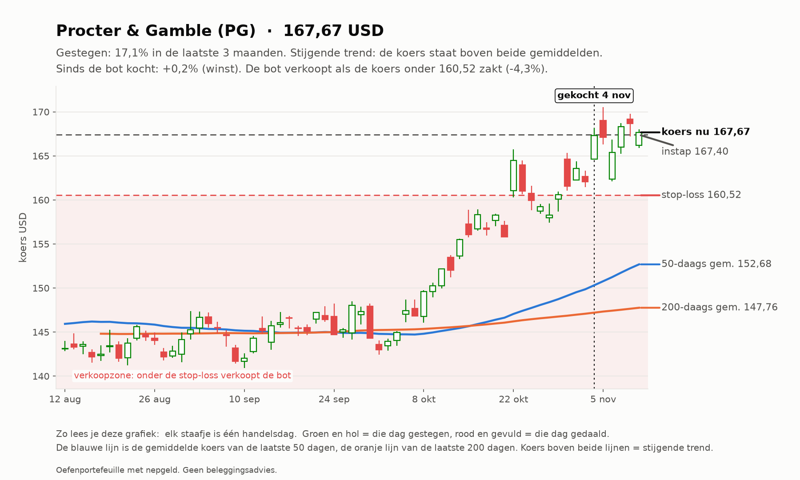

# Trend-agent rapport 2026-11-11

_Oefenportefeuille met nepgeld. Geen beleggingsadvies; resultaten uit het verleden zeggen niets over de toekomst._

**Status:** OK  
**Waarde:** €9,975.83  
**Kas:** €3,362.61  
**Marktregime:** stijgend-hoog  
**Strategieversie:** trend-1.1-eaf4f8  
**Koersbronnen:** 69 bevestigd door 2 bronnen, 60 uit 1 bron, 0 afwijkend; wisselkoers bevestigd  
**Sinds start:** -0.24%  

## Analyse van vandaag

**Wat de bot zag**

- **Markt (IWDA.AS):** koers 131,01, 7,3% boven het 200-daags gemiddelde (122,08); de afgelopen maand -0,5%. Trend: **stijgend**.
- **Beweeglijkheid:** 15% op jaarbasis, tegen normaal 10% het afgelopen jaar: **hoog**.
- **Breedte:** 84 van de 129 instrumenten staan boven hun 200-daags gemiddelde (65%; EU 41 van 60, US 43 van 69).
- **Bekeken:** 129 instrumenten.
- **Afgevallen** (een instrument kan op meer regels afvallen): geen stijgende trend (koers niet boven 50- en 200-daags gemiddelde): 76; niet gestegen over 1 of 3 maanden: 73; te weinig handel: 2; verdachte dagsprong: 1.
- **Door de zeef:** 37. Koopbare trends: **37**.

**Wat de bot eruit haalt**

- De markt stijgt breed: goede omstandigheden voor trendvolgen.
- De markt beweegt meer dan normaal: stops worden sneller geraakt. Het risico per trade blijft gelijk, dus de posities worden vanzelf kleiner.
- De sterkste trends zijn vooral Europese instrumenten.
- 3 van de 5 sterkste staan al ver boven hun gemiddelde (BRK-B, AI.PA, IBE.MC): de trend is sterk, maar instappen op zo'n moment kost vaker een terugval.
- Alle plekken zijn bezet, dus de bot koopt niets bij, hoe sterk een trend ook is.

## Vandaag gedaan

- SAP.DE: stop omhoog van 199.49 naar 199.68
- DB1.DE: stop omhoog van 306.86 naar 307.21

## Verlies en risico

| Ticker | Instap | Koers nu | Resultaat | Stop | Afstand tot stop | Als de stop geraakt wordt |
| --- | --- | --- | --- | --- | --- | --- |
| SAP.DE | 191.56 EUR | 210.65 | €38,19 (+10,0%) | 199.68 | +5,5% | €15,25 winst vastgezet |
| DB1.DE | 314.96 EUR | 326.90 | €11,94 (+3,8%) | 307.21 | +6,4% | -€8,75 verlies |
| ABBV | 290.94 USD | 294.98 | €12,95 (+1,4%) | 277.38 | +6,3% | -€19,83 verlies |
| WKL.AS | 86.80 EUR | 88.40 | €15,97 (+1,8%) | 84.13 | +5,1% | -€27,73 verlies |
| MA | 647.63 USD | 660.73 | €41,26 (+2,0%) | 631.15 | +4,7% | -€13,14 verlies |
| V | 420.59 USD | 425.55 | €30,59 (+1,2%) | 412.07 | +3,3% | -€6,92 verlies |
| OR.PA | 446.42 EUR | 446.15 | -€0,55 (-0,1%) | 428.34 | +4,2% | -€37,16 verlies |
| PG | 167.40 USD | 167.67 | €20,81 (+0,2%) | 160.52 | +4,5% | -€31,79 verlies |

Raken alle stops tegelijk, dan is het verlies hooguit ongeveer €145,32 (bij een koersgat 's ochtends kan het meer zijn).

**Remmen** (bij overschrijden gaat de kill switch aan en koopt de bot niets meer):

- Daling vanaf de top: -0,11% (grens -10%; top was €9.987,03)
- Vandaag: +0,59% (grens -2%)
- Verliestrades op rij: 1 van 3

## Kansen: wat de bot vandaag het sterkst vond

_Dit is wat de oefenbot met zijn nepgeld volgens zijn eigen regels zou doen. Geen advies voor echt geld; het instapmoment is een ongeteste vuistregel en wordt door de bot niet gebruikt._

### 1. Berkshire Hathaway (BRK-B): instapmoment **opgelopen**

- **Waarom sterk:** Berkshire Hathaway steeg +16,0% in 3 maanden en +13,0% in 1 maand; koers boven het 50-daags en dat boven het 200-daags gemiddelde; MACD positief (de stijging versnelt); handel 1,1x het normale volume; beweegt gemiddeld 1,9% per dag.
- **Instapmoment:** de koers staat +5,9% van het 20-daags gemiddelde (3,1x de normale dagbeweging) en RSI is 80; na zo'n sprint volgt vaak eerst een terugval.
- **Status:** niet gekocht: RSI 80 boven de grens 75.
- **Plan van de bot:** koop 2 stuks rond 588.53 USD (inzet €1.062,54), stop-loss 565.78 USD (-3,9%). Maximaal verlies als de stop wordt geraakt: ongeveer €43,08. Ter oriëntatie: 2x het risico winst ligt bij 634.04 USD; de bot verkoopt daar niet vanzelf, hij laat de stop meeschuiven.

### 2. Air Liquide (AI.PA): instapmoment **opgelopen**

- **Waarom sterk:** Air Liquide steeg +14,3% in 3 maanden en +13,8% in 1 maand; koers boven het 50-daags en dat boven het 200-daags gemiddelde; MACD positief (de stijging versnelt); handel 1,1x het normale volume; beweegt gemiddeld 1,6% per dag.
- **Instapmoment:** de koers staat +5,9% van het 20-daags gemiddelde (3,6x de normale dagbeweging) en RSI is 81; na zo'n sprint volgt vaak eerst een terugval.
- **Status:** niet gekocht: RSI 81 boven de grens 75.
- **Plan van de bot:** koop 7 stuks rond 192.44 EUR (inzet €1.347,05), stop-loss 186.19 EUR (-3,2%). Maximaal verlies als de stop wordt geraakt: ongeveer €45,74. Ter oriëntatie: 2x het risico winst ligt bij 204.93 EUR; de bot verkoopt daar niet vanzelf, hij laat de stop meeschuiven.

### 3. Deutsche Börse (DB1.DE): instapmoment **neutraal**

- **Waarom sterk:** Deutsche Börse steeg +19,8% in 3 maanden en +9,4% in 1 maand; koers boven het 50-daags en dat boven het 200-daags gemiddelde; MACD negatief (de stijging vertraagt); handel 1,2x het normale volume; beweegt gemiddeld 2,0% per dag.
- **Instapmoment:** de koers staat +4,1% van het 20-daags gemiddelde, RSI 66.
- **Status:** al in bezit.
- **Plan van de bot:** koop 3 stuks rond 327.06 EUR (inzet €981,19), stop-loss 313.73 EUR (-4,1%). Maximaal verlies als de stop wordt geraakt: ongeveer €41,99. Ter oriëntatie: 2x het risico winst ligt bij 353.72 EUR; de bot verkoopt daar niet vanzelf, hij laat de stop meeschuiven.

### 4. L'Oreal (OR.PA): instapmoment **neutraal**

- **Waarom sterk:** L'Oreal steeg +17,6% in 3 maanden en +15,2% in 1 maand; koers boven het 50-daags en dat boven het 200-daags gemiddelde; MACD positief (de stijging versnelt); handel 1,3x het normale volume; beweegt gemiddeld 2,2% per dag.
- **Instapmoment:** de koers staat +3,9% van het 20-daags gemiddelde, RSI 67.
- **Status:** al in bezit.
- **Plan van de bot:** koop 2 stuks rond 446.37 EUR (inzet €892,75), stop-loss 426.92 EUR (-4,4%). Maximaal verlies als de stop wordt geraakt: ongeveer €40,90. Ter oriëntatie: 2x het risico winst ligt bij 485.27 EUR; de bot verkoopt daar niet vanzelf, hij laat de stop meeschuiven.

### 5. Iberdrola (IBE.MC): instapmoment **opgelopen**

- **Waarom sterk:** Iberdrola steeg +14,8% in 3 maanden en +7,6% in 1 maand; koers boven het 50-daags en dat boven het 200-daags gemiddelde; MACD positief (de stijging versnelt); handel 1,0x het normale volume; beweegt gemiddeld 1,4% per dag.
- **Instapmoment:** de koers staat +4,3% van het 20-daags gemiddelde (3,1x de normale dagbeweging) en RSI is 78; na zo'n sprint volgt vaak eerst een terugval.
- **Status:** niet gekocht: RSI 78 boven de grens 75.
- **Plan van de bot:** koop 76 stuks rond 23.20 EUR (inzet €1.763,32), stop-loss 22.55 EUR (-2,8%). Maximaal verlies als de stop wordt geraakt: ongeveer €51,83. Ter oriëntatie: 2x het risico winst ligt bij 24.51 EUR; de bot verkoopt daar niet vanzelf, hij laat de stop meeschuiven.

## Wat de bot tot nu toe geleerd heeft

- 5 afgesloten trades: 1 met winst (20%), gemiddeld -0,87 R per trade (R = winst of verlies gedeeld door het risico bij instap), totaal -€187,32.
- Pas vanaf 20 trades trekt de bot conclusies over welke omstandigheden goed of slecht uitpakken; met minder is het vooral toeval. Het wekelijkse onderzoek (zaterdag) doet dat.

## Klaar voor echt geld?

**Trend-agent:** Nog niet klaar: de bot is nog bezig met bewijzen. Blijven oefenen.

| Eis | Stand | Nu |
| --- | --- | --- |
| Oefentijd | ⏳ | 23 van 63 handelsdagen (ongeveer 3 maanden) |
| Minstens zo goed als de wereld-ETF | ⏳ | verschil tot nu toe +0,56% |
| Grootste daling onder 5% | ✅ | grootste daling tot nu toe -2,18% |
| Genoeg afgesloten trades | ⏳ | 5 van 20 |

Zo analyseert de trend-agent (klik om te openen)

1. **Data controleren.** Koersen van Yahoo, gecontroleerd bij een tweede bron en de wisselkoers bij de ECB.
   Bevroren koersen, rare sprongen of achterlopende markten: dat instrument wordt die dag niet gekocht.
2. **De markt als geheel.** Aan de hand van de wereld-ETF (IWDA) of de S&P 500: staat de koers boven het
   200-daags gemiddelde (stijgend), eronder (dalend) of ertussenin (zijwaarts)? En beweegt de markt meer of
   minder dan normaal vergeleken met het afgelopen jaar? Plus: hoeveel aandelen staan boven hun 200-daags gemiddelde (de breedte).
3. **Elk instrument door de zeef.** Een trend telt alleen als ALLES klopt: koers boven het 50-daags gemiddelde en
   dat boven het 200-daags, plus over 1 en 3 maanden gestegen, genoeg handel en geen verdachte sprong.
4. **Rangschikken.** Score = stijging (60% 3 maanden, 40% 1 maand) gedeeld door de beweeglijkheid. Een rustige,
   stevige stijger wint van een wilde.
5. **Risico bepalen.** Stop-loss op 2x de gemiddelde dagbeweging (ATR) onder de instap. Het aantal stuks wordt zo
   gekozen dat de stop hooguit 0,25% van het vermogen kost.
6. **Beheren.** De stop schuift mee omhoog (3x ATR onder de hoogste slotkoers). Verkopen bij stop of als de koers
   onder het 50-daags gemiddelde sluit.

## Open posities

| Ticker | Aantal | Instap | Stop | Sinds |
| --- | --- | --- | --- | --- |
| SAP.DE | 2 | 191.56 EUR | 199.68 | 2026-10-10 |
| DB1.DE | 1 | 314.96 EUR | 307.21 | 2026-10-29 |
| ABBV | 2 | 290.94 USD | 277.38 | 2026-10-29 |
| WKL.AS | 10 | 86.80 EUR | 84.13 | 2026-10-30 |
| MA | 2 | 647.63 USD | 631.15 | 2026-11-03 |
| V | 3 | 420.59 USD | 412.07 | 2026-11-03 |
| OR.PA | 2 | 446.42 EUR | 428.34 | 2026-11-04 |
| PG | 8 | 167.40 USD | 160.52 | 2026-11-04 |

## Sterkste trends vandaag

| # | Ticker | Score | 3 mnd | 1 mnd |
| --- | --- | --- | --- | --- |
| 1 | BRK-B | 0.170 | +16.0% | +13.0% |
| 2 | AI.PA | 0.149 | +14.3% | +13.8% |
| 3 | DB1.DE | 0.148 | +19.8% | +9.4% |
| 4 | OR.PA | 0.140 | +17.6% | +15.2% |
| 5 | IBE.MC | 0.140 | +14.8% | +7.6% |
| 6 | HEIA.AS | 0.139 | +13.4% | +14.9% |
| 7 | BAYN.DE | 0.132 | +18.3% | +28.1% |
| 8 | ASRNL.AS | 0.127 | +14.2% | +8.7% |
| 9 | PG | 0.126 | +17.0% | +10.3% |
| 10 | LLY | 0.122 | +19.1% | +23.2% |

## Afgesloten trades

5 trades, 1 winst (20%), totaal €-187.32 na kosten.

## Grafieken (laatste 3 maanden)

_Grafieken worden 20 handelsdagen bewaard._
