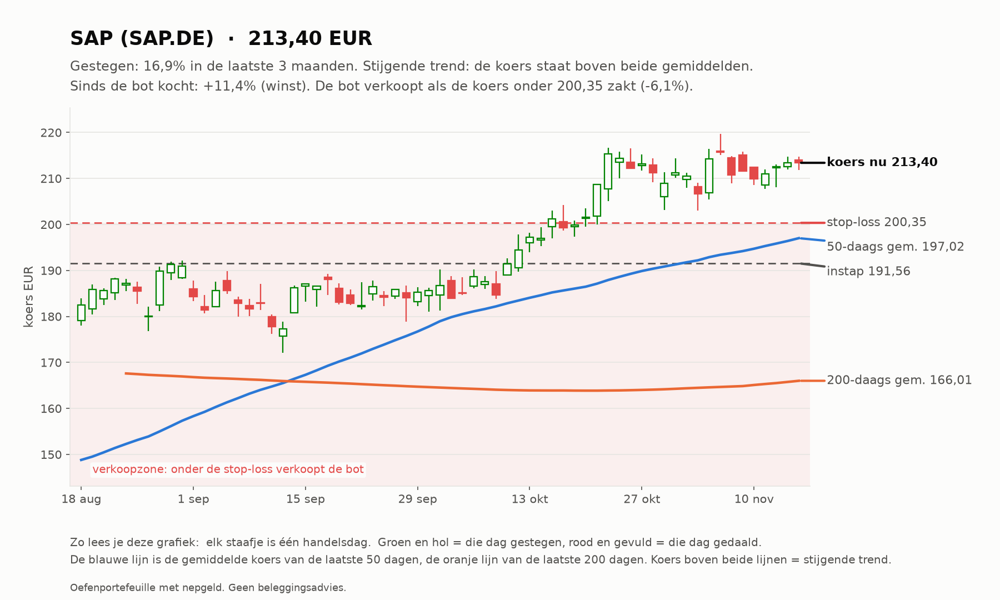
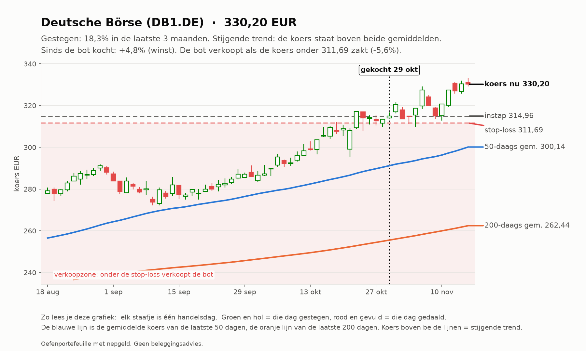
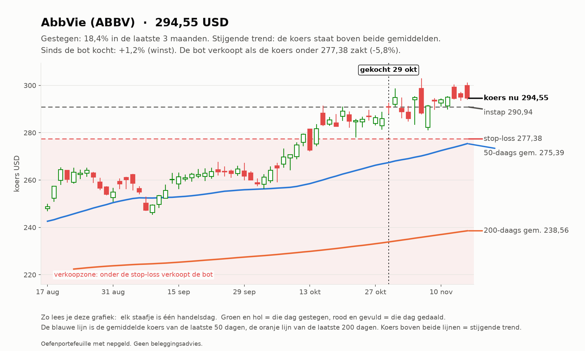
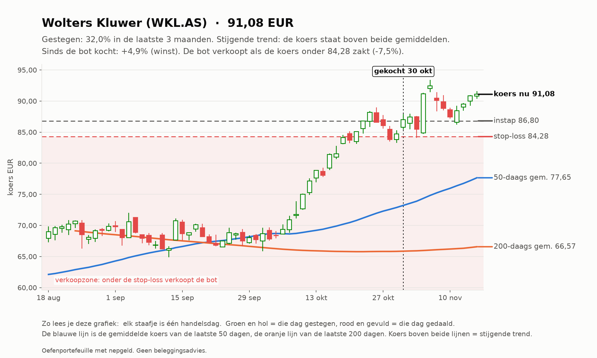
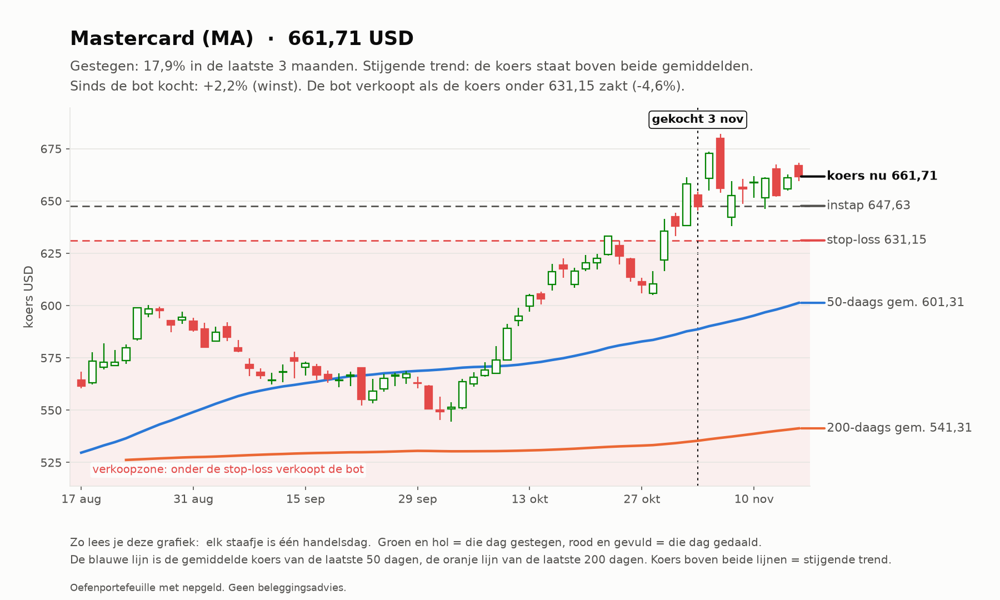
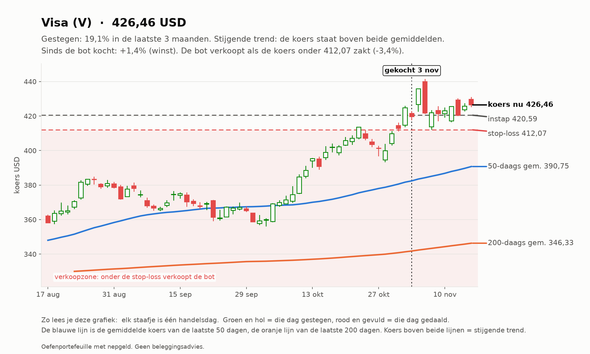
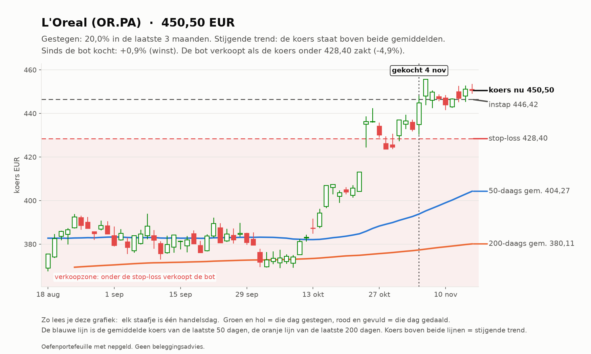
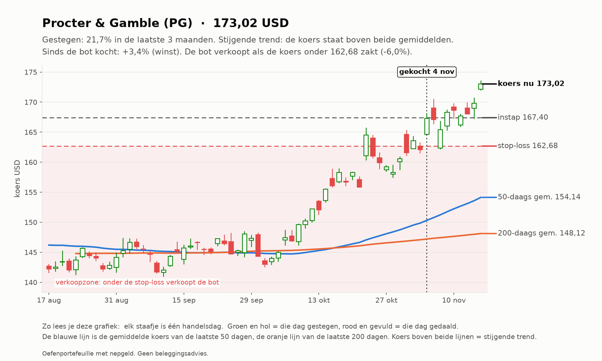

# Trend-agent rapport 2026-11-16

_Oefenportefeuille met nepgeld. Geen beleggingsadvies; resultaten uit het verleden zeggen niets over de toekomst._

**Status:** OK  
**Waarde:** €10,087.85  
**Kas:** €3,362.61  
**Marktregime:** stijgend-hoog  
**Strategieversie:** trend-1.1-eaf4f8  
**Koersbronnen:** 69 bevestigd door 2 bronnen, 60 uit 1 bron, 0 afwijkend; wisselkoers bevestigd  
**Sinds start:** +0.88%  

## Analyse van vandaag

**Wat de bot zag**

- **Markt (IWDA.AS):** koers 130,02, 6,3% boven het 200-daags gemiddelde (122,35); de afgelopen maand -0,4%. Trend: **stijgend**.
- **Beweeglijkheid:** 15% op jaarbasis, tegen normaal 10% het afgelopen jaar: **hoog**.
- **Breedte:** 80 van de 129 instrumenten staan boven hun 200-daags gemiddelde (62%; EU 41 van 60, US 39 van 69).
- **Bekeken:** 129 instrumenten.
- **Afgevallen** (een instrument kan op meer regels afvallen): geen stijgende trend (koers niet boven 50- en 200-daags gemiddelde): 80; niet gestegen over 1 of 3 maanden: 76; te weinig handel: 2; verdachte dagsprong: 1.
- **Door de zeef:** 38. Koopbare trends: **38**.

**Wat de bot eruit haalt**

- De markt stijgt breed: goede omstandigheden voor trendvolgen.
- De markt beweegt meer dan normaal: stops worden sneller geraakt. Het risico per trade blijft gelijk, dus de posities worden vanzelf kleiner.
- 3 van de 5 sterkste staan al ver boven hun gemiddelde (BRK-B, HEIA.AS, AI.PA): de trend is sterk, maar instappen op zo'n moment kost vaker een terugval.
- Alle plekken zijn bezet, dus de bot koopt niets bij, hoe sterk een trend ook is.

## Vandaag gedaan

- SAP.DE: stop omhoog van 200.21 naar 200.35
- DB1.DE: stop omhoog van 311.41 naar 311.69
- WKL.AS: stop omhoog van 84.13 naar 84.28
- OR.PA: stop omhoog van 428.34 naar 428.40
- PG: stop omhoog van 160.52 naar 162.68

## Verlies en risico

| Ticker | Instap | Koers nu | Resultaat | Stop | Afstand tot stop | Als de stop geraakt wordt |
| --- | --- | --- | --- | --- | --- | --- |
| SAP.DE | 191.56 EUR | 213.40 | €43,69 (+11,4%) | 200.35 | +6,5% | €16,58 winst vastgezet |
| DB1.DE | 314.96 EUR | 330.20 | €15,24 (+4,8%) | 311.69 | +5,9% | -€4,27 verlies |
| ABBV | 290.94 USD | 294.55 | €15,47 (+1,2%) | 277.38 | +6,2% | -€16,72 verlies |
| WKL.AS | 86.80 EUR | 91.08 | €42,77 (+4,9%) | 84.28 | +8,1% | -€26,28 verlies |
| MA | 647.63 USD | 661.71 | €50,44 (+2,2%) | 631.15 | +4,8% | -€6,07 verlies |
| V | 420.59 USD | 426.46 | €40,22 (+1,4%) | 412.07 | +3,5% | €0,01 winst vastgezet |
| OR.PA | 446.42 EUR | 450.50 | €8,15 (+0,9%) | 428.40 | +5,2% | -€37,05 verlies |
| PG | 167.40 USD | 173.02 | €67,19 (+3,4%) | 162.68 | +6,4% | -€8,95 verlies |

Raken alle stops tegelijk, dan is het verlies hooguit ongeveer €99,34 (bij een koersgat 's ochtends kan het meer zijn).

**Remmen** (bij overschrijden gaat de kill switch aan en koopt de bot niets meer):

- Daling vanaf de top: +0,00% (grens -10%; top was €10.087,85)
- Vandaag: +0,40% (grens -2%)
- Verliestrades op rij: 1 van 3

## Kansen: wat de bot vandaag het sterkst vond

_Dit is wat de oefenbot met zijn nepgeld volgens zijn eigen regels zou doen. Geen advies voor echt geld; het instapmoment is een ongeteste vuistregel en wordt door de bot niet gebruikt._

### 1. Berkshire Hathaway (BRK-B): instapmoment **opgelopen**

- **Waarom sterk:** Berkshire Hathaway steeg +17,9% in 3 maanden en +11,4% in 1 maand; koers boven het 50-daags en dat boven het 200-daags gemiddelde; MACD positief (de stijging versnelt); handel 1,1x het normale volume; beweegt gemiddeld 1,9% per dag.
- **Instapmoment:** de koers staat +4,9% van het 20-daags gemiddelde (2,6x de normale dagbeweging) en RSI is 81; na zo'n sprint volgt vaak eerst een terugval.
- **Status:** niet gekocht: RSI 81 boven de grens 75.
- **Plan van de bot:** koop 2 stuks rond 593.15 USD (inzet €1.077,51), stop-loss 570.22 USD (-3,9%). Maximaal verlies als de stop wordt geraakt: ongeveer €43,65. Ter oriëntatie: 2x het risico winst ligt bij 639.01 USD; de bot verkoopt daar niet vanzelf, hij laat de stop meeschuiven.

### 2. Heineken (HEIA.AS): instapmoment **opgelopen**

- **Waarom sterk:** Heineken steeg +18,4% in 3 maanden en +12,0% in 1 maand; koers boven het 50-daags en dat boven het 200-daags gemiddelde; MACD positief (de stijging versnelt); handel 1,1x het normale volume; beweegt gemiddeld 2,0% per dag.
- **Instapmoment:** de koers staat +5,1% van het 20-daags gemiddelde (2,6x de normale dagbeweging) en RSI is 77; na zo'n sprint volgt vaak eerst een terugval.
- **Status:** niet gekocht: RSI 77 boven de grens 75.
- **Plan van de bot:** koop 15 stuks rond 85.24 EUR (inzet €1.278,64), stop-loss 81.90 EUR (-3,9%). Maximaal verlies als de stop wordt geraakt: ongeveer €52,14. Ter oriëntatie: 2x het risico winst ligt bij 91.93 EUR; de bot verkoopt daar niet vanzelf, hij laat de stop meeschuiven.

### 3. Air Liquide (AI.PA): instapmoment **opgelopen**

- **Waarom sterk:** Air Liquide steeg +15,9% in 3 maanden en +11,7% in 1 maand; koers boven het 50-daags en dat boven het 200-daags gemiddelde; MACD positief (de stijging versnelt); handel 1,1x het normale volume; beweegt gemiddeld 1,6% per dag.
- **Instapmoment:** de koers staat +4,7% van het 20-daags gemiddelde (2,9x de normale dagbeweging) en RSI is 82; na zo'n sprint volgt vaak eerst een terugval.
- **Status:** niet gekocht: RSI 82 boven de grens 75.
- **Plan van de bot:** koop 8 stuks rond 193.44 EUR (inzet €1.547,49), stop-loss 187.27 EUR (-3,2%). Maximaal verlies als de stop wordt geraakt: ongeveer €51,35. Ter oriëntatie: 2x het risico winst ligt bij 205.77 EUR; de bot verkoopt daar niet vanzelf, hij laat de stop meeschuiven.

### 4. ASR Nederland (ASRNL.AS): instapmoment **neutraal**

- **Waarom sterk:** ASR Nederland steeg +17,4% in 3 maanden en +7,7% in 1 maand; koers boven het 50-daags en dat boven het 200-daags gemiddelde; MACD positief (de stijging versnelt); handel 0,8x het normale volume; beweegt gemiddeld 1,3% per dag.
- **Instapmoment:** de koers staat +3,4% van het 20-daags gemiddelde, RSI 73.
- **Status:** niet gekocht: alle 8 plekken zijn bezet.
- **Plan van de bot:** koop 24 stuks rond 79.80 EUR (inzet €1.915,20), stop-loss 77.76 EUR (-2,6%). Maximaal verlies als de stop wordt geraakt: ongeveer €50,99. Ter oriëntatie: 2x het risico winst ligt bij 83.88 EUR; de bot verkoopt daar niet vanzelf, hij laat de stop meeschuiven.

### 5. Procter & Gamble (PG): instapmoment **neutraal**

- **Waarom sterk:** Procter & Gamble steeg +21,4% in 3 maanden en +9,3% in 1 maand; koers boven het 50-daags en dat boven het 200-daags gemiddelde; MACD positief (de stijging versnelt); handel 1,1x het normale volume; beweegt gemiddeld 2,0% per dag.
- **Instapmoment:** de koers staat +5,4% van het 20-daags gemiddelde, RSI 73.
- **Status:** al in bezit.
- **Plan van de bot:** koop 8 stuks rond 173.11 USD (inzet €1.257,86), stop-loss 166.21 USD (-4,0%). Maximaal verlies als de stop wordt geraakt: ongeveer €52,10. Ter oriëntatie: 2x het risico winst ligt bij 186.90 USD; de bot verkoopt daar niet vanzelf, hij laat de stop meeschuiven.

## Wat de bot tot nu toe geleerd heeft

- 5 afgesloten trades: 1 met winst (20%), gemiddeld -0,87 R per trade (R = winst of verlies gedeeld door het risico bij instap), totaal -€187,32.
- Pas vanaf 20 trades trekt de bot conclusies over welke omstandigheden goed of slecht uitpakken; met minder is het vooral toeval. Het wekelijkse onderzoek (zaterdag) doet dat.

## Klaar voor echt geld?

**Trend-agent:** Nog niet klaar: de bot is nog bezig met bewijzen. Blijven oefenen.

| Eis | Stand | Nu |
| --- | --- | --- |
| Oefentijd | ⏳ | 26 van 63 handelsdagen (ongeveer 3 maanden) |
| Minstens zo goed als de wereld-ETF | ⏳ | verschil tot nu toe +2,43% |
| Grootste daling onder 5% | ✅ | grootste daling tot nu toe -2,18% |
| Genoeg afgesloten trades | ⏳ | 5 van 20 |

Zo analyseert de trend-agent (klik om te openen)

1. **Data controleren.** Koersen van Yahoo, gecontroleerd bij een tweede bron en de wisselkoers bij de ECB.
   Bevroren koersen, rare sprongen of achterlopende markten: dat instrument wordt die dag niet gekocht.
2. **De markt als geheel.** Aan de hand van de wereld-ETF (IWDA) of de S&P 500: staat de koers boven het
   200-daags gemiddelde (stijgend), eronder (dalend) of ertussenin (zijwaarts)? En beweegt de markt meer of
   minder dan normaal vergeleken met het afgelopen jaar? Plus: hoeveel aandelen staan boven hun 200-daags gemiddelde (de breedte).
3. **Elk instrument door de zeef.** Een trend telt alleen als ALLES klopt: koers boven het 50-daags gemiddelde en
   dat boven het 200-daags, plus over 1 en 3 maanden gestegen, genoeg handel en geen verdachte sprong.
4. **Rangschikken.** Score = stijging (60% 3 maanden, 40% 1 maand) gedeeld door de beweeglijkheid. Een rustige,
   stevige stijger wint van een wilde.
5. **Risico bepalen.** Stop-loss op 2x de gemiddelde dagbeweging (ATR) onder de instap. Het aantal stuks wordt zo
   gekozen dat de stop hooguit 0,25% van het vermogen kost.
6. **Beheren.** De stop schuift mee omhoog (3x ATR onder de hoogste slotkoers). Verkopen bij stop of als de koers
   onder het 50-daags gemiddelde sluit.

## Open posities

| Ticker | Aantal | Instap | Stop | Sinds |
| --- | --- | --- | --- | --- |
| SAP.DE | 2 | 191.56 EUR | 200.35 | 2026-10-10 |
| DB1.DE | 1 | 314.96 EUR | 311.69 | 2026-10-29 |
| ABBV | 2 | 290.94 USD | 277.38 | 2026-10-29 |
| WKL.AS | 10 | 86.80 EUR | 84.28 | 2026-10-30 |
| MA | 2 | 647.63 USD | 631.15 | 2026-11-03 |
| V | 3 | 420.59 USD | 412.07 | 2026-11-03 |
| OR.PA | 2 | 446.42 EUR | 428.40 | 2026-11-04 |
| PG | 8 | 167.40 USD | 162.68 | 2026-11-04 |

## Sterkste trends vandaag

| # | Ticker | Score | 3 mnd | 1 mnd |
| --- | --- | --- | --- | --- |
| 1 | BRK-B | 0.180 | +17.9% | +11.4% |
| 2 | HEIA.AS | 0.154 | +18.4% | +12.0% |
| 3 | AI.PA | 0.150 | +15.9% | +11.7% |
| 4 | ASRNL.AS | 0.149 | +17.4% | +7.7% |
| 5 | PG | 0.138 | +21.4% | +9.3% |
| 6 | SAN.PA | 0.137 | +12.5% | +22.9% |
| 7 | IBE.MC | 0.134 | +15.8% | +7.0% |
| 8 | DB1.DE | 0.131 | +18.8% | +6.7% |
| 9 | OR.PA | 0.128 | +17.8% | +10.6% |
| 10 | BAYN.DE | 0.125 | +16.4% | +28.3% |

## Afgesloten trades

5 trades, 1 winst (20%), totaal €-187.32 na kosten.

## Grafieken (laatste 3 maanden)

_Grafieken worden 20 handelsdagen bewaard._
