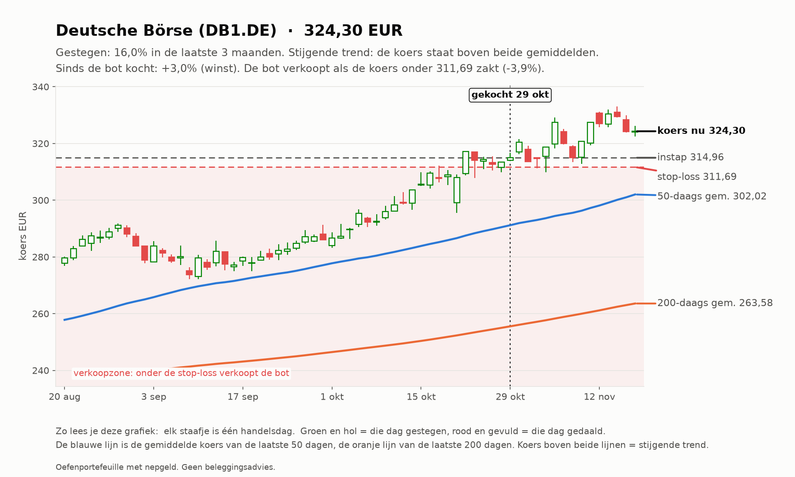
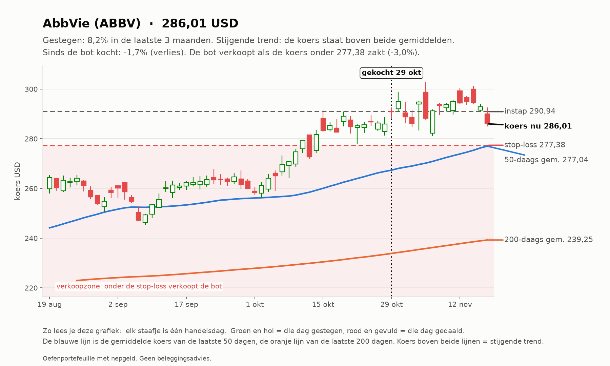
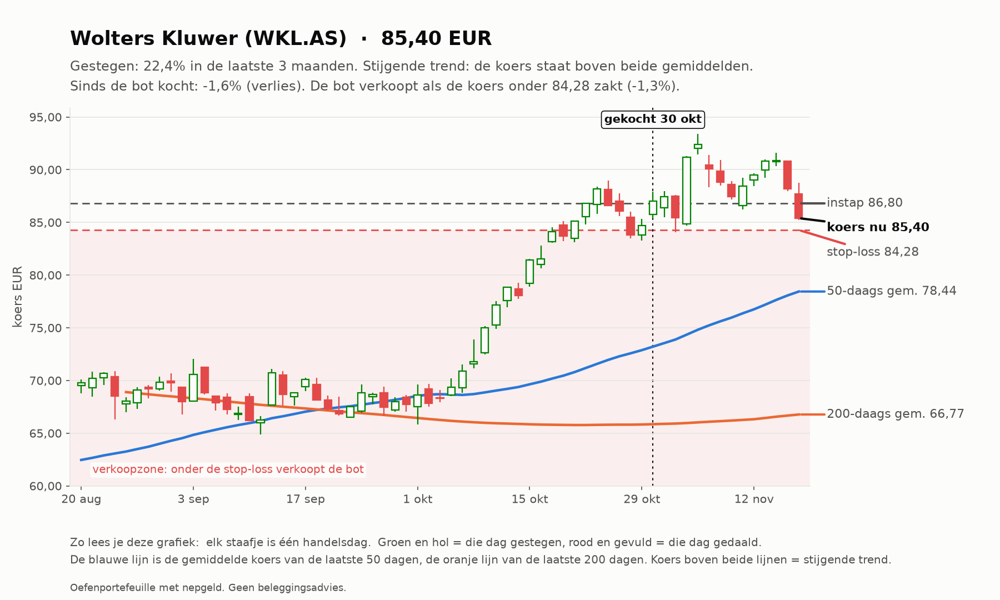
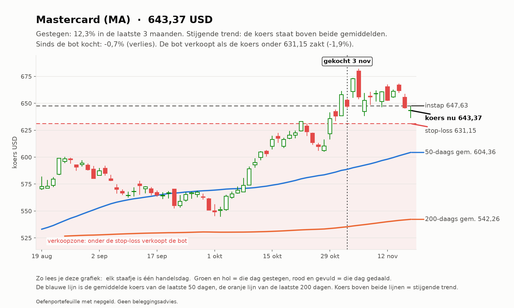
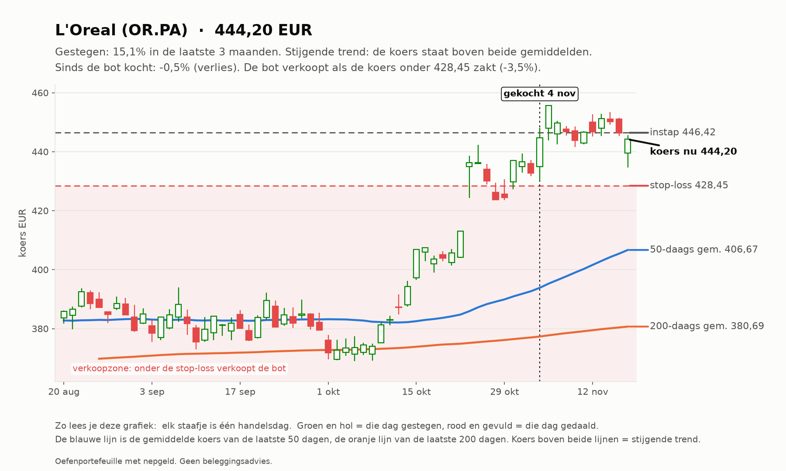
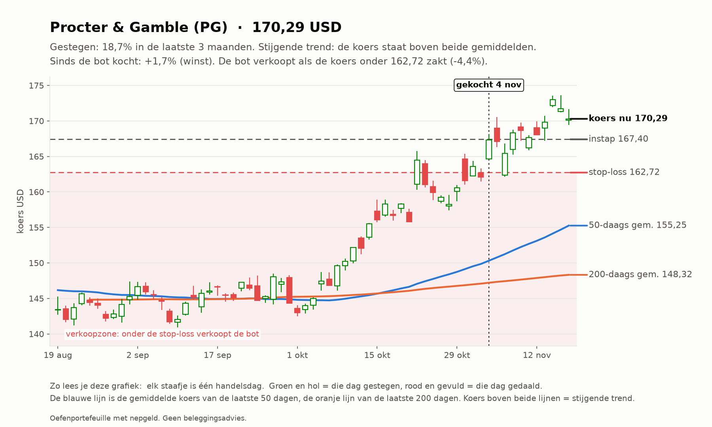
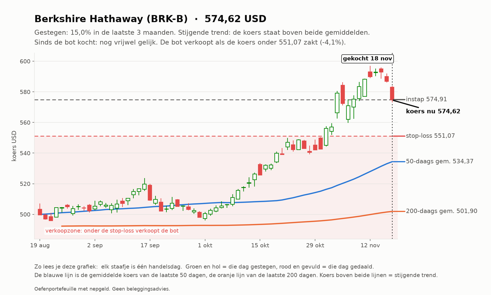
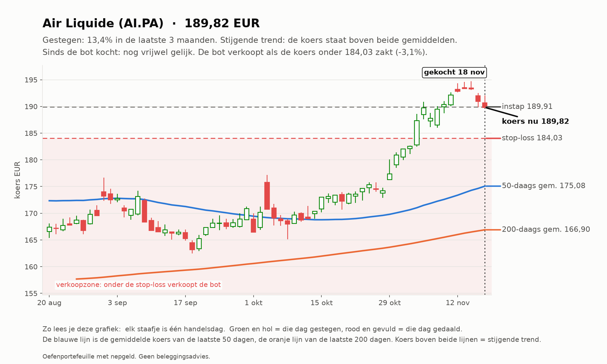
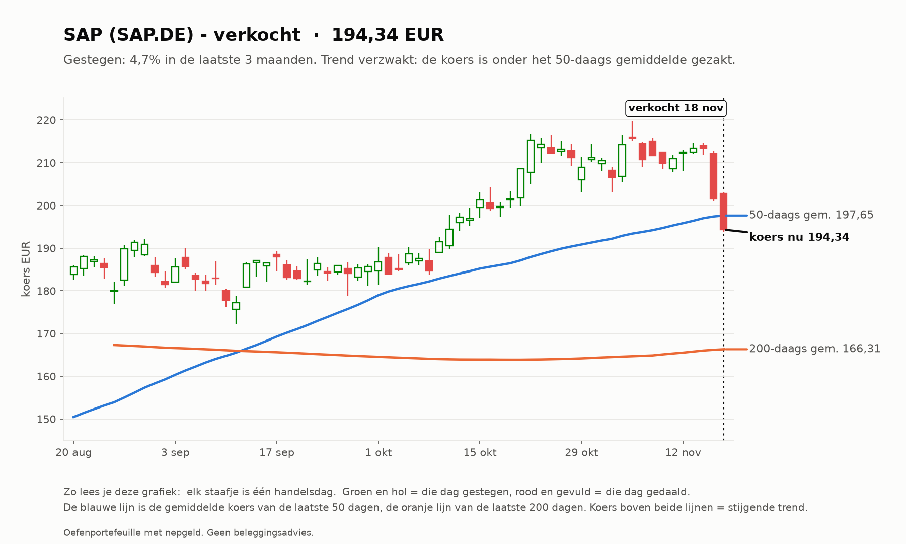
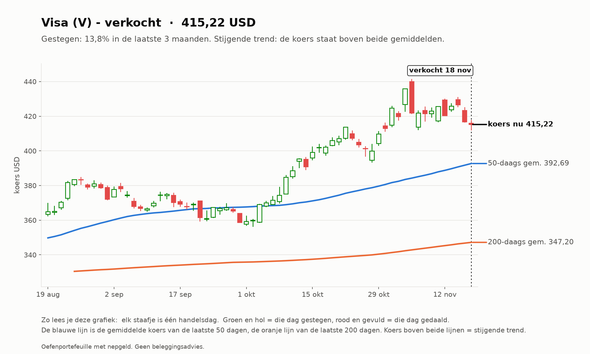

# Trend-agent rapport 2026-11-18

_Oefenportefeuille met nepgeld. Geen beleggingsadvies; resultaten uit het verleden zeggen niets over de toekomst._

**Status:** OK  
**Waarde:** €9,890.78  
**Kas:** €2,318.04  
**Marktregime:** stijgend-hoog  
**Strategieversie:** trend-1.1-eaf4f8  
**Koersbronnen:** 69 bevestigd door 2 bronnen, 60 uit 1 bron, 0 afwijkend; wisselkoers bevestigd  
**Sinds start:** -1.09%  

## Analyse van vandaag

**Wat de bot zag**

- **Markt (IWDA.AS):** koers 127,03, 3,7% boven het 200-daags gemiddelde (122,50); de afgelopen maand -2,6%. Trend: **stijgend**.
- **Beweeglijkheid:** 16% op jaarbasis, tegen normaal 10% het afgelopen jaar: **hoog**.
- **Breedte:** 74 van de 129 instrumenten staan boven hun 200-daags gemiddelde (57%; EU 38 van 60, US 36 van 69).
- **Bekeken:** 129 instrumenten.
- **Afgevallen** (een instrument kan op meer regels afvallen): geen stijgende trend (koers niet boven 50- en 200-daags gemiddelde): 87; niet gestegen over 1 of 3 maanden: 79; te weinig handel: 2; verdachte dagsprong: 1.
- **Door de zeef:** 34. Koopbare trends: **34**.

**Wat de bot eruit haalt**

- De markt stijgt, maar gedragen door een minderheid van de aandelen: kwetsbaarder dan het lijkt.
- De markt beweegt meer dan normaal: stops worden sneller geraakt. Het risico per trade blijft gelijk, dus de posities worden vanzelf kleiner.
- Sterk zonder ver weggelopen te zijn: BRK-B.
- Gekocht vandaag: BRK-B, AI.PA.

## Vandaag gedaan

- SELL 2 x SAP.DE @ 200.25 (stop-loss geraakt, resultaat €+15.38)
- SELL 3 x V @ 411.86 (stop-loss geraakt, resultaat €+3.51)
- PG: stop omhoog van 162.68 naar 162.72
- PHIA.AS: overgeslagen (patroonfilter: geen terugval in de laatste week)
- BUY 2 x BRK-B @ 574.91 (trend OK: 3m +15.7%, 1m +6.4%, volume x1.10)
- BUY 8 x AI.PA @ 189.91 (trend OK: 3m +13.6%, 1m +10.2%, volume x1.12)

## Waarom

- **SELL SAP.DE**: stop-loss geraakt. Omstandigheden: RSI 37, MACD-histogram -1.23%, ATR 3.1% per dag, +16.9% boven SMA200, markt stijgend-hoog, R = +0.69 na 39 dagen
- **SELL V**: stop-loss geraakt. Omstandigheden: RSI 54, MACD-histogram -0.47%, ATR 2.4% per dag, +19.6% boven SMA200, markt stijgend-hoog, R = +0.08 na 15 dagen
- **BUY BRK-B**: trend OK: 3m +15.7%, 1m +6.4%, volume x1.10. Omstandigheden: RSI 61, MACD-histogram -0.00%, ATR 2.1% per dag, +14.5% boven SMA200, markt stijgend-hoog
- **BUY AI.PA**: trend OK: 3m +13.6%, 1m +10.2%, volume x1.12. Omstandigheden: RSI 68, MACD-histogram +0.10%, ATR 1.6% per dag, +13.7% boven SMA200, markt stijgend-hoog

## Verlies en risico

| Ticker | Instap | Koers nu | Resultaat | Stop | Afstand tot stop | Als de stop geraakt wordt |
| --- | --- | --- | --- | --- | --- | --- |
| DB1.DE | 314.96 EUR | 324.30 | €9,34 (+3,0%) | 311.69 | +4,0% | -€4,27 verlies |
| ABBV | 290.94 USD | 286.01 | €2,30 (-1,7%) | 277.38 | +3,1% | -€14,45 verlies |
| WKL.AS | 86.80 EUR | 85.40 | -€14,03 (-1,6%) | 84.28 | +1,3% | -€26,28 verlies |
| MA | 647.63 USD | 643.37 | €22,40 (-0,7%) | 631.15 | +1,9% | -€0,90 verlies |
| OR.PA | 446.42 EUR | 444.20 | -€4,45 (-0,5%) | 428.45 | +3,7% | -€36,94 verlies |
| PG | 167.40 USD | 170.29 | €52,94 (+1,7%) | 162.72 | +4,7% | -€3,29 verlies |
| BRK-B | 574.91 USD | 574.62 | -€0,52 (-0,1%) | 551.07 | +4,3% | -€44,50 verlies |
| AI.PA | 189.91 EUR | 189.82 | -€0,76 (-0,1%) | 184.03 | +3,1% | -€48,11 verlies |

Raken alle stops tegelijk, dan is het verlies hooguit ongeveer €178,74 (bij een koersgat 's ochtends kan het meer zijn).

**Remmen** (bij overschrijden gaat de kill switch aan en koopt de bot niets meer):

- Daling vanaf de top: -1,95% (grens -10%; top was €10.087,85)
- Vandaag: -0,72% (grens -2%)
- Verliestrades op rij: 0 van 3

## Kansen: wat de bot vandaag het sterkst vond

_Dit is wat de oefenbot met zijn nepgeld volgens zijn eigen regels zou doen. Geen advies voor echt geld; het instapmoment is een ongeteste vuistregel en wordt door de bot niet gebruikt._

### 1. Philips (PHIA.AS): instapmoment **neutraal**

- **Waarom sterk:** Philips steeg +15,2% in 3 maanden en +17,7% in 1 maand; koers boven het 50-daags en dat boven het 200-daags gemiddelde; MACD positief (de stijging versnelt); handel 1,3x het normale volume; beweegt gemiddeld 2,5% per dag.
- **Instapmoment:** de koers staat +4,4% van het 20-daags gemiddelde, RSI 74.
- **Status:** niet gekocht: alle 8 plekken zijn bezet.
- **Plan van de bot:** koop 35 stuks rond 27.22 EUR (inzet €952,83), stop-loss 25.84 EUR (-5,1%). Maximaal verlies als de stop wordt geraakt: ongeveer €50,40. Ter oriëntatie: 2x het risico winst ligt bij 29.99 EUR; de bot verkoopt daar niet vanzelf, hij laat de stop meeschuiven.

### 2. Berkshire Hathaway (BRK-B): instapmoment **gunstig**

- **Waarom sterk:** Berkshire Hathaway steeg +15,7% in 3 maanden en +6,4% in 1 maand; koers boven het 50-daags en dat boven het 200-daags gemiddelde; MACD negatief (de stijging vertraagt); handel 1,1x het normale volume; beweegt gemiddeld 2,1% per dag.
- **Instapmoment:** de trend is sterk maar de koers is niet ver weggelopen (+1,2% van het 20-daags gemiddelde, RSI 61).
- **Status:** vandaag gekocht door de bot.
- **Plan van de bot:** koop 2 stuks rond 574.91 USD (inzet €1.049,09), stop-loss 551.07 USD (-4,2%). Maximaal verlies als de stop wordt geraakt: ongeveer €45,50. Ter oriëntatie: 2x het risico winst ligt bij 622.58 USD; de bot verkoopt daar niet vanzelf, hij laat de stop meeschuiven.

### 3. Air Liquide (AI.PA): instapmoment **neutraal**

- **Waarom sterk:** Air Liquide steeg +13,6% in 3 maanden en +10,2% in 1 maand; koers boven het 50-daags en dat boven het 200-daags gemiddelde; MACD positief (de stijging versnelt); handel 1,1x het normale volume; beweegt gemiddeld 1,6% per dag.
- **Instapmoment:** de koers staat +2,2% van het 20-daags gemiddelde, RSI 68.
- **Status:** vandaag gekocht door de bot.
- **Plan van de bot:** koop 8 stuks rond 189.91 EUR (inzet €1.519,32), stop-loss 184.03 EUR (-3,1%). Maximaal verlies als de stop wordt geraakt: ongeveer €49,11. Ter oriëntatie: 2x het risico winst ligt bij 201.69 EUR; de bot verkoopt daar niet vanzelf, hij laat de stop meeschuiven.

### 4. Heineken (HEIA.AS): instapmoment **neutraal**

- **Waarom sterk:** Heineken steeg +16,3% in 3 maanden en +9,4% in 1 maand; koers boven het 50-daags en dat boven het 200-daags gemiddelde; MACD negatief (de stijging vertraagt); handel 1,0x het normale volume; beweegt gemiddeld 1,8% per dag.
- **Instapmoment:** de koers staat +3,2% van het 20-daags gemiddelde, RSI 71.
- **Status:** niet gekocht: alle 8 plekken zijn bezet.
- **Plan van de bot:** koop 16 stuks rond 84.30 EUR (inzet €1.348,83), stop-loss 81.22 EUR (-3,7%). Maximaal verlies als de stop wordt geraakt: ongeveer €51,37. Ter oriëntatie: 2x het risico winst ligt bij 90.47 EUR; de bot verkoopt daar niet vanzelf, hij laat de stop meeschuiven.

### 5. Costco (COST): instapmoment **neutraal**

- **Waarom sterk:** Costco steeg +17,6% in 3 maanden en +10,4% in 1 maand; koers boven het 50-daags en dat boven het 200-daags gemiddelde; MACD positief (de stijging versnelt); handel 1,1x het normale volume; beweegt gemiddeld 2,0% per dag.
- **Instapmoment:** de koers staat +4,0% van het 20-daags gemiddelde, RSI 69.
- **Status:** niet gekocht: alle 8 plekken zijn bezet.
- **Plan van de bot:** koop 1 stuk rond 1097.17 USD (inzet €1.001,06), stop-loss 1053.34 USD (-4,0%). Maximaal verlies als de stop wordt geraakt: ongeveer €41,99. Ter oriëntatie: 2x het risico winst ligt bij 1184.82 USD; de bot verkoopt daar niet vanzelf, hij laat de stop meeschuiven.

## Wat de bot tot nu toe geleerd heeft

- 7 afgesloten trades: 3 met winst (43%), gemiddeld -0,51 R per trade (R = winst of verlies gedeeld door het risico bij instap), totaal -€168,43.
- Pas vanaf 20 trades trekt de bot conclusies over welke omstandigheden goed of slecht uitpakken; met minder is het vooral toeval. Het wekelijkse onderzoek (zaterdag) doet dat.

## Klaar voor echt geld?

**Trend-agent:** Nog niet klaar: de bot is nog bezig met bewijzen. Blijven oefenen.

| Eis | Stand | Nu |
| --- | --- | --- |
| Oefentijd | ⏳ | 28 van 63 handelsdagen (ongeveer 3 maanden) |
| Minstens zo goed als de wereld-ETF | ⏳ | verschil tot nu toe +2,72% |
| Grootste daling onder 5% | ✅ | grootste daling tot nu toe -2,18% |
| Genoeg afgesloten trades | ⏳ | 7 van 20 |

Zo analyseert de trend-agent (klik om te openen)

1. **Data controleren.** Koersen van Yahoo, gecontroleerd bij een tweede bron en de wisselkoers bij de ECB.
   Bevroren koersen, rare sprongen of achterlopende markten: dat instrument wordt die dag niet gekocht.
2. **De markt als geheel.** Aan de hand van de wereld-ETF (IWDA) of de S&P 500: staat de koers boven het
   200-daags gemiddelde (stijgend), eronder (dalend) of ertussenin (zijwaarts)? En beweegt de markt meer of
   minder dan normaal vergeleken met het afgelopen jaar? Plus: hoeveel aandelen staan boven hun 200-daags gemiddelde (de breedte).
3. **Elk instrument door de zeef.** Een trend telt alleen als ALLES klopt: koers boven het 50-daags gemiddelde en
   dat boven het 200-daags, plus over 1 en 3 maanden gestegen, genoeg handel en geen verdachte sprong.
4. **Rangschikken.** Score = stijging (60% 3 maanden, 40% 1 maand) gedeeld door de beweeglijkheid. Een rustige,
   stevige stijger wint van een wilde.
5. **Risico bepalen.** Stop-loss op 2x de gemiddelde dagbeweging (ATR) onder de instap. Het aantal stuks wordt zo
   gekozen dat de stop hooguit 0,25% van het vermogen kost.
6. **Beheren.** De stop schuift mee omhoog (3x ATR onder de hoogste slotkoers). Verkopen bij stop of als de koers
   onder het 50-daags gemiddelde sluit.

## Open posities

| Ticker | Aantal | Instap | Stop | Sinds |
| --- | --- | --- | --- | --- |
| DB1.DE | 1 | 314.96 EUR | 311.69 | 2026-10-29 |
| ABBV | 2 | 290.94 USD | 277.38 | 2026-10-29 |
| WKL.AS | 10 | 86.80 EUR | 84.28 | 2026-10-30 |
| MA | 2 | 647.63 USD | 631.15 | 2026-11-03 |
| OR.PA | 2 | 446.42 EUR | 428.45 | 2026-11-04 |
| PG | 8 | 167.40 USD | 162.72 | 2026-11-04 |
| BRK-B | 2 | 574.91 USD | 551.07 | 2026-11-18 |
| AI.PA | 8 | 189.91 EUR | 184.03 | 2026-11-18 |

## Sterkste trends vandaag

| # | Ticker | Score | 3 mnd | 1 mnd |
| --- | --- | --- | --- | --- |
| 1 | PHIA.AS | 0.141 | +15.2% | +17.7% |
| 2 | BRK-B | 0.135 | +15.7% | +6.4% |
| 3 | AI.PA | 0.129 | +13.6% | +10.2% |
| 4 | HEIA.AS | 0.129 | +16.3% | +9.4% |
| 5 | COST | 0.127 | +17.6% | +10.4% |
| 6 | BAYN.DE | 0.126 | +16.5% | +28.7% |
| 7 | PG | 0.125 | +19.9% | +7.6% |
| 8 | ASRNL.AS | 0.119 | +14.9% | +5.6% |
| 9 | IBE.MC | 0.116 | +13.5% | +7.2% |
| 10 | OR.PA | 0.115 | +14.9% | +10.0% |

## Afgesloten trades

7 trades, 3 winst (43%), totaal €-168.43 na kosten.

## Grafieken (laatste 3 maanden)

_Grafieken worden 20 handelsdagen bewaard._
