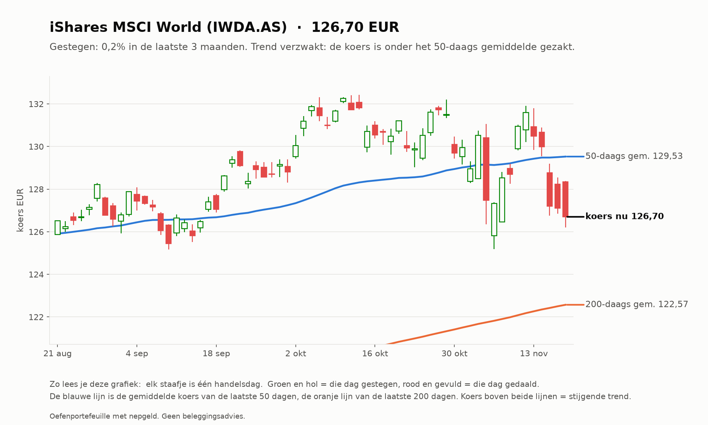
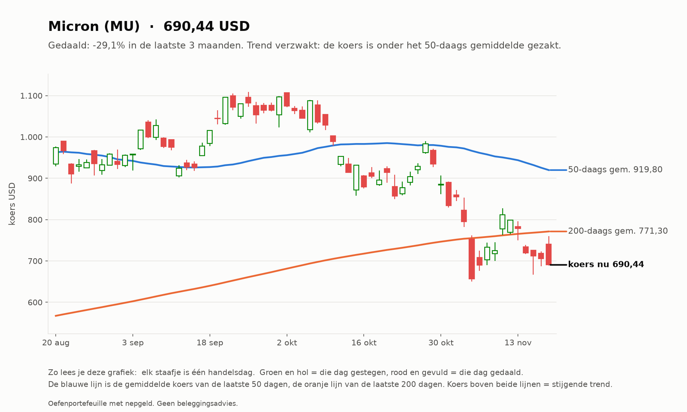
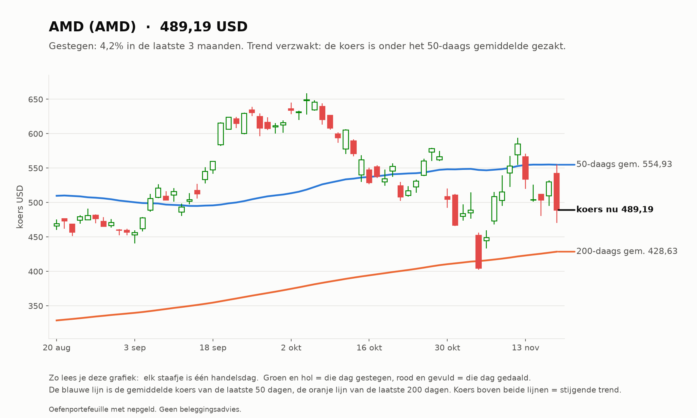
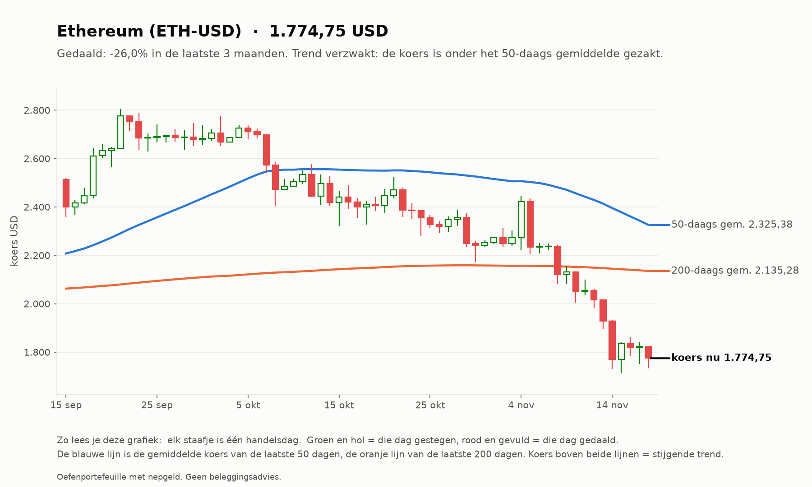
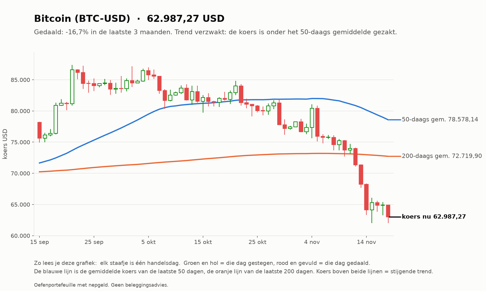

# Investeerder 2026-11-19

_Oefenportefeuille met nepgeld. Geen beleggingsadvies._

**Status:** OK  
**Waarde:** €9,018.70  
**Marktregime:** stijgend-hoog  
**Strategieversie:** investeerder-1.0-64ce27  
**Koersbronnen:** 69 bevestigd door 2 bronnen, 62 uit 1 bron, 0 afwijkend; wisselkoers bevestigd  
**Sinds start:** -9.81%  

## Verdeling

| Instrument | Aandeel |
| --- | --- |
| iShares MSCI World (IWDA.AS) | 60.9% |
| AMD (AMD) | 5.6% |
| Micron (MU) | 4.7% |
| Bitcoin (BTC-USD) | 4.3% |
| Ethereum (ETH-USD) | 4.0% |
| Kas | 20.5% |

## Analyse van vandaag

**Wat de bot zag**

- **Markt (IWDA.AS):** koers 126,70, 3,4% boven het 200-daags gemiddelde (122,57); de afgelopen maand -3,4%. Trend: **stijgend**.
- **Beweeglijkheid:** 16% op jaarbasis, tegen normaal 10% het afgelopen jaar: **hoog**.
- **Breedte:** 65 van de 129 instrumenten staan boven hun 200-daags gemiddelde (50%; EU 36 van 60, US 29 van 69).
- **Sterkste momentum nu (12 maanden, zonder laatste maand):** AMD +140%, CrowdStrike +86%, Texas Instruments +84%, Palo Alto Networks +73%, Bayer +66%.
- **BTC-USD:** 13,4% onder het 200-daags gemiddelde (blijft in kas).
- **ETH-USD:** 16,9% onder het 200-daags gemiddelde (blijft in kas).

**Wat de bot eruit haalt**

- De markt stijgt: de kern (wereld-ETF) doet zijn werk, de sterkste aandelen lopen mee.
- De markt beweegt meer dan normaal: grotere schommelingen in de waarde zijn te verwachten; de spreiding over 60% wereld-ETF dempt dat.
- Uit de top gevallen: MU. Blijft dat zo, dan worden ze bij de volgende herverdeling (eerste handelsdag van 2026-12) vervangen door CRWD, TXN, PANW, BAYN.DE.
- BTC-USD, ETH-USD staat onder het 200-daags gemiddelde: bij de volgende herverdeling gaat dat deel naar kas.

## Verlies en winst per belegging

| Instrument | Waarde | Ingelegd | Resultaat |
| --- | --- | --- | --- |
| IWDA.AS | €5.493,61 | €5.714,81 | -€221,21 (-3,9%) |
| MU | €425,66 | €600,00 | -€174,34 (-29,1%) |
| ETH-USD | €363,33 | €500,00 | -€136,67 (-27,3%) |
| BTC-USD | €386,79 | €500,00 | -€113,21 (-22,6%) |
| AMD | €501,95 | €600,00 | -€98,05 (-16,3%) |

Totaal op de beleggingen: -€743,48 (inclusief aankoopkosten).
Daling vanaf de hoogste waarde ooit: -9,81% (top €10.000,00). De investeerder heeft geen stop-loss: hij houdt een spreiding vast en herverdeelt maandelijks.

## Vandaag gedaan

- Niets (herverdelen gebeurt één keer per maand)

## Klaar voor echt geld?

**Investeerder:** Nog niet klaar: een eis wordt niet gehaald. Blijven oefenen en kijken waarom.

| Eis | Stand | Nu |
| --- | --- | --- |
| Oefentijd | ⏳ | 28 van 63 handelsdagen (ongeveer 3 maanden) |
| Minstens zo goed als de wereld-ETF | ⏳ | verschil tot nu toe -5,48% |
| Daling niet veel dieper dan de ETF | ❌ | bot -9,81%, ETF -4,20% |

Zo analyseert de investeerder (klik om te openen)

1. **Kern (60%):** de wereld-ETF (IWDA), altijd.
2. **Satelliet (30%):** de 5 aandelen of ETF's met de grootste stijging over 12 maanden (de laatste maand niet
   meegeteld, omdat die vaak terugveert), alleen als ze boven hun 200-daags gemiddelde staan en genoeg verhandeld worden.
3. **Crypto (10%):** Bitcoin en Ethereum, alleen als ze boven hun 200-daags gemiddelde staan; anders kas.
4. **Eén keer per maand** wordt alles teruggezet naar deze verdeling. Tussendoor kijkt hij elke dag mee, maar handelt niet.

## Grafieken (laatste 3 maanden)

_Grafieken worden 20 handelsdagen bewaard._
