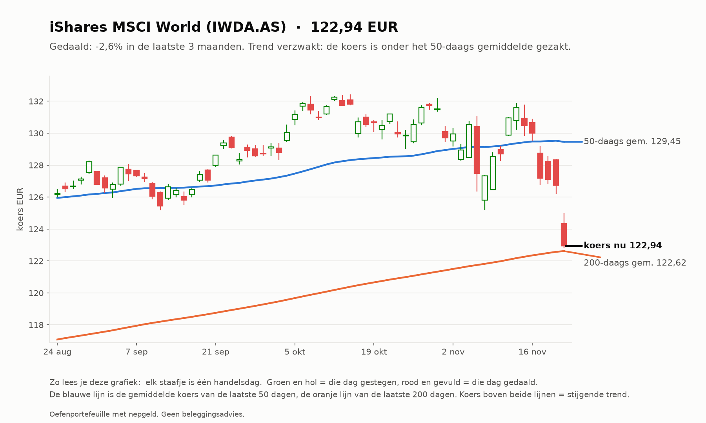
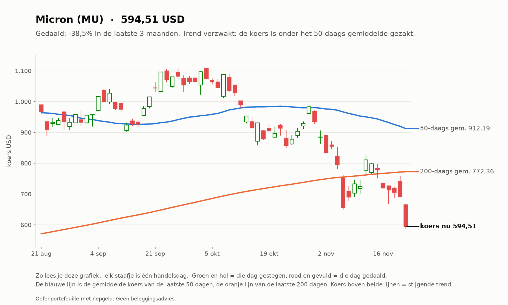
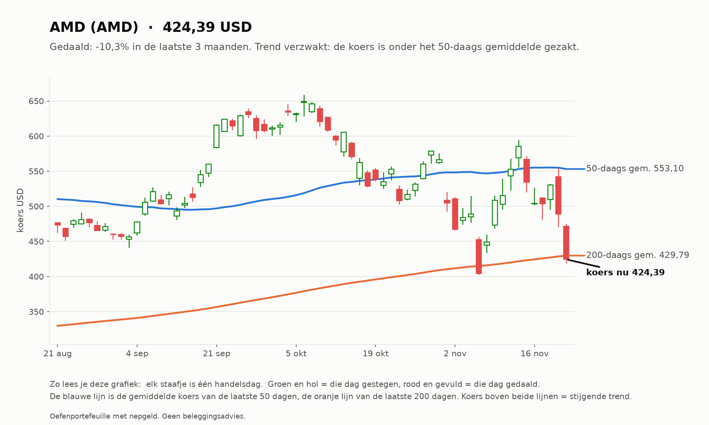
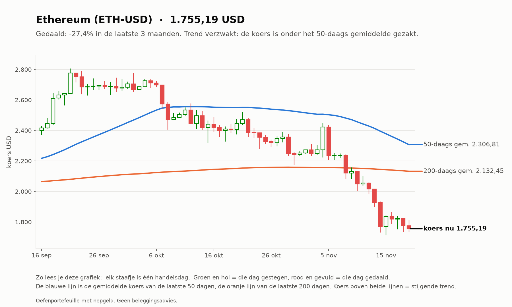
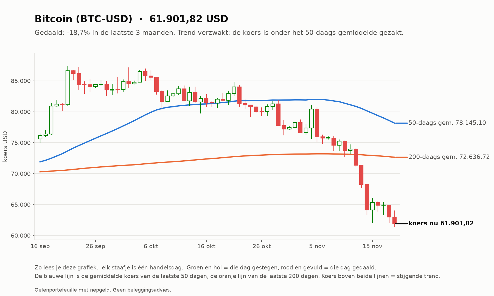

# Investeerder 2026-11-20

_Oefenportefeuille met nepgeld. Geen beleggingsadvies._

**Status:** OK  
**Waarde:** €8,720.21  
**Marktregime:** stijgend-hoog  
**Strategieversie:** investeerder-1.0-64ce27  
**Koersbronnen:** 69 bevestigd door 2 bronnen, 62 uit 1 bron, 0 afwijkend; wisselkoers bevestigd  
**Sinds start:** -12.80%  

## Verdeling

| Instrument | Aandeel |
| --- | --- |
| iShares MSCI World (IWDA.AS) | 61.1% |
| AMD (AMD) | 5.0% |
| Bitcoin (BTC-USD) | 4.4% |
| Micron (MU) | 4.2% |
| Ethereum (ETH-USD) | 4.1% |
| Kas | 21.2% |

## Analyse van vandaag

**Wat de bot zag**

- **Markt (IWDA.AS):** koers 122,94, 0,3% boven het 200-daags gemiddelde (122,62); de afgelopen maand -5,4%. Trend: **stijgend**.
- **Beweeglijkheid:** 19% op jaarbasis, tegen normaal 10% het afgelopen jaar: **hoog**.
- **Breedte:** 57 van de 129 instrumenten staan boven hun 200-daags gemiddelde (44%; EU 30 van 60, US 27 van 69).
- **Sterkste momentum nu (12 maanden, zonder laatste maand):** CrowdStrike +83%, Palo Alto Networks +78%, Bayer +61%, Merck & Co +59%, DSM-Firmenich +58%.
- **BTC-USD:** 14,8% onder het 200-daags gemiddelde (blijft in kas).
- **ETH-USD:** 17,7% onder het 200-daags gemiddelde (blijft in kas).

**Wat de bot eruit haalt**

- De markt stijgt: de kern (wereld-ETF) doet zijn werk, de sterkste aandelen lopen mee.
- De markt beweegt meer dan normaal: grotere schommelingen in de waarde zijn te verwachten; de spreiding over 60% wereld-ETF dempt dat.
- Uit de top gevallen: AMD, MU. Blijft dat zo, dan worden ze bij de volgende herverdeling (eerste handelsdag van 2026-12) vervangen door CRWD, PANW, BAYN.DE, MRK, DSFIR.AS.
- BTC-USD, ETH-USD staat onder het 200-daags gemiddelde: bij de volgende herverdeling gaat dat deel naar kas.

## Verlies en winst per belegging

| Instrument | Waarde | Ingelegd | Resultaat |
| --- | --- | --- | --- |
| IWDA.AS | €5.330,58 | €5.714,81 | -€384,24 (-6,7%) |
| MU | €366,72 | €600,00 | -€233,28 (-38,9%) |
| AMD | €435,70 | €600,00 | -€164,30 (-27,4%) |
| ETH-USD | €359,52 | €500,00 | -€140,48 (-28,1%) |
| BTC-USD | €380,33 | €500,00 | -€119,67 (-23,9%) |

Totaal op de beleggingen: -€1.041,97 (inclusief aankoopkosten).
Daling vanaf de hoogste waarde ooit: -12,80% (top €10.000,00). De investeerder heeft geen stop-loss: hij houdt een spreiding vast en herverdeelt maandelijks.

## Vandaag gedaan

- Niets (herverdelen gebeurt één keer per maand)

## Klaar voor echt geld?

**Investeerder:** Nog niet klaar: een eis wordt niet gehaald. Blijven oefenen en kijken waarom.

| Eis | Stand | Nu |
| --- | --- | --- |
| Oefentijd | ⏳ | 29 van 63 handelsdagen (ongeveer 3 maanden) |
| Minstens zo goed als de wereld-ETF | ⏳ | verschil tot nu toe -5,63% |
| Daling niet veel dieper dan de ETF | ❌ | bot -12,80%, ETF -7,05% |

Zo analyseert de investeerder (klik om te openen)

1. **Kern (60%):** de wereld-ETF (IWDA), altijd.
2. **Satelliet (30%):** de 5 aandelen of ETF's met de grootste stijging over 12 maanden (de laatste maand niet
   meegeteld, omdat die vaak terugveert), alleen als ze boven hun 200-daags gemiddelde staan en genoeg verhandeld worden.
3. **Crypto (10%):** Bitcoin en Ethereum, alleen als ze boven hun 200-daags gemiddelde staan; anders kas.
4. **Eén keer per maand** wordt alles teruggezet naar deze verdeling. Tussendoor kijkt hij elke dag mee, maar handelt niet.

## Grafieken (laatste 3 maanden)

_Grafieken worden 20 handelsdagen bewaard._
