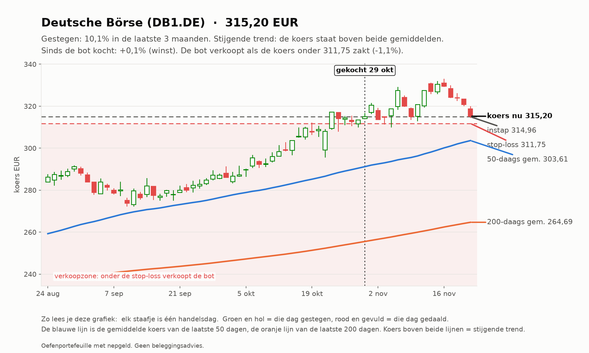
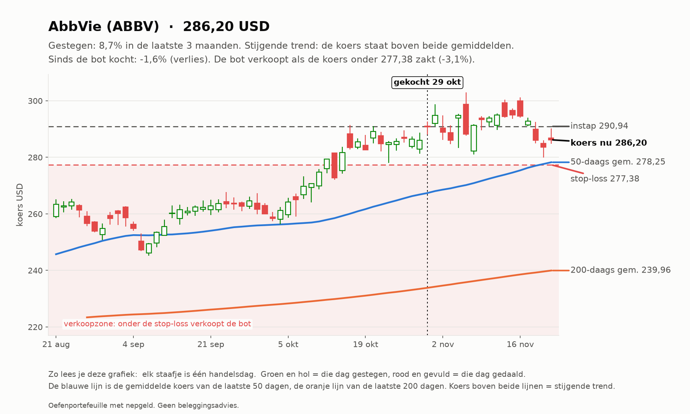
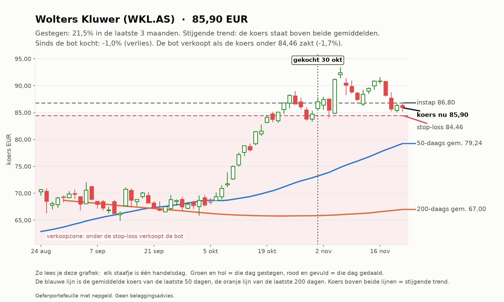
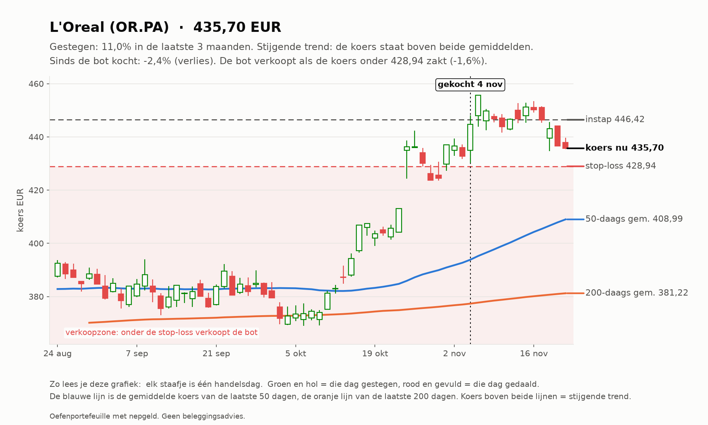
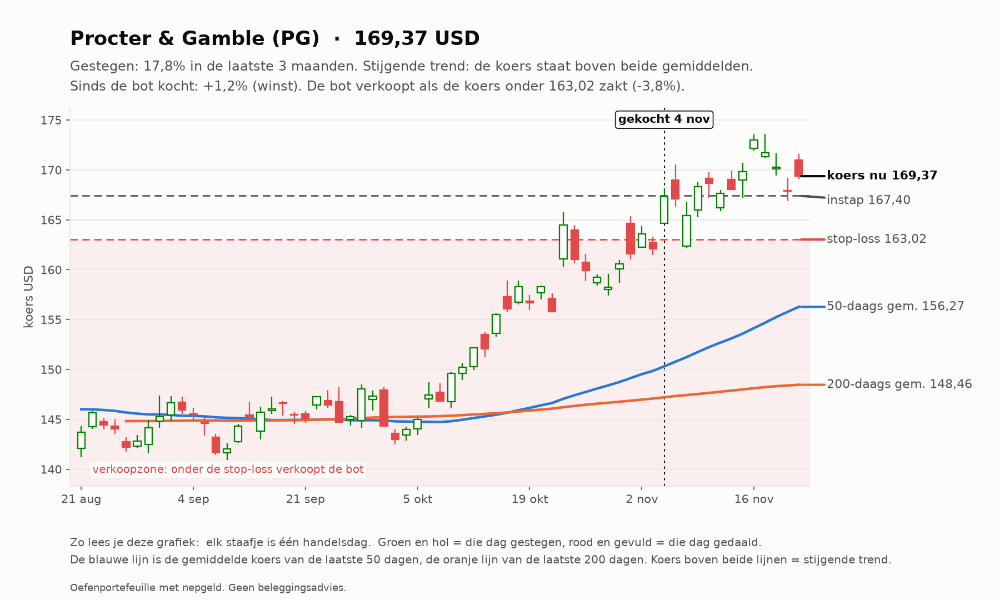
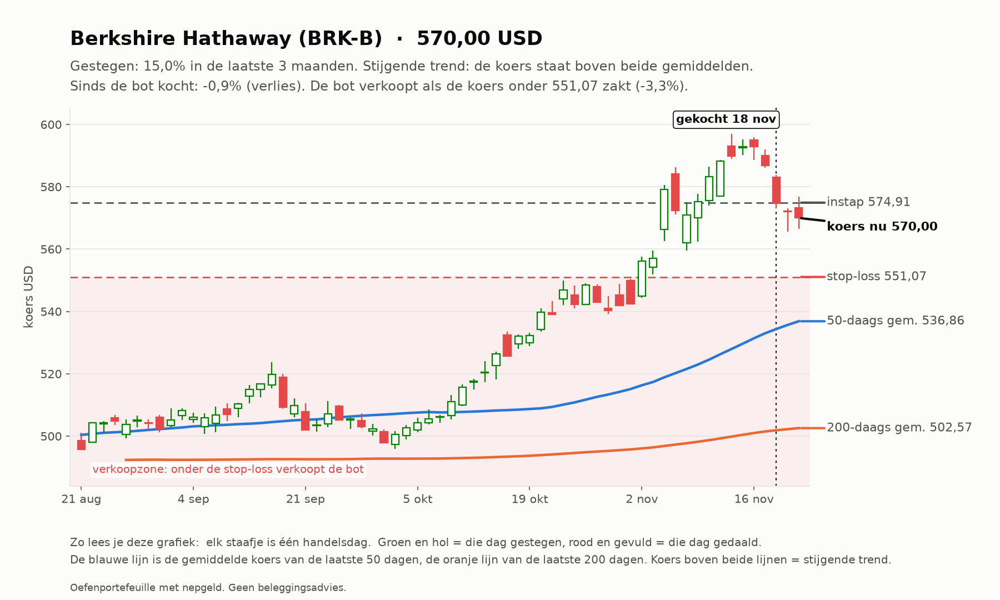
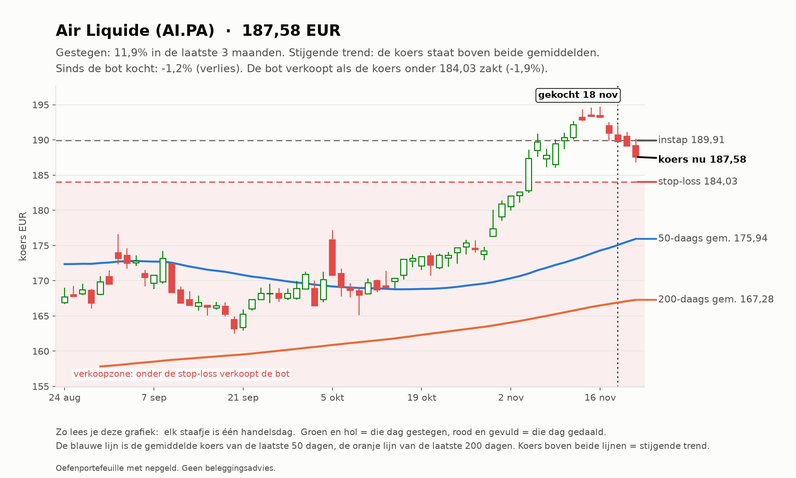
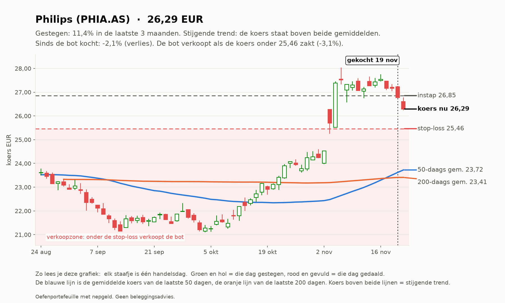

# Trend-agent rapport 2026-11-20

_Oefenportefeuille met nepgeld. Geen beleggingsadvies; resultaten uit het verleden zeggen niets over de toekomst._

**Status:** OK  
**Waarde:** €9,788.28  
**Kas:** €2,525.68  
**Marktregime:** stijgend-hoog  
**Strategieversie:** trend-1.1-eaf4f8  
**Koersbronnen:** 69 bevestigd door 2 bronnen, 60 uit 1 bron, 0 afwijkend; wisselkoers bevestigd  
**Sinds start:** -2.12%  

## Analyse van vandaag

**Wat de bot zag**

- **Markt (IWDA.AS):** koers 122,94, 0,3% boven het 200-daags gemiddelde (122,62); de afgelopen maand -5,4%. Trend: **stijgend**.
- **Beweeglijkheid:** 19% op jaarbasis, tegen normaal 10% het afgelopen jaar: **hoog**.
- **Breedte:** 57 van de 129 instrumenten staan boven hun 200-daags gemiddelde (44%; EU 30 van 60, US 27 van 69).
- **Bekeken:** 129 instrumenten.
- **Afgevallen** (een instrument kan op meer regels afvallen): geen stijgende trend (koers niet boven 50- en 200-daags gemiddelde): 98; niet gestegen over 1 of 3 maanden: 101; te weinig handel: 2; verdachte dagsprong: 1.
- **Door de zeef:** 21. Koopbare trends: **21**.

**Wat de bot eruit haalt**

- De markt stijgt, maar gedragen door een minderheid van de aandelen: kwetsbaarder dan het lijkt.
- De markt beweegt meer dan normaal: stops worden sneller geraakt. Het risico per trade blijft gelijk, dus de posities worden vanzelf kleiner.
- Sterk zonder ver weggelopen te zijn: BRK-B, AI.PA, PHIA.AS, HEIA.AS.
- Alle plekken zijn bezet, dus de bot koopt niets bij, hoe sterk een trend ook is.

## Vandaag gedaan

- DB1.DE: stop omhoog van 311.69 naar 311.75
- WKL.AS: stop omhoog van 84.28 naar 84.46
- OR.PA: stop omhoog van 428.45 naar 428.94

## Verlies en risico

| Ticker | Instap | Koers nu | Resultaat | Stop | Afstand tot stop | Als de stop geraakt wordt |
| --- | --- | --- | --- | --- | --- | --- |
| DB1.DE | 314.96 EUR | 315.20 | €0,24 (+0,1%) | 311.75 | +1,1% | -€4,21 verlies |
| ABBV | 290.94 USD | 286.20 | €2,19 (-1,6%) | 277.38 | +3,2% | -€14,89 verlies |
| WKL.AS | 86.80 EUR | 85.90 | -€9,03 (-1,0%) | 84.46 | +1,7% | -€24,43 verlies |
| OR.PA | 446.42 EUR | 435.70 | -€21,45 (-2,4%) | 428.94 | +1,6% | -€35,97 verlies |
| PG | 167.40 USD | 169.37 | €45,14 (+1,2%) | 163.02 | +3,9% | -€2,19 verlies |
| BRK-B | 574.91 USD | 570.00 | -€9,87 (-0,9%) | 551.07 | +3,4% | -€45,38 verlies |
| AI.PA | 189.91 EUR | 187.58 | -€18,68 (-1,2%) | 184.03 | +1,9% | -€48,11 verlies |
| PHIA.AS | 26.85 EUR | 26.29 | -€19,72 (-2,1%) | 25.46 | +3,2% | -€49,70 verlies |

Raken alle stops tegelijk, dan is het verlies hooguit ongeveer €224,88 (bij een koersgat 's ochtends kan het meer zijn).

**Remmen** (bij overschrijden gaat de kill switch aan en koopt de bot niets meer):

- Daling vanaf de top: -2,97% (grens -10%; top was €10.087,85)
- Vandaag: -0,33% (grens -2%)
- Verliestrades op rij: 1 van 3

## Kansen: wat de bot vandaag het sterkst vond

_Dit is wat de oefenbot met zijn nepgeld volgens zijn eigen regels zou doen. Geen advies voor echt geld; het instapmoment is een ongeteste vuistregel en wordt door de bot niet gebruikt._

### 1. Berkshire Hathaway (BRK-B): instapmoment **gunstig**

- **Waarom sterk:** Berkshire Hathaway steeg +13,0% in 3 maanden en +4,2% in 1 maand; koers boven het 50-daags en dat boven het 200-daags gemiddelde; MACD negatief (de stijging vertraagt); handel 1,1x het normale volume; beweegt gemiddeld 2,0% per dag.
- **Instapmoment:** de trend is sterk maar de koers is niet ver weggelopen (+0,3% van het 20-daags gemiddelde, RSI 57).
- **Status:** al in bezit.
- **Plan van de bot:** koop 2 stuks rond 570.28 USD (inzet €1.039,74), stop-loss 547.05 USD (-4,1%). Maximaal verlies als de stop wordt geraakt: ongeveer €44,36. Ter oriëntatie: 2x het risico winst ligt bij 616.75 USD; de bot verkoopt daar niet vanzelf, hij laat de stop meeschuiven.

### 2. Air Liquide (AI.PA): instapmoment **gunstig**

- **Waarom sterk:** Air Liquide steeg +11,8% in 3 maanden en +8,1% in 1 maand; koers boven het 50-daags en dat boven het 200-daags gemiddelde; MACD negatief (de stijging vertraagt); handel 1,1x het normale volume; beweegt gemiddeld 1,5% per dag.
- **Instapmoment:** de trend is sterk maar de koers is niet ver weggelopen (+0,8% van het 20-daags gemiddelde, RSI 60).
- **Status:** al in bezit.
- **Plan van de bot:** koop 8 stuks rond 187.67 EUR (inzet €1.501,39), stop-loss 181.89 EUR (-3,1%). Maximaal verlies als de stop wordt geraakt: ongeveer €48,27. Ter oriëntatie: 2x het risico winst ligt bij 199.24 EUR; de bot verkoopt daar niet vanzelf, hij laat de stop meeschuiven.

### 3. Philips (PHIA.AS): instapmoment **gunstig**

- **Waarom sterk:** Philips steeg +12,1% in 3 maanden en +10,0% in 1 maand; koers boven het 50-daags en dat boven het 200-daags gemiddelde; MACD negatief (de stijging vertraagt); handel 1,3x het normale volume; beweegt gemiddeld 2,7% per dag.
- **Instapmoment:** de trend is sterk maar de koers is niet ver weggelopen (+0,6% van het 20-daags gemiddelde, RSI 58).
- **Status:** al in bezit.
- **Plan van de bot:** koop 35 stuks rond 26.30 EUR (inzet €920,61), stop-loss 24.91 EUR (-5,3%). Maximaal verlies als de stop wordt geraakt: ongeveer €50,90. Ter oriëntatie: 2x het risico winst ligt bij 29.10 EUR; de bot verkoopt daar niet vanzelf, hij laat de stop meeschuiven.

### 4. Costco (COST): instapmoment **neutraal**

- **Waarom sterk:** Costco steeg +13,6% in 3 maanden en +8,4% in 1 maand; koers boven het 50-daags en dat boven het 200-daags gemiddelde; MACD positief (de stijging versnelt); handel 1,1x het normale volume; beweegt gemiddeld 1,9% per dag.
- **Instapmoment:** de koers staat +3,7% van het 20-daags gemiddelde, RSI 70.
- **Status:** niet gekocht: alle 8 plekken zijn bezet.
- **Plan van de bot:** koop 1 stuk rond 1102.70 USD (inzet €1.005,22), stop-loss 1060.95 USD (-3,8%). Maximaal verlies als de stop wordt geraakt: ongeveer €40,06. Ter oriëntatie: 2x het risico winst ligt bij 1186.20 USD; de bot verkoopt daar niet vanzelf, hij laat de stop meeschuiven.

### 5. Heineken (HEIA.AS): instapmoment **gunstig**

- **Waarom sterk:** Heineken steeg +13,9% in 3 maanden en +5,9% in 1 maand; koers boven het 50-daags en dat boven het 200-daags gemiddelde; MACD negatief (de stijging vertraagt); handel 1,0x het normale volume; beweegt gemiddeld 1,8% per dag.
- **Instapmoment:** de trend is sterk maar de koers is niet ver weggelopen (+0,9% van het 20-daags gemiddelde, RSI 59).
- **Status:** niet gekocht: alle 8 plekken zijn bezet.
- **Plan van de bot:** koop 16 stuks rond 82.56 EUR (inzet €1.320,98), stop-loss 79.68 EUR (-3,5%). Maximaal verlies als de stop wordt geraakt: ongeveer €48,17. Ter oriëntatie: 2x het risico winst ligt bij 88.33 EUR; de bot verkoopt daar niet vanzelf, hij laat de stop meeschuiven.

## Wat de bot tot nu toe geleerd heeft

- 8 afgesloten trades: 3 met winst (38%), gemiddeld -0,46 R per trade (R = winst of verlies gedeeld door het risico bij instap), totaal -€172,54.
- Pas vanaf 20 trades trekt de bot conclusies over welke omstandigheden goed of slecht uitpakken; met minder is het vooral toeval. Het wekelijkse onderzoek (zaterdag) doet dat.

## Klaar voor echt geld?

**Trend-agent:** Nog niet klaar: de bot is nog bezig met bewijzen. Blijven oefenen.

| Eis | Stand | Nu |
| --- | --- | --- |
| Oefentijd | ⏳ | 30 van 63 handelsdagen (ongeveer 3 maanden) |
| Minstens zo goed als de wereld-ETF | ⏳ | verschil tot nu toe +4,79% |
| Grootste daling onder 5% | ✅ | grootste daling tot nu toe -2,97% |
| Genoeg afgesloten trades | ⏳ | 8 van 20 |

Zo analyseert de trend-agent (klik om te openen)

1. **Data controleren.** Koersen van Yahoo, gecontroleerd bij een tweede bron en de wisselkoers bij de ECB.
   Bevroren koersen, rare sprongen of achterlopende markten: dat instrument wordt die dag niet gekocht.
2. **De markt als geheel.** Aan de hand van de wereld-ETF (IWDA) of de S&P 500: staat de koers boven het
   200-daags gemiddelde (stijgend), eronder (dalend) of ertussenin (zijwaarts)? En beweegt de markt meer of
   minder dan normaal vergeleken met het afgelopen jaar? Plus: hoeveel aandelen staan boven hun 200-daags gemiddelde (de breedte).
3. **Elk instrument door de zeef.** Een trend telt alleen als ALLES klopt: koers boven het 50-daags gemiddelde en
   dat boven het 200-daags, plus over 1 en 3 maanden gestegen, genoeg handel en geen verdachte sprong.
4. **Rangschikken.** Score = stijging (60% 3 maanden, 40% 1 maand) gedeeld door de beweeglijkheid. Een rustige,
   stevige stijger wint van een wilde.
5. **Risico bepalen.** Stop-loss op 2x de gemiddelde dagbeweging (ATR) onder de instap. Het aantal stuks wordt zo
   gekozen dat de stop hooguit 0,25% van het vermogen kost.
6. **Beheren.** De stop schuift mee omhoog (3x ATR onder de hoogste slotkoers). Verkopen bij stop of als de koers
   onder het 50-daags gemiddelde sluit.

## Open posities

| Ticker | Aantal | Instap | Stop | Sinds |
| --- | --- | --- | --- | --- |
| DB1.DE | 1 | 314.96 EUR | 311.75 | 2026-10-29 |
| ABBV | 2 | 290.94 USD | 277.38 | 2026-10-29 |
| WKL.AS | 10 | 86.80 EUR | 84.46 | 2026-10-30 |
| OR.PA | 2 | 446.42 EUR | 428.94 | 2026-11-04 |
| PG | 8 | 167.40 USD | 163.02 | 2026-11-04 |
| BRK-B | 2 | 574.91 USD | 551.07 | 2026-11-18 |
| AI.PA | 8 | 189.91 EUR | 184.03 | 2026-11-18 |
| PHIA.AS | 35 | 26.85 EUR | 25.46 | 2026-11-19 |

## Sterkste trends vandaag

| # | Ticker | Score | 3 mnd | 1 mnd |
| --- | --- | --- | --- | --- |
| 1 | BRK-B | 0.112 | +13.0% | +4.2% |
| 2 | AI.PA | 0.111 | +11.8% | +8.1% |
| 3 | PHIA.AS | 0.106 | +12.1% | +10.0% |
| 4 | COST | 0.104 | +13.6% | +8.4% |
| 5 | HEIA.AS | 0.104 | +13.9% | +5.9% |
| 6 | IBE.MC | 0.098 | +12.6% | +4.3% |
| 7 | BAYN.DE | 0.092 | +9.3% | +21.7% |
| 8 | SAN.PA | 0.087 | +7.7% | +13.2% |
| 9 | ASRNL.AS | 0.087 | +11.1% | +3.7% |
| 10 | PG | 0.087 | +16.3% | +3.0% |

## Afgesloten trades

8 trades, 3 winst (38%), totaal €-172.54 na kosten.

## Grafieken (laatste 3 maanden)

_Grafieken worden 20 handelsdagen bewaard._
