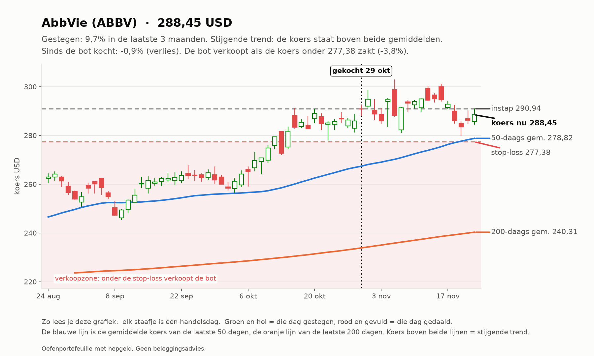
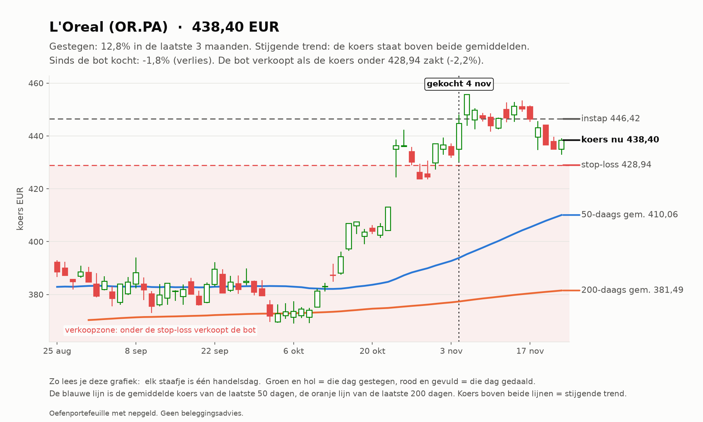
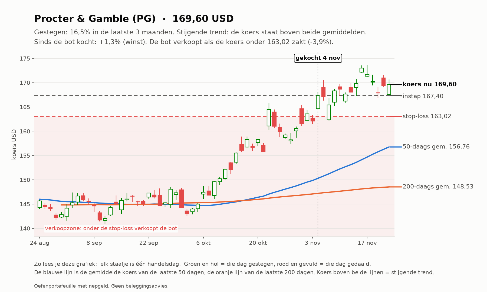
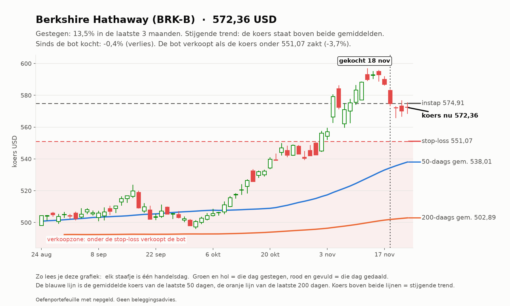
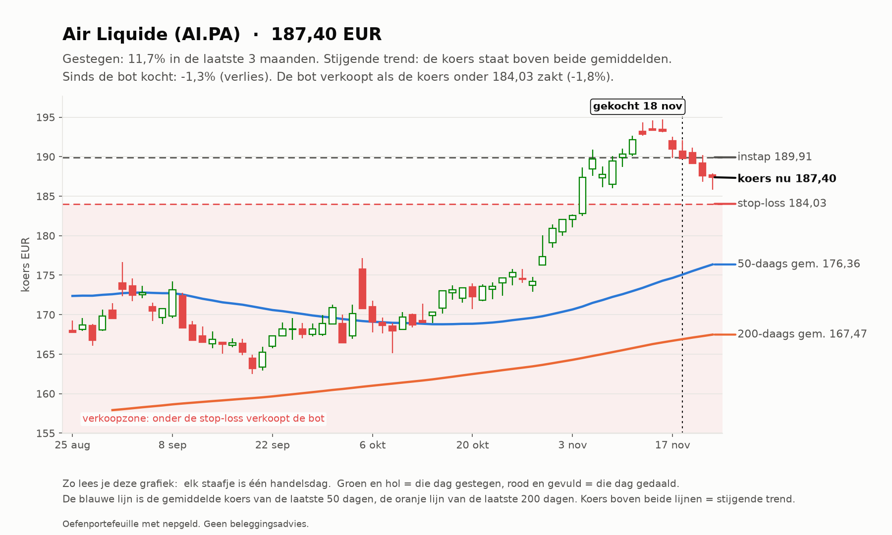
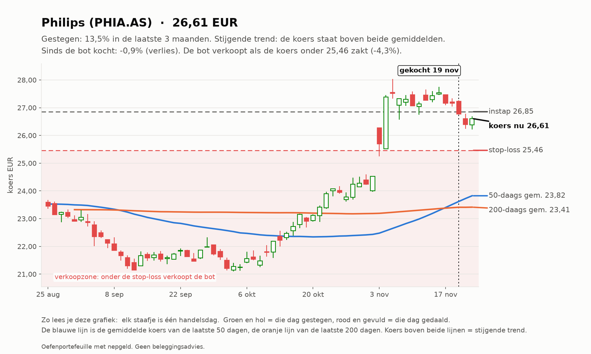
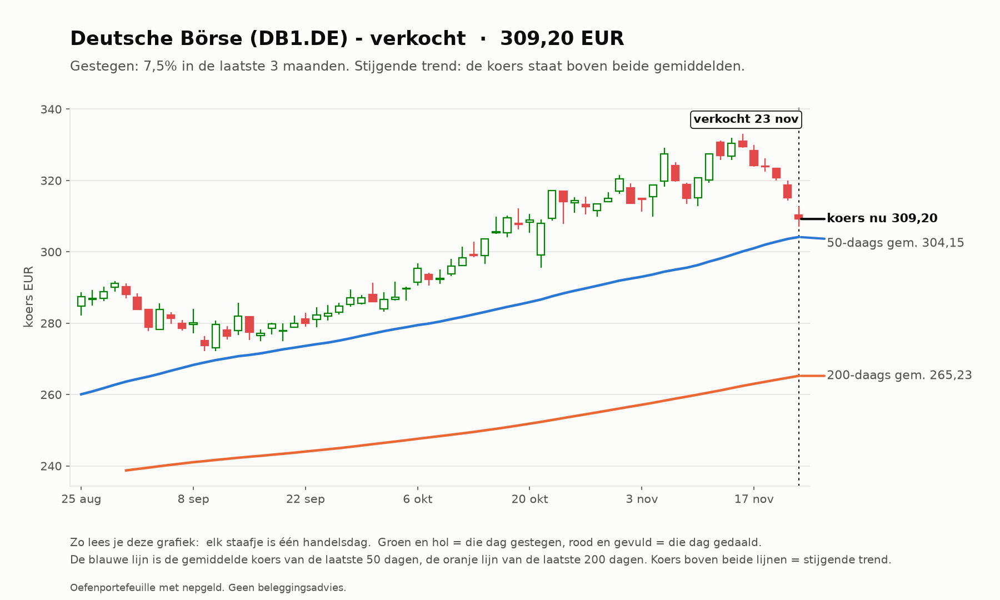
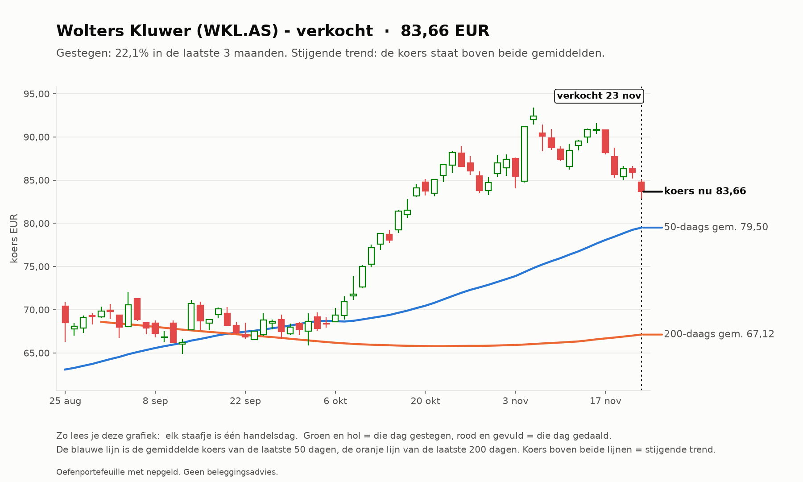

# Trend-agent rapport 2026-11-23

_Oefenportefeuille met nepgeld. Geen beleggingsadvies; resultaten uit het verleden zeggen niets over de toekomst._

**Status:** GESTOPT  
**Waarde:** €9,806.42  
**Kas:** €3,678.00  
**Marktregime:** stijgend-hoog  
**Strategieversie:** trend-1.1-eaf4f8  
**Koersbronnen:** 69 bevestigd door 2 bronnen, 60 uit 1 bron, 0 afwijkend; wisselkoers bevestigd  
**Sinds start:** -1.94%  

## Analyse van vandaag

**Wat de bot zag**

- **Markt (IWDA.AS):** koers 126,83, 3,4% boven het 200-daags gemiddelde (122,69); de afgelopen maand -2,4%. Trend: **stijgend**.
- **Beweeglijkheid:** 23% op jaarbasis, tegen normaal 10% het afgelopen jaar: **hoog**.
- **Breedte:** 67 van de 129 instrumenten staan boven hun 200-daags gemiddelde (52%; EU 34 van 60, US 33 van 69).
- **Bekeken:** 129 instrumenten.
- **Afgevallen** (een instrument kan op meer regels afvallen): geen stijgende trend (koers niet boven 50- en 200-daags gemiddelde): 92; niet gestegen over 1 of 3 maanden: 91; te weinig handel: 2; verdachte dagsprong: 2.
- **Door de zeef:** 27. Koopbare trends: **27**.

**Wat de bot eruit haalt**

- De markt stijgt, maar gedragen door een minderheid van de aandelen: kwetsbaarder dan het lijkt.
- De markt beweegt meer dan normaal: stops worden sneller geraakt. Het risico per trade blijft gelijk, dus de posities worden vanzelf kleiner.
- Sterk zonder ver weggelopen te zijn: PHIA.AS, BRK-B, AI.PA, HEIA.AS.
- Er waren trends, maar geen enkele paste binnen de risicoregels (zie Kansen voor de reden per ticker).

## Vandaag gedaan

- SELL 1 x DB1.DE @ 310.14 (stop-loss geraakt, resultaat €-6.81)
- SELL 10 x WKL.AS @ 84.42 (stop-loss geraakt, resultaat €-25.86)

## Waarom

- **SELL DB1.DE**: stop-loss geraakt. Omstandigheden: RSI 44, MACD-histogram -0.76%, ATR 2.2% per dag, +16.6% boven SMA200, markt stijgend-hoog, R = -0.49 na 25 dagen
- **SELL WKL.AS**: stop-loss geraakt. Omstandigheden: RSI 46, MACD-histogram -1.39%, ATR 3.1% per dag, +24.6% boven SMA200, markt stijgend-hoog, R = -0.54 na 24 dagen

## Waarschuwingen

- Kill switch aangezet: 3 verliestrades op rij. Hij gaat na 5 handelsdagen vanzelf weer uit; eerder kan met 'resume'.

## Verlies en risico

| Ticker | Instap | Koers nu | Resultaat | Stop | Afstand tot stop | Als de stop geraakt wordt |
| --- | --- | --- | --- | --- | --- | --- |
| ABBV | 290.94 USD | 288.45 | €9,06 (-0,9%) | 277.38 | +4,0% | -€12,23 verlies |
| OR.PA | 446.42 EUR | 438.40 | -€16,05 (-1,8%) | 428.94 | +2,2% | -€35,97 verlies |
| PG | 167.40 USD | 169.60 | €53,33 (+1,3%) | 163.02 | +4,0% | €4,07 winst vastgezet |
| BRK-B | 574.91 USD | 572.36 | -€0,07 (-0,4%) | 551.07 | +3,9% | -€40,09 verlies |
| AI.PA | 189.91 EUR | 187.40 | -€20,12 (-1,3%) | 184.03 | +1,8% | -€48,11 verlies |
| PHIA.AS | 26.85 EUR | 26.61 | -€8,52 (-0,9%) | 25.46 | +4,5% | -€49,70 verlies |

Raken alle stops tegelijk, dan is het verlies hooguit ongeveer €186,10 (bij een koersgat 's ochtends kan het meer zijn).

**Remmen** (bij overschrijden gaat de kill switch aan en koopt de bot niets meer):

- Daling vanaf de top: -2,79% (grens -10%; top was €10.087,85)
- Vandaag: +0,19% (grens -2%)
- Verliestrades op rij: 3 van 3

## Kansen: wat de bot vandaag het sterkst vond

_Dit is wat de oefenbot met zijn nepgeld volgens zijn eigen regels zou doen. Geen advies voor echt geld; het instapmoment is een ongeteste vuistregel en wordt door de bot niet gebruikt._

### 1. Philips (PHIA.AS): instapmoment **gunstig**

- **Waarom sterk:** Philips steeg +15,0% in 3 maanden en +10,5% in 1 maand; koers boven het 50-daags en dat boven het 200-daags gemiddelde; MACD negatief (de stijging vertraagt); handel 1,3x het normale volume; beweegt gemiddeld 2,3% per dag.
- **Instapmoment:** de trend is sterk maar de koers is niet ver weggelopen (+1,6% van het 20-daags gemiddelde, RSI 62).
- **Status:** al in bezit.
- **Plan van de bot:** koop 40 stuks rond 26.62 EUR (inzet €1.064,93), stop-loss 25.41 EUR (-4,6%). Maximaal verlies als de stop wordt geraakt: ongeveer €50,57. Ter oriëntatie: 2x het risico winst ligt bij 29.05 EUR; de bot verkoopt daar niet vanzelf, hij laat de stop meeschuiven.

### 2. Berkshire Hathaway (BRK-B): instapmoment **gunstig**

- **Waarom sterk:** Berkshire Hathaway steeg +13,5% in 3 maanden en +5,6% in 1 maand; koers boven het 50-daags en dat boven het 200-daags gemiddelde; MACD negatief (de stijging vertraagt); handel 1,1x het normale volume; beweegt gemiddeld 2,0% per dag.
- **Instapmoment:** de trend is sterk maar de koers is niet ver weggelopen (+0,6% van het 20-daags gemiddelde, RSI 58).
- **Status:** al in bezit.
- **Plan van de bot:** koop 2 stuks rond 572.65 USD (inzet €1.049,55), stop-loss 549.49 USD (-4,0%). Maximaal verlies als de stop wordt geraakt: ongeveer €44,45. Ter oriëntatie: 2x het risico winst ligt bij 618.97 USD; de bot verkoopt daar niet vanzelf, hij laat de stop meeschuiven.

### 3. Costco (COST): instapmoment **neutraal**

- **Waarom sterk:** Costco steeg +14,5% in 3 maanden en +9,6% in 1 maand; koers boven het 50-daags en dat boven het 200-daags gemiddelde; MACD negatief (de stijging vertraagt); handel 1,1x het normale volume; beweegt gemiddeld 1,9% per dag.
- **Instapmoment:** de koers staat +3,0% van het 20-daags gemiddelde, RSI 68.
- **Status:** niet gekocht: de kill switch staat aan.
- **Plan van de bot:** koop 1 stuk rond 1098.46 USD (inzet €1.006,63), stop-loss 1057.33 USD (-3,7%). Maximaal verlies als de stop wordt geraakt: ongeveer €39,69. Ter oriëntatie: 2x het risico winst ligt bij 1180.71 USD; de bot verkoopt daar niet vanzelf, hij laat de stop meeschuiven.

### 4. Air Liquide (AI.PA): instapmoment **gunstig**

- **Waarom sterk:** Air Liquide steeg +11,1% in 3 maanden en +7,3% in 1 maand; koers boven het 50-daags en dat boven het 200-daags gemiddelde; MACD negatief (de stijging vertraagt); handel 1,2x het normale volume; beweegt gemiddeld 1,6% per dag.
- **Instapmoment:** de trend is sterk maar de koers is niet ver weggelopen (+0,6% van het 20-daags gemiddelde, RSI 59).
- **Status:** al in bezit.
- **Plan van de bot:** koop 8 stuks rond 187.49 EUR (inzet €1.499,95), stop-loss 181.64 EUR (-3,1%). Maximaal verlies als de stop wordt geraakt: ongeveer €48,87. Ter oriëntatie: 2x het risico winst ligt bij 199.21 EUR; de bot verkoopt daar niet vanzelf, hij laat de stop meeschuiven.

### 5. Heineken (HEIA.AS): instapmoment **gunstig**

- **Waarom sterk:** Heineken steeg +13,2% in 3 maanden en +6,4% in 1 maand; koers boven het 50-daags en dat boven het 200-daags gemiddelde; MACD negatief (de stijging vertraagt); handel 1,1x het normale volume; beweegt gemiddeld 1,7% per dag.
- **Instapmoment:** de trend is sterk maar de koers is niet ver weggelopen (+0,7% van het 20-daags gemiddelde, RSI 59).
- **Status:** niet gekocht: de kill switch staat aan.
- **Plan van de bot:** koop 17 stuks rond 82.50 EUR (inzet €1.402,52), stop-loss 79.65 EUR (-3,5%). Maximaal verlies als de stop wordt geraakt: ongeveer €50,43. Ter oriëntatie: 2x het risico winst ligt bij 88.20 EUR; de bot verkoopt daar niet vanzelf, hij laat de stop meeschuiven.

## Wat de bot tot nu toe geleerd heeft

- 10 afgesloten trades: 3 met winst (30%), gemiddeld -0,47 R per trade (R = winst of verlies gedeeld door het risico bij instap), totaal -€205,21.
- Pas vanaf 20 trades trekt de bot conclusies over welke omstandigheden goed of slecht uitpakken; met minder is het vooral toeval. Het wekelijkse onderzoek (zaterdag) doet dat.

## Klaar voor echt geld?

**Trend-agent:** Nog niet klaar: de bot is nog bezig met bewijzen. Blijven oefenen.

| Eis | Stand | Nu |
| --- | --- | --- |
| Oefentijd | ⏳ | 31 van 63 handelsdagen (ongeveer 3 maanden) |
| Minstens zo goed als de wereld-ETF | ⏳ | verschil tot nu toe +2,03% |
| Grootste daling onder 5% | ✅ | grootste daling tot nu toe -2,97% |
| Genoeg afgesloten trades | ⏳ | 10 van 20 |

Zo analyseert de trend-agent (klik om te openen)

1. **Data controleren.** Koersen van Yahoo, gecontroleerd bij een tweede bron en de wisselkoers bij de ECB.
   Bevroren koersen, rare sprongen of achterlopende markten: dat instrument wordt die dag niet gekocht.
2. **De markt als geheel.** Aan de hand van de wereld-ETF (IWDA) of de S&P 500: staat de koers boven het
   200-daags gemiddelde (stijgend), eronder (dalend) of ertussenin (zijwaarts)? En beweegt de markt meer of
   minder dan normaal vergeleken met het afgelopen jaar? Plus: hoeveel aandelen staan boven hun 200-daags gemiddelde (de breedte).
3. **Elk instrument door de zeef.** Een trend telt alleen als ALLES klopt: koers boven het 50-daags gemiddelde en
   dat boven het 200-daags, plus over 1 en 3 maanden gestegen, genoeg handel en geen verdachte sprong.
4. **Rangschikken.** Score = stijging (60% 3 maanden, 40% 1 maand) gedeeld door de beweeglijkheid. Een rustige,
   stevige stijger wint van een wilde.
5. **Risico bepalen.** Stop-loss op 2x de gemiddelde dagbeweging (ATR) onder de instap. Het aantal stuks wordt zo
   gekozen dat de stop hooguit 0,25% van het vermogen kost.
6. **Beheren.** De stop schuift mee omhoog (3x ATR onder de hoogste slotkoers). Verkopen bij stop of als de koers
   onder het 50-daags gemiddelde sluit.

## Open posities

| Ticker | Aantal | Instap | Stop | Sinds |
| --- | --- | --- | --- | --- |
| ABBV | 2 | 290.94 USD | 277.38 | 2026-10-29 |
| OR.PA | 2 | 446.42 EUR | 428.94 | 2026-11-04 |
| PG | 8 | 167.40 USD | 163.02 | 2026-11-04 |
| BRK-B | 2 | 574.91 USD | 551.07 | 2026-11-18 |
| AI.PA | 8 | 189.91 EUR | 184.03 | 2026-11-18 |
| PHIA.AS | 35 | 26.85 EUR | 25.46 | 2026-11-19 |

## Sterkste trends vandaag

| # | Ticker | Score | 3 mnd | 1 mnd |
| --- | --- | --- | --- | --- |
| 1 | PHIA.AS | 0.121 | +15.0% | +10.5% |
| 2 | BRK-B | 0.121 | +13.5% | +5.6% |
| 3 | COST | 0.114 | +14.5% | +9.6% |
| 4 | AI.PA | 0.108 | +11.1% | +7.3% |
| 5 | HEIA.AS | 0.106 | +13.2% | +6.4% |
| 6 | PG | 0.099 | +17.4% | +5.3% |
| 7 | SAN.PA | 0.099 | +8.9% | +15.0% |
| 8 | IBE.MC | 0.098 | +12.9% | +3.9% |
| 9 | ASRNL.AS | 0.096 | +11.7% | +5.2% |
| 10 | BAYN.DE | 0.091 | +8.6% | +21.3% |

## Afgesloten trades

10 trades, 3 winst (30%), totaal €-205.21 na kosten.

## Grafieken (laatste 3 maanden)

_Grafieken worden 20 handelsdagen bewaard._
