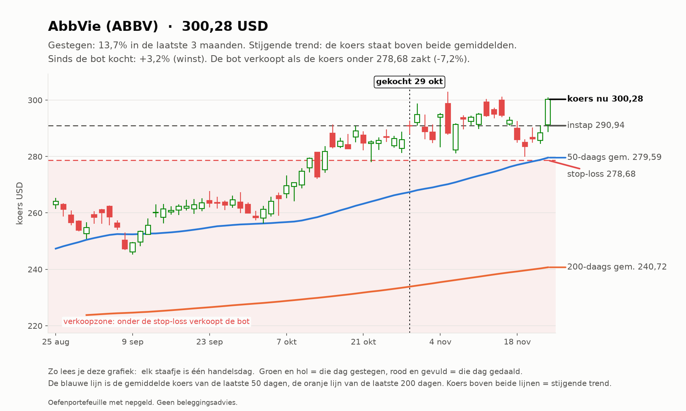
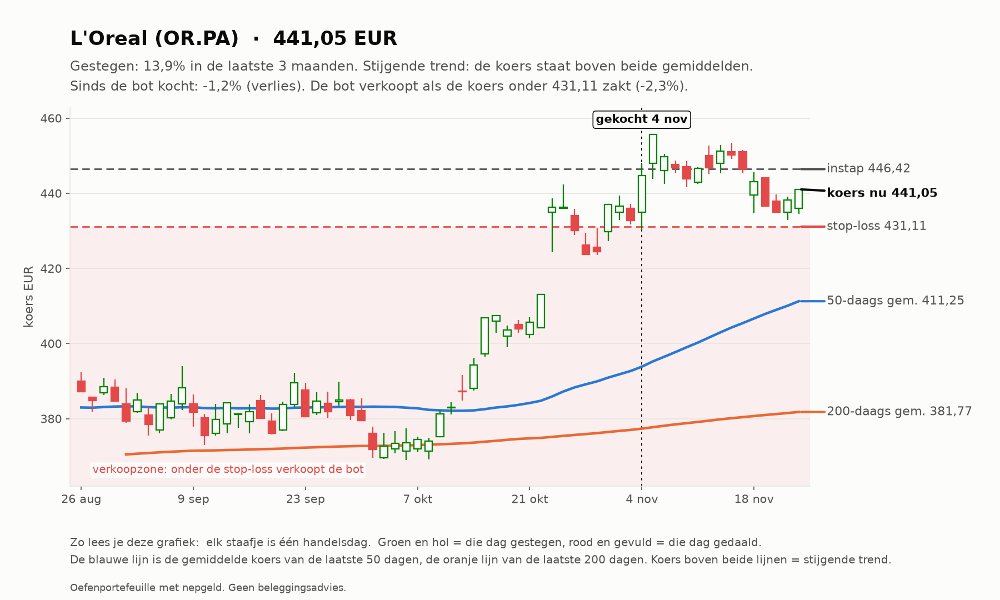
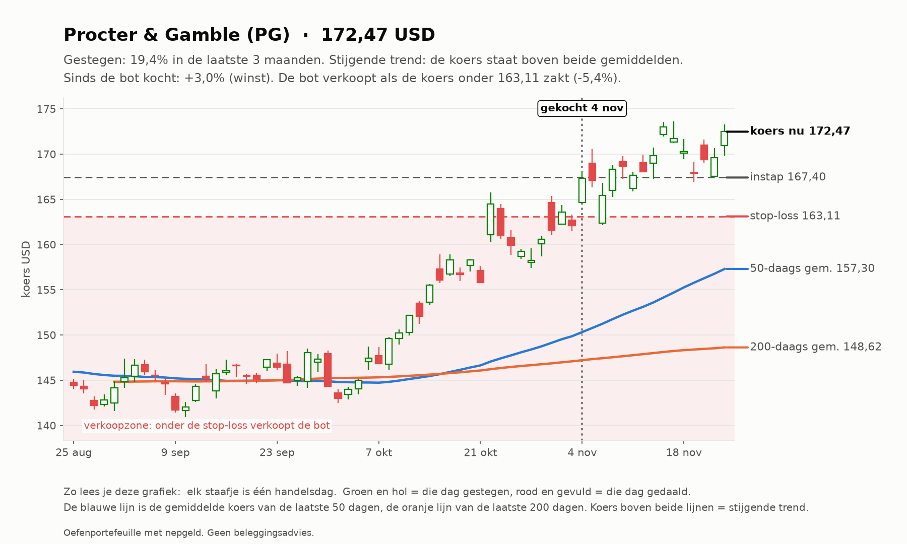
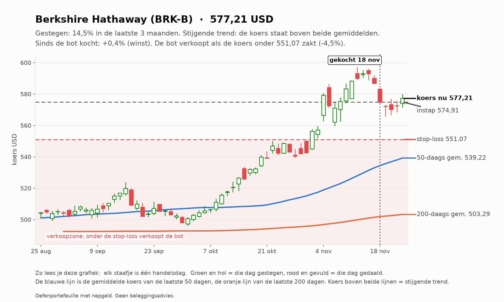
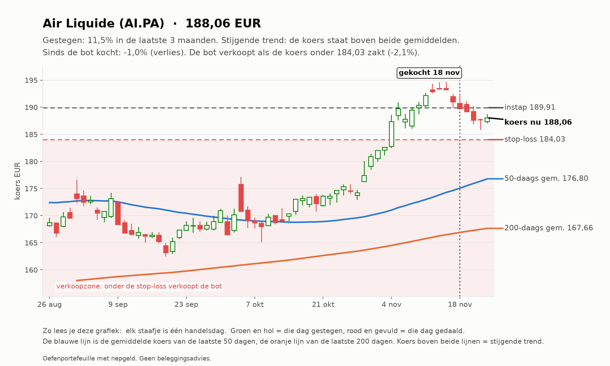
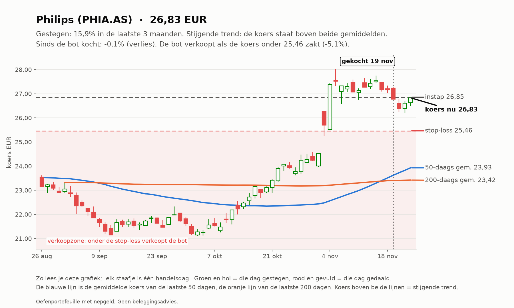

# Trend-agent rapport 2026-11-24

_Oefenportefeuille met nepgeld. Geen beleggingsadvies; resultaten uit het verleden zeggen niets over de toekomst._

**Status:** GESTOPT  
**Waarde:** €9,866.90  
**Kas:** €3,678.00  
**Marktregime:** stijgend-hoog  
**Strategieversie:** trend-1.1-eaf4f8  
**Koersbronnen:** 69 bevestigd door 2 bronnen, 60 uit 1 bron, 0 afwijkend; wisselkoers bevestigd  
**Sinds start:** -1.33%  

## Analyse van vandaag

**Wat de bot zag**

- **Markt (IWDA.AS):** koers 124,60, 1,5% boven het 200-daags gemiddelde (122,74); de afgelopen maand -4,5%. Trend: **stijgend**.
- **Beweeglijkheid:** 24% op jaarbasis, tegen normaal 10% het afgelopen jaar: **hoog**.
- **Breedte:** 65 van de 129 instrumenten staan boven hun 200-daags gemiddelde (50%; EU 33 van 60, US 32 van 69).
- **Bekeken:** 129 instrumenten.
- **Afgevallen** (een instrument kan op meer regels afvallen): geen stijgende trend (koers niet boven 50- en 200-daags gemiddelde): 93; niet gestegen over 1 of 3 maanden: 88; te weinig handel: 2; verdachte dagsprong: 2.
- **Door de zeef:** 29. Koopbare trends: **29**.

**Wat de bot eruit haalt**

- De markt stijgt, maar gedragen door een minderheid van de aandelen: kwetsbaarder dan het lijkt.
- De markt beweegt meer dan normaal: stops worden sneller geraakt. Het risico per trade blijft gelijk, dus de posities worden vanzelf kleiner.
- Sterk zonder ver weggelopen te zijn: HEIA.AS, PHIA.AS, BRK-B.
- Er waren trends, maar geen enkele paste binnen de risicoregels (zie Kansen voor de reden per ticker).

## Vandaag gedaan

- ABBV: stop omhoog van 277.38 naar 278.68
- OR.PA: stop omhoog van 428.94 naar 431.11
- PG: stop omhoog van 163.02 naar 163.11

## Waarschuwingen

- Kill switch staat aan (3 verliestrades op rij). Geen aankopen; stop-losses blijven actief.

## Verlies en risico

| Ticker | Instap | Koers nu | Resultaat | Stop | Afstand tot stop | Als de stop geraakt wordt |
| --- | --- | --- | --- | --- | --- | --- |
| ABBV | 290.94 USD | 300.28 | €28,94 (+3,2%) | 278.68 | +7,8% | -€11,52 verlies |
| OR.PA | 446.42 EUR | 441.05 | -€10,75 (-1,2%) | 431.11 | +2,3% | -€31,62 verlies |
| PG | 167.40 USD | 172.47 | €70,23 (+3,0%) | 163.10 | +5,7% | €0,80 winst vastgezet |
| BRK-B | 574.91 USD | 577.21 | €5,36 (+0,4%) | 551.07 | +4,7% | -€43,40 verlies |
| AI.PA | 189.91 EUR | 188.06 | -€14,84 (-1,0%) | 184.03 | +2,2% | -€48,11 verlies |
| PHIA.AS | 26.85 EUR | 26.83 | -€0,82 (-0,1%) | 25.46 | +5,4% | -€49,70 verlies |

Raken alle stops tegelijk, dan is het verlies hooguit ongeveer €184,35 (bij een koersgat 's ochtends kan het meer zijn).

**Remmen** (bij overschrijden gaat de kill switch aan en koopt de bot niets meer):

- Daling vanaf de top: -2,19% (grens -10%; top was €10.087,85)
- Vandaag: +0,62% (grens -2%)
- Verliestrades op rij: 3 van 3

## Kansen: wat de bot vandaag het sterkst vond

_Dit is wat de oefenbot met zijn nepgeld volgens zijn eigen regels zou doen. Geen advies voor echt geld; het instapmoment is een ongeteste vuistregel en wordt door de bot niet gebruikt._

### 1. Sanofi (SAN.PA): instapmoment **opgelopen**

- **Waarom sterk:** Sanofi steeg +21,2% in 3 maanden en +25,6% in 1 maand; koers boven het 50-daags en dat boven het 200-daags gemiddelde; MACD positief (de stijging versnelt); handel 1,3x het normale volume; beweegt gemiddeld 2,5% per dag.
- **Instapmoment:** de koers staat +11,2% van het 20-daags gemiddelde (4,5x de normale dagbeweging) en RSI is 77; na zo'n sprint volgt vaak eerst een terugval.
- **Status:** niet gekocht: de kill switch staat aan.
- **Plan van de bot:** koop 10 stuks rond 93.75 EUR (inzet €937,47), stop-loss 89.11 EUR (-4,9%). Maximaal verlies als de stop wordt geraakt: ongeveer €48,34. Ter oriëntatie: 2x het risico winst ligt bij 103.02 EUR; de bot verkoopt daar niet vanzelf, hij laat de stop meeschuiven.

### 2. Costco (COST): instapmoment **neutraal**

- **Waarom sterk:** Costco steeg +17,6% in 3 maanden en +11,8% in 1 maand; koers boven het 50-daags en dat boven het 200-daags gemiddelde; MACD negatief (de stijging vertraagt); handel 1,1x het normale volume; beweegt gemiddeld 1,8% per dag.
- **Instapmoment:** de koers staat +4,8% van het 20-daags gemiddelde, RSI 73.
- **Status:** niet gekocht: de kill switch staat aan.
- **Plan van de bot:** koop 1 stuk rond 1092.26 USD (inzet €997,67), stop-loss 1053.20 USD (-3,6%). Maximaal verlies als de stop wordt geraakt: ongeveer €37,67. Ter oriëntatie: 2x het risico winst ligt bij 1170.37 USD; de bot verkoopt daar niet vanzelf, hij laat de stop meeschuiven.

### 3. Heineken (HEIA.AS): instapmoment **gunstig**

- **Waarom sterk:** Heineken steeg +16,3% in 3 maanden en +8,6% in 1 maand; koers boven het 50-daags en dat boven het 200-daags gemiddelde; MACD negatief (de stijging vertraagt); handel 1,0x het normale volume; beweegt gemiddeld 1,5% per dag.
- **Instapmoment:** de trend is sterk maar de koers is niet ver weggelopen (+2,2% van het 20-daags gemiddelde, RSI 65).
- **Status:** niet gekocht: de kill switch staat aan.
- **Plan van de bot:** koop 19 stuks rond 83.94 EUR (inzet €1.594,90), stop-loss 81.38 EUR (-3,0%). Maximaal verlies als de stop wordt geraakt: ongeveer €50,64. Ter oriëntatie: 2x het risico winst ligt bij 89.06 EUR; de bot verkoopt daar niet vanzelf, hij laat de stop meeschuiven.

### 4. Philips (PHIA.AS): instapmoment **gunstig**

- **Waarom sterk:** Philips steeg +15,5% in 3 maanden en +12,1% in 1 maand; koers boven het 50-daags en dat boven het 200-daags gemiddelde; MACD negatief (de stijging vertraagt); handel 1,3x het normale volume; beweegt gemiddeld 1,8% per dag.
- **Instapmoment:** de trend is sterk maar de koers is niet ver weggelopen (+2,2% van het 20-daags gemiddelde, RSI 64).
- **Status:** al in bezit.
- **Plan van de bot:** koop 50 stuks rond 26.84 EUR (inzet €1.342,17), stop-loss 25.86 EUR (-3,7%). Maximaal verlies als de stop wordt geraakt: ongeveer €51,21. Ter oriëntatie: 2x het risico winst ligt bij 28.81 EUR; de bot verkoopt daar niet vanzelf, hij laat de stop meeschuiven.

### 5. Berkshire Hathaway (BRK-B): instapmoment **gunstig**

- **Waarom sterk:** Berkshire Hathaway steeg +14,3% in 3 maanden en +5,2% in 1 maand; koers boven het 50-daags en dat boven het 200-daags gemiddelde; MACD negatief (de stijging vertraagt); handel 1,1x het normale volume; beweegt gemiddeld 1,8% per dag.
- **Instapmoment:** de trend is sterk maar de koers is niet ver weggelopen (+1,4% van het 20-daags gemiddelde, RSI 61).
- **Status:** al in bezit.
- **Plan van de bot:** koop 2 stuks rond 577.50 USD (inzet €1.054,97), stop-loss 556.50 USD (-3,6%). Maximaal verlies als de stop wordt geraakt: ongeveer €40,36. Ter oriëntatie: 2x het risico winst ligt bij 619.50 USD; de bot verkoopt daar niet vanzelf, hij laat de stop meeschuiven.

## Wat de bot tot nu toe geleerd heeft

- 10 afgesloten trades: 3 met winst (30%), gemiddeld -0,47 R per trade (R = winst of verlies gedeeld door het risico bij instap), totaal -€205,21.
- Pas vanaf 20 trades trekt de bot conclusies over welke omstandigheden goed of slecht uitpakken; met minder is het vooral toeval. Het wekelijkse onderzoek (zaterdag) doet dat.

## Klaar voor echt geld?

**Trend-agent:** Nog niet klaar: de bot is nog bezig met bewijzen. Blijven oefenen.

| Eis | Stand | Nu |
| --- | --- | --- |
| Oefentijd | ⏳ | 32 van 63 handelsdagen (ongeveer 3 maanden) |
| Minstens zo goed als de wereld-ETF | ⏳ | verschil tot nu toe +4,32% |
| Grootste daling onder 5% | ✅ | grootste daling tot nu toe -2,97% |
| Genoeg afgesloten trades | ⏳ | 10 van 20 |

Zo analyseert de trend-agent (klik om te openen)

1. **Data controleren.** Koersen van Yahoo, gecontroleerd bij een tweede bron en de wisselkoers bij de ECB.
   Bevroren koersen, rare sprongen of achterlopende markten: dat instrument wordt die dag niet gekocht.
2. **De markt als geheel.** Aan de hand van de wereld-ETF (IWDA) of de S&P 500: staat de koers boven het
   200-daags gemiddelde (stijgend), eronder (dalend) of ertussenin (zijwaarts)? En beweegt de markt meer of
   minder dan normaal vergeleken met het afgelopen jaar? Plus: hoeveel aandelen staan boven hun 200-daags gemiddelde (de breedte).
3. **Elk instrument door de zeef.** Een trend telt alleen als ALLES klopt: koers boven het 50-daags gemiddelde en
   dat boven het 200-daags, plus over 1 en 3 maanden gestegen, genoeg handel en geen verdachte sprong.
4. **Rangschikken.** Score = stijging (60% 3 maanden, 40% 1 maand) gedeeld door de beweeglijkheid. Een rustige,
   stevige stijger wint van een wilde.
5. **Risico bepalen.** Stop-loss op 2x de gemiddelde dagbeweging (ATR) onder de instap. Het aantal stuks wordt zo
   gekozen dat de stop hooguit 0,25% van het vermogen kost.
6. **Beheren.** De stop schuift mee omhoog (3x ATR onder de hoogste slotkoers). Verkopen bij stop of als de koers
   onder het 50-daags gemiddelde sluit.

## Open posities

| Ticker | Aantal | Instap | Stop | Sinds |
| --- | --- | --- | --- | --- |
| ABBV | 2 | 290.94 USD | 278.68 | 2026-10-29 |
| OR.PA | 2 | 446.42 EUR | 431.11 | 2026-11-04 |
| PG | 8 | 167.40 USD | 163.11 | 2026-11-04 |
| BRK-B | 2 | 574.91 USD | 551.07 | 2026-11-18 |
| AI.PA | 8 | 189.91 EUR | 184.03 | 2026-11-18 |
| PHIA.AS | 35 | 26.85 EUR | 25.46 | 2026-11-19 |

## Sterkste trends vandaag

| # | Ticker | Score | 3 mnd | 1 mnd |
| --- | --- | --- | --- | --- |
| 1 | SAN.PA | 0.147 | +21.2% | +25.6% |
| 2 | COST | 0.135 | +17.6% | +11.8% |
| 3 | HEIA.AS | 0.128 | +16.3% | +8.6% |
| 4 | PHIA.AS | 0.127 | +15.5% | +12.1% |
| 5 | BRK-B | 0.126 | +14.3% | +5.2% |
| 6 | AI.PA | 0.119 | +12.8% | +7.2% |
| 7 | PG | 0.118 | +19.7% | +7.8% |
| 8 | LLY | 0.107 | +18.5% | +10.2% |
| 9 | IBE.MC | 0.101 | +13.5% | +3.6% |
| 10 | ABBV | 0.092 | +14.9% | +4.7% |

## Afgesloten trades

10 trades, 3 winst (30%), totaal €-205.21 na kosten.

## Grafieken (laatste 3 maanden)

_Grafieken worden 20 handelsdagen bewaard._
