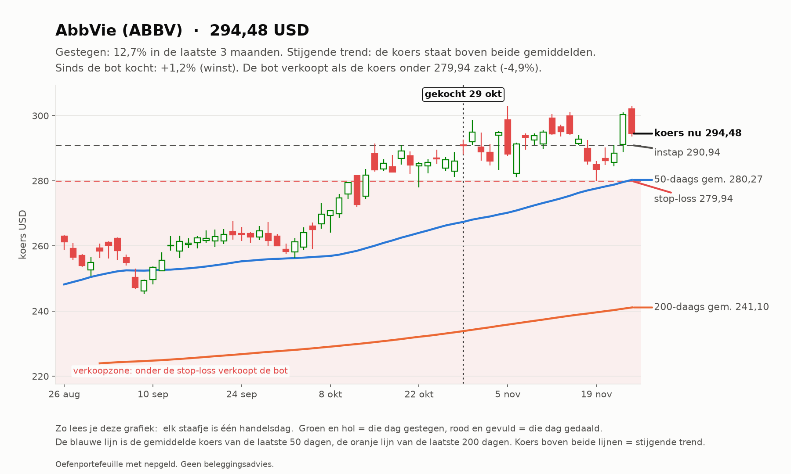
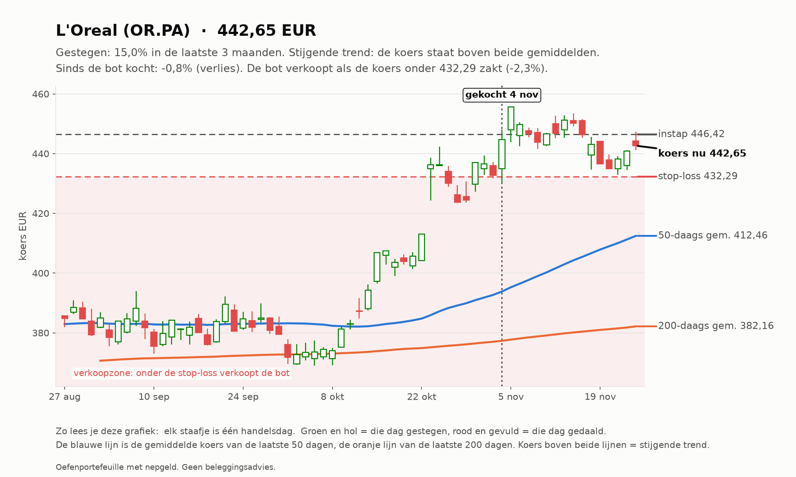
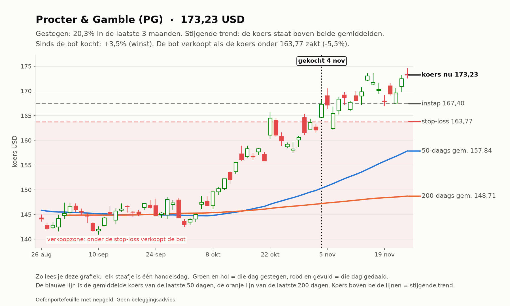
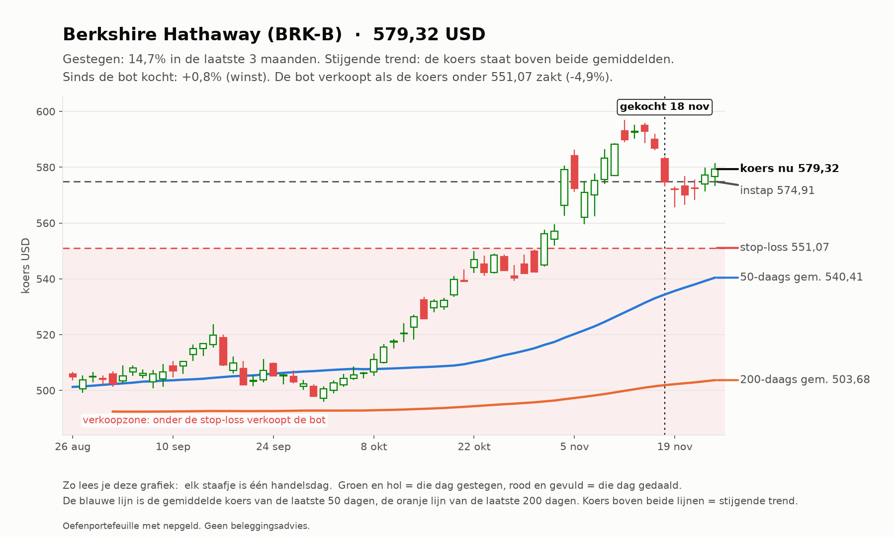
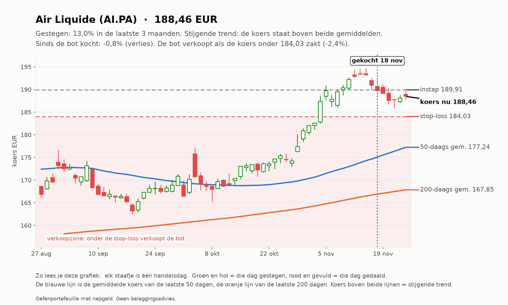
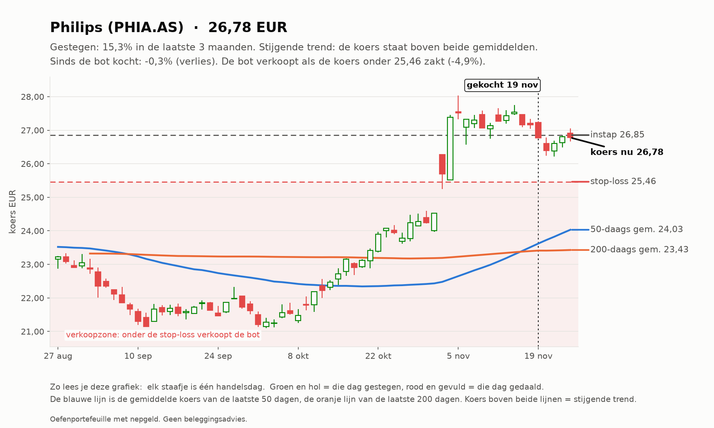

# Trend-agent rapport 2026-11-25

_Oefenportefeuille met nepgeld. Geen beleggingsadvies; resultaten uit het verleden zeggen niets over de toekomst._

**Status:** GESTOPT  
**Waarde:** €9,866.29  
**Kas:** €3,678.00  
**Marktregime:** zijwaarts-hoog  
**Strategieversie:** trend-1.1-eaf4f8  
**Koersbronnen:** 69 bevestigd door 2 bronnen, 60 uit 1 bron, 0 afwijkend; wisselkoers bevestigd  
**Sinds start:** -1.34%  

## Analyse van vandaag

**Wat de bot zag**

- **Markt (IWDA.AS):** koers 122,61, 0,1% onder het 200-daags gemiddelde (122,79); de afgelopen maand -6,8%. Trend: **zijwaarts**.
- **Beweeglijkheid:** 24% op jaarbasis, tegen normaal 10% het afgelopen jaar: **hoog**.
- **Breedte:** 63 van de 129 instrumenten staan boven hun 200-daags gemiddelde (49%; EU 30 van 60, US 33 van 69).
- **Bekeken:** 129 instrumenten.
- **Afgevallen** (een instrument kan op meer regels afvallen): geen stijgende trend (koers niet boven 50- en 200-daags gemiddelde): 94; niet gestegen over 1 of 3 maanden: 89; te weinig handel: 2; verdachte dagsprong: 2.
- **Door de zeef:** 29. Koopbare trends: **29**.

**Wat de bot eruit haalt**

- De markt beweegt zijwaarts: trends houden vaak kort stand, verwacht meer kleine verliezen.
- De markt beweegt meer dan normaal: stops worden sneller geraakt. Het risico per trade blijft gelijk, dus de posities worden vanzelf kleiner.
- Sterk zonder ver weggelopen te zijn: BRK-B.
- Er waren trends, maar geen enkele paste binnen de risicoregels (zie Kansen voor de reden per ticker).

## Vandaag gedaan

- ABBV: stop omhoog van 278.68 naar 279.94
- OR.PA: stop omhoog van 431.11 naar 432.29
- PG: stop omhoog van 163.11 naar 163.77

## Waarschuwingen

- Kill switch staat aan (3 verliestrades op rij). Geen aankopen; stop-losses blijven actief.

## Verlies en risico

| Ticker | Instap | Koers nu | Resultaat | Stop | Afstand tot stop | Als de stop geraakt wordt |
| --- | --- | --- | --- | --- | --- | --- |
| ABBV | 290.94 USD | 294.48 | €17,58 (+1,2%) | 279.94 | +5,2% | -€9,94 verlies |
| OR.PA | 446.42 EUR | 442.65 | -€7,55 (-0,9%) | 432.29 | +2,4% | -€29,27 verlies |
| PG | 167.40 USD | 173.23 | €73,99 (+3,5%) | 163.77 | +5,8% | €3,94 winst vastgezet |
| BRK-B | 574.91 USD | 579.32 | €7,70 (+0,8%) | 551.07 | +5,1% | -€44,83 verlies |
| AI.PA | 189.91 EUR | 188.46 | -€11,64 (-0,8%) | 184.03 | +2,4% | -€48,11 verlies |
| PHIA.AS | 26.85 EUR | 26.78 | -€2,57 (-0,3%) | 25.46 | +5,2% | -€49,70 verlies |

Raken alle stops tegelijk, dan is het verlies hooguit ongeveer €181,85 (bij een koersgat 's ochtends kan het meer zijn).

**Remmen** (bij overschrijden gaat de kill switch aan en koopt de bot niets meer):

- Daling vanaf de top: -2,20% (grens -10%; top was €10.087,85)
- Vandaag: -0,01% (grens -2%)
- Verliestrades op rij: 3 van 3

## Kansen: wat de bot vandaag het sterkst vond

_Dit is wat de oefenbot met zijn nepgeld volgens zijn eigen regels zou doen. Geen advies voor echt geld; het instapmoment is een ongeteste vuistregel en wordt door de bot niet gebruikt._

### 1. Sanofi (SAN.PA): instapmoment **opgelopen**

- **Waarom sterk:** Sanofi steeg +26,8% in 3 maanden en +30,3% in 1 maand; koers boven het 50-daags en dat boven het 200-daags gemiddelde; MACD positief (de stijging versnelt); handel 1,3x het normale volume; beweegt gemiddeld 2,6% per dag.
- **Instapmoment:** de koers staat +14,5% van het 20-daags gemiddelde (5,5x de normale dagbeweging) en RSI is 81; na zo'n sprint volgt vaak eerst een terugval.
- **Status:** niet gekocht: de kill switch staat aan.
- **Plan van de bot:** koop 9 stuks rond 98.00 EUR (inzet €881,99), stop-loss 92.83 EUR (-5,3%). Maximaal verlies als de stop wordt geraakt: ongeveer €48,50. Ter oriëntatie: 2x het risico winst ligt bij 108.33 EUR; de bot verkoopt daar niet vanzelf, hij laat de stop meeschuiven.

### 2. Costco (COST): instapmoment **neutraal**

- **Waarom sterk:** Costco steeg +19,7% in 3 maanden en +12,8% in 1 maand; koers boven het 50-daags en dat boven het 200-daags gemiddelde; MACD negatief (de stijging vertraagt); handel 1,1x het normale volume; beweegt gemiddeld 1,6% per dag.
- **Instapmoment:** de koers staat +3,9% van het 20-daags gemiddelde, RSI 70.
- **Status:** niet gekocht: de kill switch staat aan.
- **Plan van de bot:** koop 1 stuk rond 1087.35 USD (inzet €991,78), stop-loss 1051.49 USD (-3,3%). Maximaal verlies als de stop wordt geraakt: ongeveer €34,71. Ter oriëntatie: 2x het risico winst ligt bij 1159.07 USD; de bot verkoopt daar niet vanzelf, hij laat de stop meeschuiven.

### 3. Heineken (HEIA.AS): instapmoment **neutraal**

- **Waarom sterk:** Heineken steeg +18,0% in 3 maanden en +11,0% in 1 maand; koers boven het 50-daags en dat boven het 200-daags gemiddelde; MACD negatief (de stijging vertraagt); handel 1,0x het normale volume; beweegt gemiddeld 1,4% per dag.
- **Instapmoment:** de koers staat +3,5% van het 20-daags gemiddelde, RSI 69.
- **Status:** niet gekocht: de kill switch staat aan.
- **Plan van de bot:** koop 20 stuks rond 85.30 EUR (inzet €1.706,05), stop-loss 82.85 EUR (-2,9%). Maximaal verlies als de stop wordt geraakt: ongeveer €51,09. Ter oriëntatie: 2x het risico winst ligt bij 90.21 EUR; de bot verkoopt daar niet vanzelf, hij laat de stop meeschuiven.

### 4. Berkshire Hathaway (BRK-B): instapmoment **gunstig**

- **Waarom sterk:** Berkshire Hathaway steeg +15,0% in 3 maanden en +6,7% in 1 maand; koers boven het 50-daags en dat boven het 200-daags gemiddelde; MACD negatief (de stijging vertraagt); handel 1,1x het normale volume; beweegt gemiddeld 1,7% per dag.
- **Instapmoment:** de trend is sterk maar de koers is niet ver weggelopen (+1,6% van het 20-daags gemiddelde, RSI 63).
- **Status:** al in bezit.
- **Plan van de bot:** koop 2 stuks rond 579.61 USD (inzet €1.057,32), stop-loss 559.61 USD (-3,5%). Maximaal verlies als de stop wordt geraakt: ongeveer €38,48. Ter oriëntatie: 2x het risico winst ligt bij 619.60 USD; de bot verkoopt daar niet vanzelf, hij laat de stop meeschuiven.

### 5. Procter & Gamble (PG): instapmoment **neutraal**

- **Waarom sterk:** Procter & Gamble steeg +21,8% in 3 maanden en +8,8% in 1 maand; koers boven het 50-daags en dat boven het 200-daags gemiddelde; MACD negatief (de stijging vertraagt); handel 1,1x het normale volume; beweegt gemiddeld 1,8% per dag.
- **Instapmoment:** de koers staat +3,4% van het 20-daags gemiddelde, RSI 67.
- **Status:** al in bezit.
- **Plan van de bot:** koop 8 stuks rond 173.32 USD (inzet €1.264,66), stop-loss 167.01 USD (-3,6%). Maximaal verlies als de stop wordt geraakt: ongeveer €48,03. Ter oriëntatie: 2x het risico winst ligt bij 185.93 USD; de bot verkoopt daar niet vanzelf, hij laat de stop meeschuiven.

## Wat de bot tot nu toe geleerd heeft

- 10 afgesloten trades: 3 met winst (30%), gemiddeld -0,47 R per trade (R = winst of verlies gedeeld door het risico bij instap), totaal -€205,21.
- Pas vanaf 20 trades trekt de bot conclusies over welke omstandigheden goed of slecht uitpakken; met minder is het vooral toeval. Het wekelijkse onderzoek (zaterdag) doet dat.

## Klaar voor echt geld?

**Trend-agent:** Nog niet klaar: de bot is nog bezig met bewijzen. Blijven oefenen.

| Eis | Stand | Nu |
| --- | --- | --- |
| Oefentijd | ⏳ | 33 van 63 handelsdagen (ongeveer 3 maanden) |
| Minstens zo goed als de wereld-ETF | ⏳ | verschil tot nu toe +5,82% |
| Grootste daling onder 5% | ✅ | grootste daling tot nu toe -2,97% |
| Genoeg afgesloten trades | ⏳ | 10 van 20 |

Zo analyseert de trend-agent (klik om te openen)

1. **Data controleren.** Koersen van Yahoo, gecontroleerd bij een tweede bron en de wisselkoers bij de ECB.
   Bevroren koersen, rare sprongen of achterlopende markten: dat instrument wordt die dag niet gekocht.
2. **De markt als geheel.** Aan de hand van de wereld-ETF (IWDA) of de S&P 500: staat de koers boven het
   200-daags gemiddelde (stijgend), eronder (dalend) of ertussenin (zijwaarts)? En beweegt de markt meer of
   minder dan normaal vergeleken met het afgelopen jaar? Plus: hoeveel aandelen staan boven hun 200-daags gemiddelde (de breedte).
3. **Elk instrument door de zeef.** Een trend telt alleen als ALLES klopt: koers boven het 50-daags gemiddelde en
   dat boven het 200-daags, plus over 1 en 3 maanden gestegen, genoeg handel en geen verdachte sprong.
4. **Rangschikken.** Score = stijging (60% 3 maanden, 40% 1 maand) gedeeld door de beweeglijkheid. Een rustige,
   stevige stijger wint van een wilde.
5. **Risico bepalen.** Stop-loss op 2x de gemiddelde dagbeweging (ATR) onder de instap. Het aantal stuks wordt zo
   gekozen dat de stop hooguit 0,25% van het vermogen kost.
6. **Beheren.** De stop schuift mee omhoog (3x ATR onder de hoogste slotkoers). Verkopen bij stop of als de koers
   onder het 50-daags gemiddelde sluit.

## Open posities

| Ticker | Aantal | Instap | Stop | Sinds |
| --- | --- | --- | --- | --- |
| ABBV | 2 | 290.94 USD | 279.94 | 2026-10-29 |
| OR.PA | 2 | 446.42 EUR | 432.29 | 2026-11-04 |
| PG | 8 | 167.40 USD | 163.77 | 2026-11-04 |
| BRK-B | 2 | 574.91 USD | 551.07 | 2026-11-18 |
| AI.PA | 8 | 189.91 EUR | 184.03 | 2026-11-18 |
| PHIA.AS | 35 | 26.85 EUR | 25.46 | 2026-11-19 |

## Sterkste trends vandaag

| # | Ticker | Score | 3 mnd | 1 mnd |
| --- | --- | --- | --- | --- |
| 1 | SAN.PA | 0.175 | +26.8% | +30.3% |
| 2 | COST | 0.154 | +19.7% | +12.8% |
| 3 | HEIA.AS | 0.143 | +18.0% | +11.0% |
| 4 | BRK-B | 0.138 | +15.0% | +6.7% |
| 5 | PG | 0.134 | +21.8% | +8.8% |
| 6 | PHIA.AS | 0.129 | +16.0% | +12.6% |
| 7 | DIS | 0.124 | +17.6% | +13.9% |
| 8 | AI.PA | 0.115 | +11.0% | +8.0% |
| 9 | LLY | 0.105 | +18.5% | +8.7% |
| 10 | KO | 0.098 | +10.2% | +7.0% |

## Afgesloten trades

10 trades, 3 winst (30%), totaal €-205.21 na kosten.

## Grafieken (laatste 3 maanden)

_Grafieken worden 20 handelsdagen bewaard._
