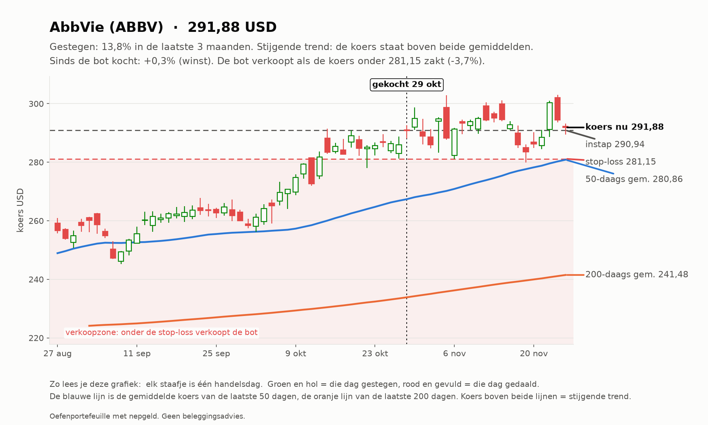
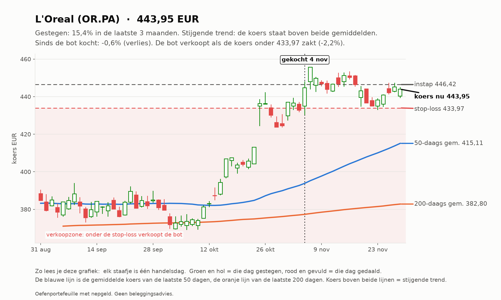
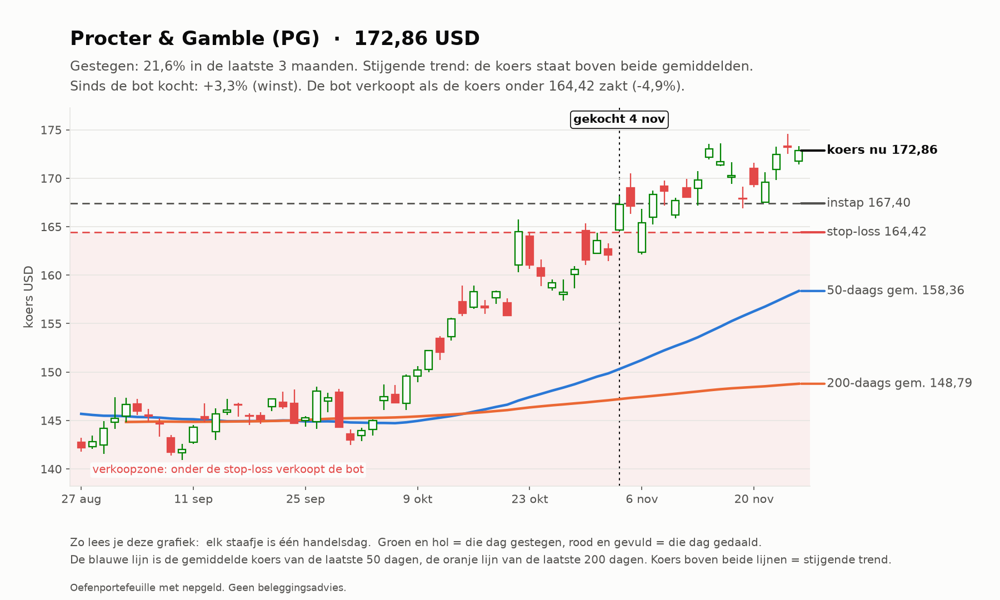
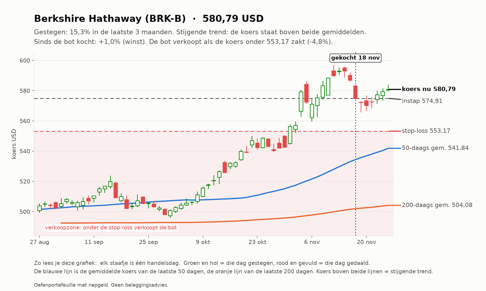
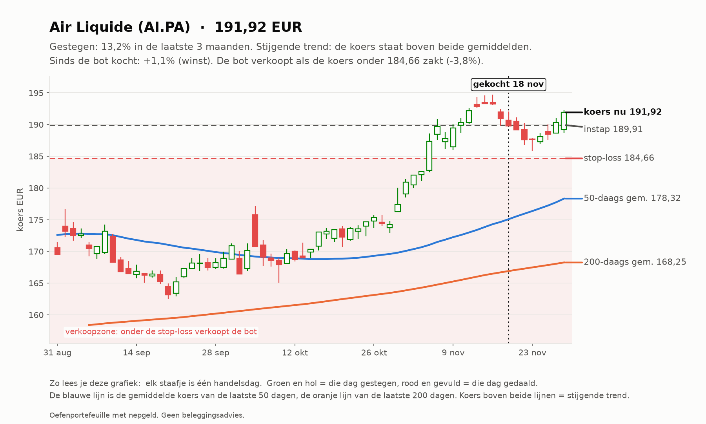
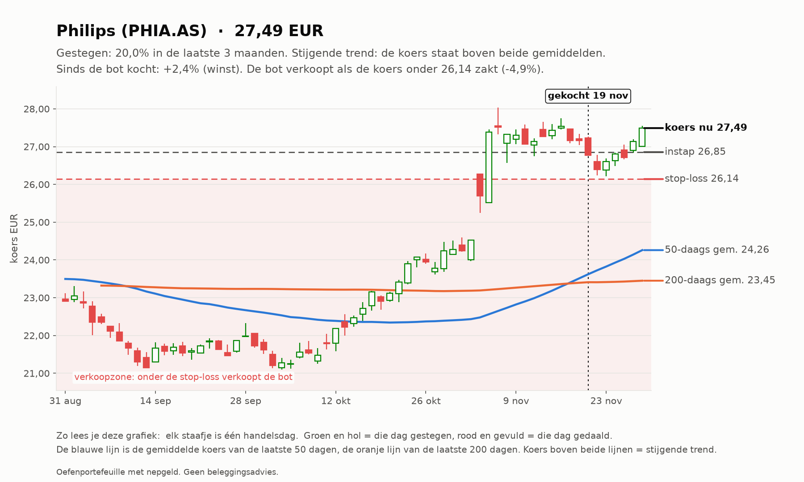

# Trend-agent rapport 2026-11-27

_Oefenportefeuille met nepgeld. Geen beleggingsadvies; resultaten uit het verleden zeggen niets over de toekomst._

**Status:** GESTOPT  
**Waarde:** €9,914.47  
**Kas:** €3,678.00  
**Marktregime:** stijgend-hoog  
**Strategieversie:** trend-1.1-eaf4f8  
**Koersbronnen:** 69 bevestigd door 2 bronnen, 60 uit 1 bron, 0 afwijkend; wisselkoers bevestigd  
**Sinds start:** -0.86%  

## Analyse van vandaag

**Wat de bot zag**

- **Markt (IWDA.AS):** koers 127,00, 3,3% boven het 200-daags gemiddelde (122,93); de afgelopen maand -3,4%. Trend: **stijgend**.
- **Beweeglijkheid:** 27% op jaarbasis, tegen normaal 10% het afgelopen jaar: **hoog**.
- **Breedte:** 77 van de 129 instrumenten staan boven hun 200-daags gemiddelde (60%; EU 37 van 60, US 40 van 69).
- **Bekeken:** 129 instrumenten.
- **Afgevallen** (een instrument kan op meer regels afvallen): geen stijgende trend (koers niet boven 50- en 200-daags gemiddelde): 87; niet gestegen over 1 of 3 maanden: 82; te weinig handel: 2; verdachte dagsprong: 1.
- **Door de zeef:** 33. Koopbare trends: **33**.

**Wat de bot eruit haalt**

- De markt stijgt, maar gedragen door een minderheid van de aandelen: kwetsbaarder dan het lijkt.
- De markt beweegt meer dan normaal: stops worden sneller geraakt. Het risico per trade blijft gelijk, dus de posities worden vanzelf kleiner.
- Sterk zonder ver weggelopen te zijn: BRK-B.
- Er waren trends, maar geen enkele paste binnen de risicoregels (zie Kansen voor de reden per ticker).

## Vandaag gedaan

- ABBV: stop omhoog van 279.94 naar 281.15
- PG: stop omhoog van 163.77 naar 164.42
- BRK-B: stop omhoog van 551.07 naar 553.17
- AI.PA: stop omhoog van 184.03 naar 184.66
- PHIA.AS: stop omhoog van 25.85 naar 26.14

## Waarschuwingen

- Kill switch staat aan (3 verliestrades op rij). Geen aankopen; stop-losses blijven actief.

## Verlies en risico

| Ticker | Instap | Koers nu | Resultaat | Stop | Afstand tot stop | Als de stop geraakt wordt |
| --- | --- | --- | --- | --- | --- | --- |
| ABBV | 290.94 USD | 291.88 | €12,43 (+0,3%) | 281.15 | +3,8% | -€8,12 verlies |
| OR.PA | 446.42 EUR | 443.95 | -€4,95 (-0,5%) | 433.97 | +2,3% | -€25,90 verlies |
| PG | 167.40 USD | 172.86 | €70,32 (+3,3%) | 164.42 | +5,1% | €7,80 winst vastgezet |
| BRK-B | 574.91 USD | 580.79 | €9,57 (+1,0%) | 553.17 | +5,0% | -€41,77 verlies |
| AI.PA | 189.91 EUR | 191.92 | €16,04 (+1,1%) | 184.66 | +3,9% | -€43,02 verlies |
| PHIA.AS | 26.85 EUR | 27.49 | €22,28 (+2,4%) | 26.14 | +5,2% | -€25,97 verlies |

Raken alle stops tegelijk, dan is het verlies hooguit ongeveer €144,78 (bij een koersgat 's ochtends kan het meer zijn).

**Remmen** (bij overschrijden gaat de kill switch aan en koopt de bot niets meer):

- Daling vanaf de top: -1,72% (grens -10%; top was €10.087,85)
- Vandaag: +0,24% (grens -2%)
- Verliestrades op rij: 3 van 3

## Kansen: wat de bot vandaag het sterkst vond

_Dit is wat de oefenbot met zijn nepgeld volgens zijn eigen regels zou doen. Geen advies voor echt geld; het instapmoment is een ongeteste vuistregel en wordt door de bot niet gebruikt._

### 1. Costco (COST): instapmoment **neutraal**

- **Waarom sterk:** Costco steeg +19,6% in 3 maanden en +15,0% in 1 maand; koers boven het 50-daags en dat boven het 200-daags gemiddelde; MACD negatief (de stijging vertraagt); handel 1,1x het normale volume; beweegt gemiddeld 1,6% per dag.
- **Instapmoment:** de koers staat +4,4% van het 20-daags gemiddelde, RSI 72.
- **Status:** niet gekocht: de kill switch staat aan.
- **Plan van de bot:** koop 1 stuk rond 1098.36 USD (inzet €1.001,04), stop-loss 1063.46 USD (-3,2%). Maximaal verlies als de stop wordt geraakt: ongeveer €33,81. Ter oriëntatie: 2x het risico winst ligt bij 1168.16 USD; de bot verkoopt daar niet vanzelf, hij laat de stop meeschuiven.

### 2. Sanofi (SAN.PA): instapmoment **opgelopen**

- **Waarom sterk:** Sanofi steeg +26,6% in 3 maanden en +27,8% in 1 maand; koers boven het 50-daags en dat boven het 200-daags gemiddelde; MACD positief (de stijging versnelt); handel 1,2x het normale volume; beweegt gemiddeld 2,9% per dag.
- **Instapmoment:** de koers staat +10,8% van het 20-daags gemiddelde (3,7x de normale dagbeweging) en RSI is 76; na zo'n sprint volgt vaak eerst een terugval.
- **Status:** niet gekocht: de kill switch staat aan.
- **Plan van de bot:** koop 8 stuks rond 97.39 EUR (inzet €779,11), stop-loss 91.68 EUR (-5,9%). Maximaal verlies als de stop wordt geraakt: ongeveer €47,69. Ter oriëntatie: 2x het risico winst ligt bij 108.81 EUR; de bot verkoopt daar niet vanzelf, hij laat de stop meeschuiven.

### 3. Philips (PHIA.AS): instapmoment **neutraal**

- **Waarom sterk:** Philips steeg +19,3% in 3 maanden en +13,2% in 1 maand; koers boven het 50-daags en dat boven het 200-daags gemiddelde; MACD negatief (de stijging vertraagt); handel 1,3x het normale volume; beweegt gemiddeld 1,6% per dag.
- **Instapmoment:** de koers staat +3,8% van het 20-daags gemiddelde, RSI 70.
- **Status:** al in bezit.
- **Plan van de bot:** koop 55 stuks rond 27.50 EUR (inzet €1.512,71), stop-loss 26.60 EUR (-3,3%). Maximaal verlies als de stop wordt geraakt: ongeveer €51,50. Ter oriëntatie: 2x het risico winst ligt bij 29.30 EUR; de bot verkoopt daar niet vanzelf, hij laat de stop meeschuiven.

### 4. Berkshire Hathaway (BRK-B): instapmoment **gunstig**

- **Waarom sterk:** Berkshire Hathaway steeg +15,0% in 3 maanden en +7,5% in 1 maand; koers boven het 50-daags en dat boven het 200-daags gemiddelde; MACD negatief (de stijging vertraagt); handel 1,1x het normale volume; beweegt gemiddeld 1,6% per dag.
- **Instapmoment:** de trend is sterk maar de koers is niet ver weggelopen (+1,6% van het 20-daags gemiddelde, RSI 64).
- **Status:** al in bezit.
- **Plan van de bot:** koop 2 stuks rond 581.08 USD (inzet €1.059,19), stop-loss 562.67 USD (-3,2%). Maximaal verlies als de stop wordt geraakt: ongeveer €35,56. Ter oriëntatie: 2x het risico winst ligt bij 617.90 USD; de bot verkoopt daar niet vanzelf, hij laat de stop meeschuiven.

### 5. Disney (DIS): instapmoment **neutraal**

- **Waarom sterk:** Disney steeg +17,7% in 3 maanden en +16,7% in 1 maand; koers boven het 50-daags en dat boven het 200-daags gemiddelde; MACD positief (de stijging versnelt); handel 1,2x het normale volume; beweegt gemiddeld 2,6% per dag.
- **Instapmoment:** de koers staat +6,8% van het 20-daags gemiddelde, RSI 71.
- **Status:** niet gekocht: de kill switch staat aan.
- **Plan van de bot:** koop 8 stuks rond 127.30 USD (inzet €928,20), stop-loss 120.72 USD (-5,2%). Maximaal verlies als de stop wordt geraakt: ongeveer €50,04. Ter oriëntatie: 2x het risico winst ligt bij 140.48 USD; de bot verkoopt daar niet vanzelf, hij laat de stop meeschuiven.

## Wat de bot tot nu toe geleerd heeft

- 10 afgesloten trades: 3 met winst (30%), gemiddeld -0,47 R per trade (R = winst of verlies gedeeld door het risico bij instap), totaal -€205,21.
- Pas vanaf 20 trades trekt de bot conclusies over welke omstandigheden goed of slecht uitpakken; met minder is het vooral toeval. Het wekelijkse onderzoek (zaterdag) doet dat.

## Klaar voor echt geld?

**Trend-agent:** Nog niet klaar: de bot is nog bezig met bewijzen. Blijven oefenen.

| Eis | Stand | Nu |
| --- | --- | --- |
| Oefentijd | ⏳ | 35 van 63 handelsdagen (ongeveer 3 maanden) |
| Minstens zo goed als de wereld-ETF | ⏳ | verschil tot nu toe +2,98% |
| Grootste daling onder 5% | ✅ | grootste daling tot nu toe -2,97% |
| Genoeg afgesloten trades | ⏳ | 10 van 20 |

Zo analyseert de trend-agent (klik om te openen)

1. **Data controleren.** Koersen van Yahoo, gecontroleerd bij een tweede bron en de wisselkoers bij de ECB.
   Bevroren koersen, rare sprongen of achterlopende markten: dat instrument wordt die dag niet gekocht.
2. **De markt als geheel.** Aan de hand van de wereld-ETF (IWDA) of de S&P 500: staat de koers boven het
   200-daags gemiddelde (stijgend), eronder (dalend) of ertussenin (zijwaarts)? En beweegt de markt meer of
   minder dan normaal vergeleken met het afgelopen jaar? Plus: hoeveel aandelen staan boven hun 200-daags gemiddelde (de breedte).
3. **Elk instrument door de zeef.** Een trend telt alleen als ALLES klopt: koers boven het 50-daags gemiddelde en
   dat boven het 200-daags, plus over 1 en 3 maanden gestegen, genoeg handel en geen verdachte sprong.
4. **Rangschikken.** Score = stijging (60% 3 maanden, 40% 1 maand) gedeeld door de beweeglijkheid. Een rustige,
   stevige stijger wint van een wilde.
5. **Risico bepalen.** Stop-loss op 2x de gemiddelde dagbeweging (ATR) onder de instap. Het aantal stuks wordt zo
   gekozen dat de stop hooguit 0,25% van het vermogen kost.
6. **Beheren.** De stop schuift mee omhoog (3x ATR onder de hoogste slotkoers). Verkopen bij stop of als de koers
   onder het 50-daags gemiddelde sluit.

## Open posities

| Ticker | Aantal | Instap | Stop | Sinds |
| --- | --- | --- | --- | --- |
| ABBV | 2 | 290.94 USD | 281.15 | 2026-10-29 |
| OR.PA | 2 | 446.42 EUR | 433.97 | 2026-11-04 |
| PG | 8 | 167.40 USD | 164.42 | 2026-11-04 |
| BRK-B | 2 | 574.91 USD | 553.17 | 2026-11-18 |
| AI.PA | 8 | 189.91 EUR | 184.66 | 2026-11-18 |
| PHIA.AS | 35 | 26.85 EUR | 26.14 | 2026-11-19 |

## Sterkste trends vandaag

| # | Ticker | Score | 3 mnd | 1 mnd |
| --- | --- | --- | --- | --- |
| 1 | COST | 0.161 | +19.6% | +15.0% |
| 2 | SAN.PA | 0.159 | +26.6% | +27.8% |
| 3 | PHIA.AS | 0.141 | +19.3% | +13.2% |
| 4 | BRK-B | 0.140 | +15.0% | +7.5% |
| 5 | DIS | 0.132 | +17.7% | +16.7% |
| 6 | PG | 0.130 | +21.0% | +9.2% |
| 7 | HEIA.AS | 0.127 | +16.9% | +9.0% |
| 8 | IBE.MC | 0.125 | +16.3% | +4.7% |
| 9 | AI.PA | 0.114 | +10.8% | +8.2% |
| 10 | LLY | 0.100 | +18.7% | +8.2% |

## Afgesloten trades

10 trades, 3 winst (30%), totaal €-205.21 na kosten.

## Grafieken (laatste 3 maanden)

_Grafieken worden 20 handelsdagen bewaard._
