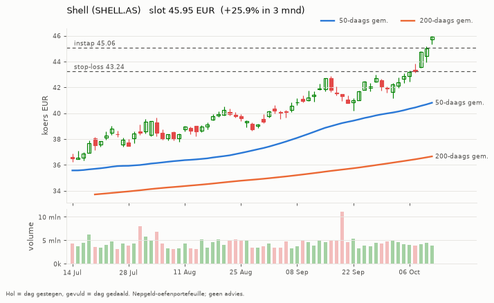
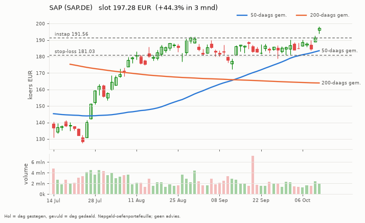
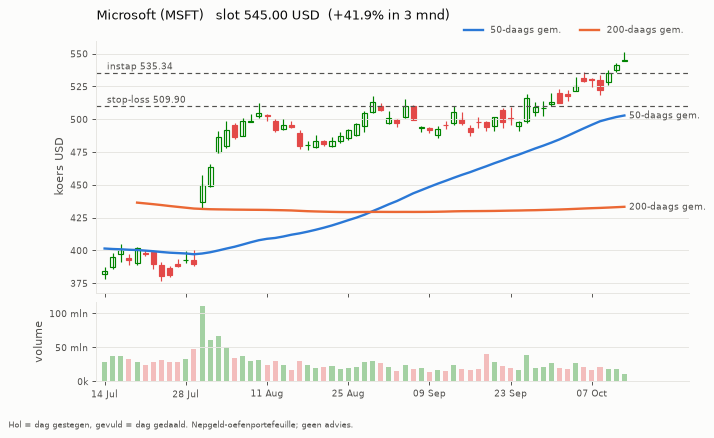

# Trend-agent rapport 2026-10-12

_Oefenportefeuille met nepgeld. Geen beleggingsadvies; resultaten uit het verleden zeggen niets over de toekomst._

**Status:** OK  
**Waarde:** €10,029.01  
**Kas:** €8,550.41  
**Marktregime:** stijgend-laag  
**Strategieversie:** trend-1.1-d373c7  
**Koersbronnen:** 0 bevestigd door 2 bronnen, 50 uit 1 bron, 0 afwijkend; wisselkoers bevestigd  
**Sinds start:** +0.29%  

## Analyse van vandaag

**Wat de bot zag**

- **Markt (IWDA.AS):** koers 131,73, 9,6% boven het 200-daags gemiddelde (120,18); de afgelopen maand +4,0%. Trend: **stijgend**.
- **Beweeglijkheid:** 8% op jaarbasis, tegen normaal 10% het afgelopen jaar: **laag**.
- **Breedte:** 33 van de 50 instrumenten staan boven hun 200-daags gemiddelde (66%; EU 12 van 23, US 21 van 27).
- **Bekeken:** 50 instrumenten.
- **Afgevallen** (een instrument kan op meer regels afvallen): geen stijgende trend (koers niet boven 50- en 200-daags gemiddelde): 25; niet gestegen over 1 of 3 maanden: 24; te weinig handel: 1.
- **Door de zeef:** 20. Koopbare trends: **20**.

**Wat de bot eruit haalt**

- De markt stijgt breed: goede omstandigheden voor trendvolgen.
- De markt is rustig: stops liggen dichterbij, posities kunnen iets groter.
- Amerika staat er duidelijk beter voor dan Europa (78% tegen 52% in een stijgende trend).
- Alle plekken zijn bezet, dus de bot koopt niets bij, hoe sterk een trend ook is.

## Vandaag gedaan

- SAP.DE: stop omhoog van 180.83 naar 181.03

## Verlies en risico

| Ticker | Instap | Koers nu | Resultaat | Stop | Afstand tot stop | Als de stop geraakt wordt |
| --- | --- | --- | --- | --- | --- | --- |
| SHELL.AS | 45.06 EUR | 45.95 | €11,60 (+2,0%) | 43.24 | +6,3% | -€24,67 verlies |
| SAP.DE | 191.56 EUR | 197.28 | €11,45 (+3,0%) | 181.03 | +9,0% | -€22,05 verlies |
| MSFT | 535.34 USD | 545.00 | €8,95 (+1,8%) | 509.90 | +6,9% | -€23,40 verlies |

Raken alle stops tegelijk, dan is het verlies hooguit ongeveer €70,12 (bij een koersgat 's ochtends kan het meer zijn).

**Remmen** (bij overschrijden gaat de kill switch aan en koopt de bot niets meer):

- Daling vanaf de top: +0,00% (grens -5%; top was €10.029,01)
- Vandaag: +0,26% (grens -1%)
- Verliestrades op rij: 0 van 3

## Kansen: wat de bot vandaag het sterkst vond

_Dit is wat de oefenbot met zijn nepgeld volgens zijn eigen regels zou doen. Geen advies voor echt geld; het instapmoment is een ongeteste vuistregel en wordt door de bot niet gebruikt._

### 1. Shell (SHELL.AS): instapmoment **opgelopen**

- **Waarom sterk:** Shell steeg +25,7% in 3 maanden en +11,0% in 1 maand; koers boven het 50-daags en dat boven het 200-daags gemiddelde; MACD positief (de stijging versnelt); handel 1,1x het normale volume; beweegt gemiddeld 2,0% per dag.
- **Instapmoment:** de koers staat +7,3% van het 20-daags gemiddelde (3,7x de normale dagbeweging) en RSI is 79; na zo'n sprint volgt vaak eerst een terugval.
- **Status:** al in bezit.
- **Plan van de bot:** koop 13 stuks rond 45.97 EUR (inzet €597,65), stop-loss 44.15 EUR (-4,0%). Maximaal verlies als de stop wordt geraakt: ongeveer €25,64. Ter oriëntatie: 2x het risico winst ligt bij 49.61 EUR; de bot verkoopt daar niet vanzelf, hij laat de stop meeschuiven.

### 2. SAP (SAP.DE): instapmoment **neutraal**

- **Waarom sterk:** SAP steeg +44,0% in 3 maanden en +11,3% in 1 maand; koers boven het 50-daags en dat boven het 200-daags gemiddelde; MACD positief (de stijging versnelt); handel 0,8x het normale volume; beweegt gemiddeld 2,8% per dag.
- **Instapmoment:** de koers staat +5,7% van het 20-daags gemiddelde, RSI 66.
- **Status:** al in bezit.
- **Plan van de bot:** koop 2 stuks rond 197.38 EUR (inzet €394,76), stop-loss 186.54 EUR (-5,5%). Maximaal verlies als de stop wordt geraakt: ongeveer €23,67. Ter oriëntatie: 2x het risico winst ligt bij 219.05 EUR; de bot verkoopt daar niet vanzelf, hij laat de stop meeschuiven.

### 3. Energie-ETF (XLE): instapmoment **neutraal**

- **Waarom sterk:** Energie-ETF steeg +19,0% in 3 maanden en +4,2% in 1 maand; koers boven het 50-daags en dat boven het 200-daags gemiddelde; MACD positief (de stijging versnelt); handel 1,1x het normale volume; beweegt gemiddeld 1,9% per dag.
- **Instapmoment:** de koers staat +4,7% van het 20-daags gemiddelde, RSI 70.
- **Status:** niet gekocht: alle 3 plekken zijn bezet.
- **Plan van de bot:** koop 11 stuks rond 66.89 USD (inzet €657,05), stop-loss 64.42 USD (-3,7%). Maximaal verlies als de stop wordt geraakt: ongeveer €26,29. Ter oriëntatie: 2x het risico winst ligt bij 71.83 USD; de bot verkoopt daar niet vanzelf, hij laat de stop meeschuiven.

### 4. Wolters Kluwer (WKL.AS): instapmoment **opgelopen**

- **Waarom sterk:** Wolters Kluwer steeg +26,6% in 3 maanden en +19,0% in 1 maand; koers boven het 50-daags en dat boven het 200-daags gemiddelde; MACD positief (de stijging versnelt); handel 1,2x het normale volume; beweegt gemiddeld 2,9% per dag.
- **Instapmoment:** de koers staat +12,1% van het 20-daags gemiddelde (4,1x de normale dagbeweging) en RSI is 76; na zo'n sprint volgt vaak eerst een terugval.
- **Status:** niet gekocht: alle 3 plekken zijn bezet.
- **Plan van de bot:** koop 5 stuks rond 78.88 EUR (inzet €394,40), stop-loss 74.24 EUR (-5,9%). Maximaal verlies als de stop wordt geraakt: ongeveer €25,19. Ter oriëntatie: 2x het risico winst ligt bij 88.15 EUR; de bot verkoopt daar niet vanzelf, hij laat de stop meeschuiven.

### 5. Microsoft (MSFT): instapmoment **neutraal**

- **Waarom sterk:** Microsoft steeg +38,0% in 3 maanden en +7,8% in 1 maand; koers boven het 50-daags en dat boven het 200-daags gemiddelde; MACD positief (de stijging versnelt); handel 0,8x het normale volume; beweegt gemiddeld 2,2% per dag.
- **Instapmoment:** de koers staat +5,1% van het 20-daags gemiddelde, RSI 71.
- **Status:** al in bezit.
- **Plan van de bot:** koop 1 stuk rond 545.27 USD (inzet €486,93), stop-loss 521.37 USD (-4,4%). Maximaal verlies als de stop wordt geraakt: ongeveer €23,35. Ter oriëntatie: 2x het risico winst ligt bij 593.08 USD; de bot verkoopt daar niet vanzelf, hij laat de stop meeschuiven.

## Wat de bot tot nu toe geleerd heeft

- Nog geen afgesloten trades. Leren begint pas als trades zijn afgesloten: dan weet de bot of een instap goed of slecht uitpakte, en onder welke omstandigheden.

## Klaar voor echt geld?

**Trend-agent:** Nog niet klaar: de bot is nog bezig met bewijzen. Blijven oefenen.

| Eis | Stand | Nu |
| --- | --- | --- |
| Oefentijd | ⏳ | 3 van 63 handelsdagen (ongeveer 3 maanden) |
| Minstens zo goed als de wereld-ETF | ⏳ | verschil tot nu toe +0,22% |
| Grootste daling onder 5% | ✅ | grootste daling tot nu toe -0,04% |
| Genoeg afgesloten trades | ⏳ | 0 van 20 |

Zo analyseert de trend-agent (klik om te openen)

1. **Data controleren.** Koersen van Yahoo, gecontroleerd bij een tweede bron en de wisselkoers bij de ECB.
   Bevroren koersen, rare sprongen of achterlopende markten: dat instrument wordt die dag niet gekocht.
2. **De markt als geheel.** Aan de hand van de wereld-ETF (IWDA) of de S&P 500: staat de koers boven het
   200-daags gemiddelde (stijgend), eronder (dalend) of ertussenin (zijwaarts)? En beweegt de markt meer of
   minder dan normaal vergeleken met het afgelopen jaar? Plus: hoeveel aandelen staan boven hun 200-daags gemiddelde (de breedte).
3. **Elk instrument door de zeef.** Een trend telt alleen als ALLES klopt: koers boven het 50-daags gemiddelde en
   dat boven het 200-daags, plus over 1 en 3 maanden gestegen, genoeg handel en geen verdachte sprong.
4. **Rangschikken.** Score = stijging (60% 3 maanden, 40% 1 maand) gedeeld door de beweeglijkheid. Een rustige,
   stevige stijger wint van een wilde.
5. **Risico bepalen.** Stop-loss op 2x de gemiddelde dagbeweging (ATR) onder de instap. Het aantal stuks wordt zo
   gekozen dat de stop hooguit 0,25% van het vermogen kost.
6. **Beheren.** De stop schuift mee omhoog (3x ATR onder de hoogste slotkoers). Verkopen bij stop of als de koers
   onder het 50-daags gemiddelde sluit.

## Open posities

| Ticker | Aantal | Instap | Stop | Sinds |
| --- | --- | --- | --- | --- |
| SHELL.AS | 13 | 45.06 EUR | 43.24 | 2026-10-10 |
| SAP.DE | 2 | 191.56 EUR | 181.03 | 2026-10-10 |
| MSFT | 1 | 535.34 USD | 509.90 | 2026-10-10 |

## Sterkste trends vandaag

| # | Ticker | Score | 3 mnd | 1 mnd |
| --- | --- | --- | --- | --- |
| 1 | SHELL.AS | 0.172 | +25.7% | +11.0% |
| 2 | SAP.DE | 0.121 | +44.0% | +11.3% |
| 3 | XLE | 0.111 | +19.0% | +4.2% |
| 4 | WKL.AS | 0.111 | +26.6% | +19.0% |
| 5 | MSFT | 0.105 | +38.0% | +7.8% |
| 6 | XOM | 0.101 | +21.4% | +5.6% |
| 7 | PLTR | 0.086 | +55.1% | +19.7% |
| 8 | TTE.PA | 0.081 | +14.4% | +2.6% |
| 9 | V | 0.071 | +11.0% | +4.8% |
| 10 | META | 0.060 | +11.8% | +14.5% |

## Grafieken (laatste 3 maanden)

_Grafieken worden 20 handelsdagen bewaard._
