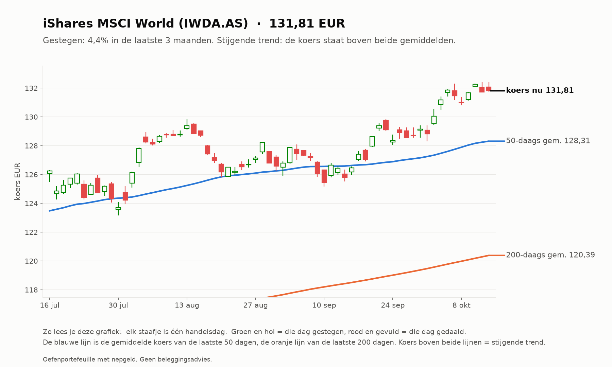
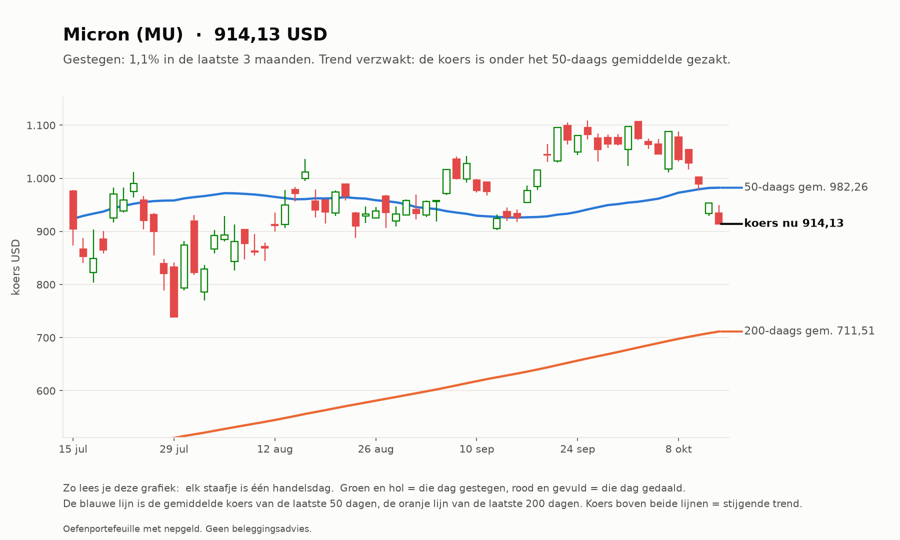
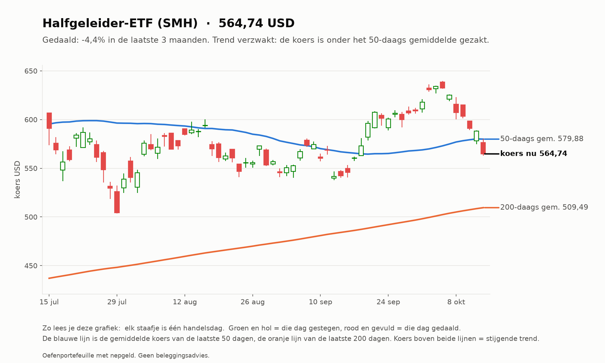
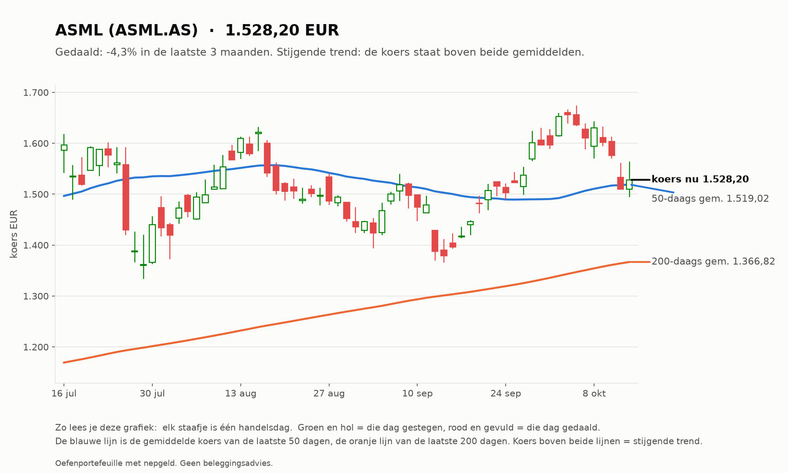
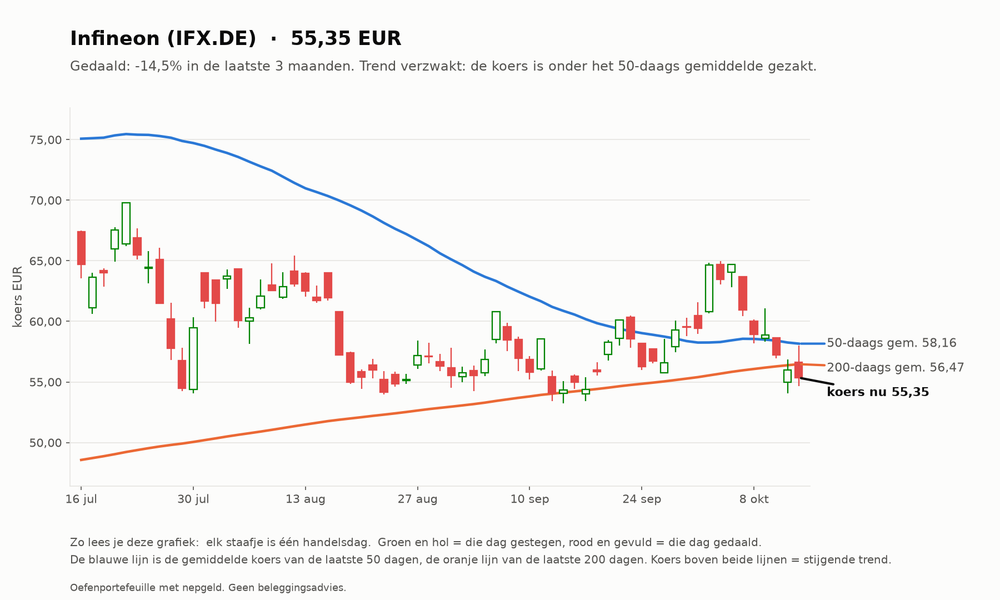
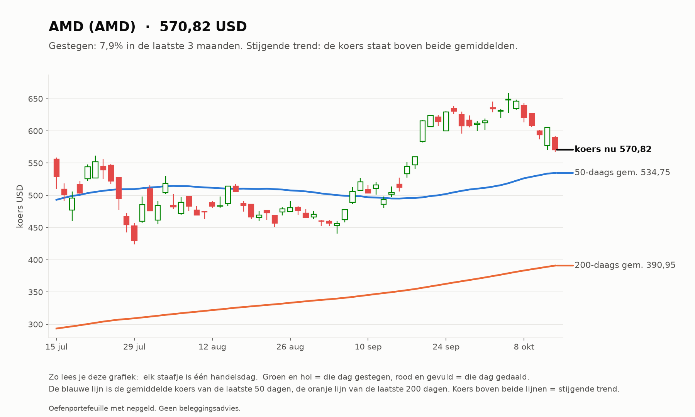
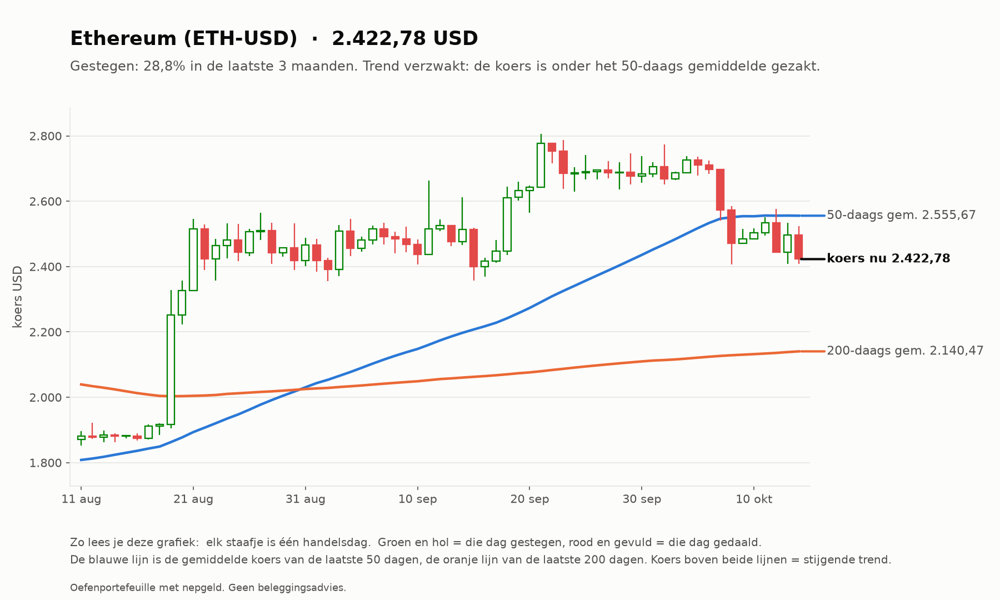
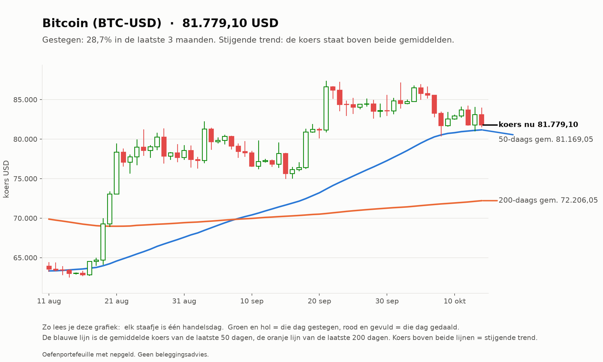

# Investeerder 2026-10-14

_Oefenportefeuille met nepgeld. Geen beleggingsadvies._

**Status:** OK  
**Waarde:** €9,820.69  
**Marktregime:** stijgend-laag  
**Strategieversie:** investeerder-1.0-c2474a  
**Koersbronnen:** 0 bevestigd door 2 bronnen, 52 uit 1 bron, 0 afwijkend; wisselkoers bevestigd  
**Sinds start:** -1.79%  

## Verdeling

| Instrument | Aandeel |
| --- | --- |
| iShares MSCI World (IWDA.AS) | 61.1% |
| AMD (AMD) | 5.9% |
| Halfgeleider-ETF (SMH) | 5.8% |
| ASML (ASML.AS) | 5.8% |
| Infineon (IFX.DE) | 5.7% |
| Micron (MU) | 5.7% |
| Bitcoin (BTC-USD) | 5.0% |
| Ethereum (ETH-USD) | 5.0% |
| Kas | 0.0% |

## Analyse van vandaag

**Wat de bot zag**

- **Markt (IWDA.AS):** koers 131,81, 9,5% boven het 200-daags gemiddelde (120,39); de afgelopen maand +4,8%. Trend: **stijgend**.
- **Beweeglijkheid:** 8% op jaarbasis, tegen normaal 10% het afgelopen jaar: **laag**.
- **Breedte:** 35 van de 50 instrumenten staan boven hun 200-daags gemiddelde (70%; EU 13 van 23, US 22 van 27).
- **Sterkste momentum nu (12 maanden, zonder laatste maand):** Micron +382%, AMD +133%, CrowdStrike +91%, Palo Alto Networks +76%, ING +63%.
- **BTC-USD:** 13,3% boven het 200-daags gemiddelde (mag in de mix).
- **ETH-USD:** 13,2% boven het 200-daags gemiddelde (mag in de mix).

**Wat de bot eruit haalt**

- De markt stijgt: de kern (wereld-ETF) doet zijn werk, de sterkste aandelen lopen mee.
- Uit de top gevallen: ASML.AS, IFX.DE, SMH. Blijft dat zo, dan worden ze bij de volgende herverdeling (eerste handelsdag van 2026-11) vervangen door CRWD, PANW, INGA.AS.

## Verlies en winst per belegging

| Instrument | Waarde | Ingelegd | Resultaat |
| --- | --- | --- | --- |
| MU | €554,47 | €600,00 | -€45,53 (-7,6%) |
| IFX.DE | €563,00 | €600,00 | -€37,00 (-6,2%) |
| ASML.AS | €571,26 | €600,00 | -€28,74 (-4,8%) |
| SMH | €573,26 | €600,00 | -€26,74 (-4,5%) |
| AMD | €576,26 | €600,00 | -€23,74 (-4,0%) |
| ETH-USD | €487,99 | €500,00 | -€12,01 (-2,4%) |
| BTC-USD | €494,08 | €500,00 | -€5,92 (-1,2%) |
| IWDA.AS | €6.000,38 | €6.000,00 | €0,38 (+0,0%) |

Totaal op de beleggingen: -€179,30 (inclusief aankoopkosten).
Daling vanaf de hoogste waarde ooit: -1,79% (top €10.000,00). De investeerder heeft geen stop-loss: hij houdt een spreiding vast en herverdeelt maandelijks.

## Vandaag gedaan

- Niets (herverdelen gebeurt één keer per maand)

## Klaar voor echt geld?

**Investeerder:** Nog niet klaar: de bot is nog bezig met bewijzen. Blijven oefenen.

| Eis | Stand | Nu |
| --- | --- | --- |
| Oefentijd | ⏳ | 2 van 63 handelsdagen (ongeveer 3 maanden) |
| Minstens zo goed als de wereld-ETF | ⏳ | verschil tot nu toe -1,31% |
| Daling niet veel dieper dan de ETF | ✅ | bot -1,79%, ETF -0,34% |

Zo analyseert de investeerder (klik om te openen)

1. **Kern (60%):** de wereld-ETF (IWDA), altijd.
2. **Satelliet (30%):** de 5 aandelen of ETF's met de grootste stijging over 12 maanden (de laatste maand niet
   meegeteld, omdat die vaak terugveert), alleen als ze boven hun 200-daags gemiddelde staan en genoeg verhandeld worden.
3. **Crypto (10%):** Bitcoin en Ethereum, alleen als ze boven hun 200-daags gemiddelde staan; anders kas.
4. **Eén keer per maand** wordt alles teruggezet naar deze verdeling. Tussendoor kijkt hij elke dag mee, maar handelt niet.

## Grafieken (laatste 3 maanden)

_Grafieken worden 20 handelsdagen bewaard._
